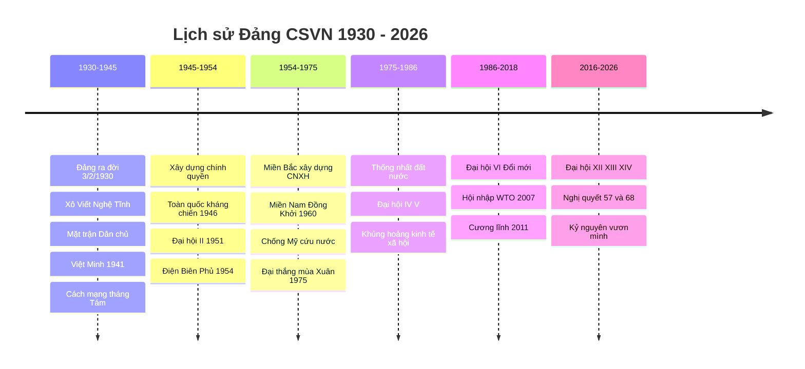
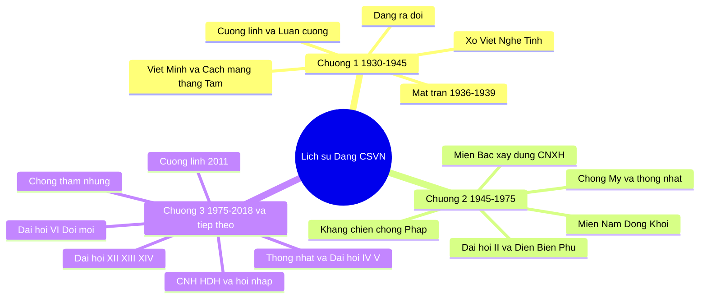
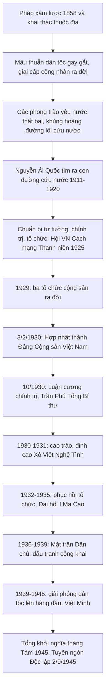
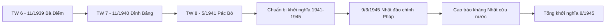
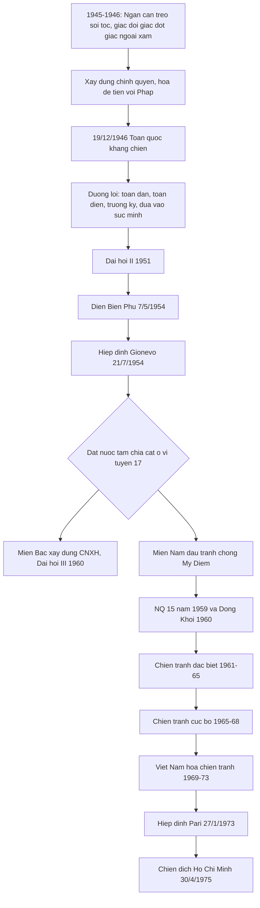
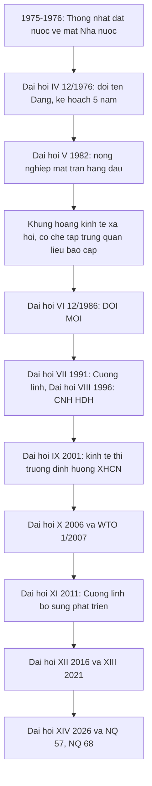

# 📘 BỘ KIẾN THỨC TRỰC QUAN – LỊCH SỬ ĐẢNG CỘNG SẢN VIỆT NAM (BẢN ĐẦY ĐỦ)

> Giáo trình chính (bắt buộc): *Giáo trình Lịch sử Đảng Cộng sản Việt Nam* – dành cho sinh viên khối **không chuyên** Mác–Lênin, tư tưởng Hồ Chí Minh (Bộ GD&ĐT, NXB Chính trị quốc gia Sự thật, 2021).
> Bản này **thay thế** file `on_tap_lich_su_dang.md` trước đó: mở rộng kiến thức, nối với toàn bộ danh mục tài liệu học tập, và **giải quyết các câu ⚠️ ở Phụ lục B**.

**Ký hiệu:** ✅ đáp án · 💬 giải thích · 💡 mẹo nhớ · ⚠️ câu có vấn đề · 🔎 thông tin đã tra cứu lại · 📌 phải thuộc · 🧩 liên hệ với tài liệu học tập

---

## 🧭 0. HƯỚNG DẪN & BẢN ĐỒ NGUỒN TÀI LIỆU

### 0.1. ⚡ Điều kiện dự thi (rất quan trọng)
Theo ghi chú trong danh mục tài liệu (nguồn số 12): **phải hoàn thành khóa ôn tập trực tuyến trên Coursera và có chứng chỉ** thì mới đủ điều kiện dự thi cuối kỳ. Hãy hoàn thành trước, đừng để sát ngày thi.

### 0.2. Bản đồ nguồn → chương

| # | Tài liệu (trong danh mục) | Vai trò | Dùng cho |
|---|---|---|---|
| 3 | **Giáo trình khối không chuyên (2021)** – *tài liệu chính* | Xương sống kiến thức và đề thi | Cả 3 chương |
| 2 | Giáo trình khối chuyên ngành (2021) | Bản chi tiết hơn, để đào sâu | Cả 3 chương |
| 1 | *Chiến tranh cách mạng Việt Nam 1945–1975, thắng lợi và bài học* (2008) | Tổng kết hai cuộc kháng chiến, bài học | **Chương 2** |
| 4 | *Hồ Chí Minh toàn tập* (t.1–15) | Văn kiện gốc: Đường Kách mệnh, Tuyên ngôn Độc lập, Lời kêu gọi 19/12/1946… | **Chương 1, 2** |
| 9 | Văn kiện Đại hội XII (2016) | Nghị quyết, 6 nhiệm vụ trọng tâm, 3 đột phá | **Chương 3** |
| 10 | Văn kiện Đại hội XIII (2021) | Tầm nhìn 2025–2030–2045 | **Chương 3** |
| 11 | Văn kiện Đại hội XIV (2026) | Cập nhật mới nhất | **Chương 3 (mục III)** |
| 6 | Nghị quyết 57-NQ/TW (22/12/2024) | Đột phá khoa học, công nghệ, đổi mới sáng tạo, chuyển đổi số | **Chương 3 (mục III)** |
| 7 | Nghị quyết 68-NQ/TW (4/5/2025) | Phát triển kinh tế tư nhân | **Chương 3 (mục III)** |
| 5 | Sách của Tổng Bí thư Nguyễn Phú Trọng về phòng, chống tham nhũng | Quan điểm đấu tranh chống tham nhũng, tiêu cực | **Chương 3 (mục IV)** |
| 8 | Tài liệu giảng dạy phòng, chống tham nhũng (QĐ 3468/QĐ-BGDĐT, 2014) | Khái niệm, nguyên nhân, biện pháp | **Chương 3 (mục IV)** |
| 12 | Khóa Coursera | Điều kiện dự thi | Toàn môn |

> 🔎 **Mức độ tra cứu:** các nội dung về Đại hội XII, XIII, XIV, Nghị quyết 57, 68, Chỉ thị 06/03/05, Hội nghị TW 8 (1941), Luật 10/59, Đồng Khởi đã được **đối chiếu với nguồn web** (liệt kê ở cuối file). Các sách/PDF trong danh mục tôi **không mở được toàn văn**, nên phần đó được tóm lược theo hiểu biết chuẩn của môn học; hãy đối chiếu với bản giáo trình của bạn.

### 0.3. Chỉnh một chi tiết ở file trước
Hội nghị hợp nhất các tổ chức cộng sản họp **từ 6/1 đến 7/2/1930**; **3/2/1930** là mốc lấy làm *ngày thành lập Đảng* (file trước ghi gộp "3–7/2/1930" là chưa chính xác).

---

## 🗺️ 1. BẢN ĐỒ TOÀN MÔN

### 1.1. Dòng thời gian tổng quát

### 1.2. Sơ đồ tư duy 3 chương

### 1.3. 📌 Bảng các Đại hội đại biểu toàn quốc

| Đại hội | Thời gian – địa điểm | Người đứng đầu | Dấu ấn / nội dung then chốt |
|---|---|---|---|
| **I** | 3/1935, Ma Cao | **Lê Hồng Phong** (Tổng Bí thư) | Phục hồi hệ thống tổ chức Đảng |
| **II** | 2/1951, Chiêm Hóa (Tuyên Quang) | Trường Chinh (Tổng Bí thư) | **"Đại hội kháng chiến thắng lợi"**; Đảng ra hoạt động công khai (Đảng Lao động VN); CM VN trải qua **3 giai đoạn** |
| **III** | 5–10/9/1960, **Hà Nội** | Lê Duẩn (Bí thư thứ nhất) | Đường lối chung xây dựng CNXH ở miền Bắc; **2 nhiệm vụ chiến lược** |
| **IV** | 14–20/12/1976, Hà Nội | Lê Duẩn (Tổng Bí thư) | **Đổi tên Đảng → Đảng Cộng sản Việt Nam**; kế hoạch 5 năm 1976–1980 |
| **V** | 3/1982 | Lê Duẩn | **Nông nghiệp là mặt trận hàng đầu**; 2 nhiệm vụ chiến lược |
| **VI** | 12/1986 | Nguyễn Văn Linh | **Đại hội Đổi mới** |
| **VII** | 6/1991 | Đỗ Mười | Cương lĩnh xây dựng đất nước thời kỳ quá độ (1991) |
| **VIII** | 6–7/1996 | Đỗ Mười | Đẩy mạnh **CNH, HĐH**; tăng trưởng gắn tiến bộ, công bằng xã hội |
| **IX** | 4/2001 | Nông Đức Mạnh | **Chính thức nêu mô hình kinh tế thị trường định hướng XHCN** |
| **X** | 4/2006 | Nông Đức Mạnh | Cho phép **đảng viên làm kinh tế tư nhân**; xây dựng, chỉnh đốn Đảng |
| **XI** | 1/2011 | Nguyễn Phú Trọng | **Cương lĩnh (bổ sung, phát triển 2011)**; 3 đột phá chiến lược |
| **XII** | 20–28/1/2016, Hà Nội | Nguyễn Phú Trọng | 6 nhiệm vụ trọng tâm; tiếp tục 3 đột phá chiến lược 🔎 |
| **XIII** | 25/1–1/2/2021 | Nguyễn Phú Trọng | Tầm nhìn **2025–2030–2045**; 12 định hướng, 6 nhiệm vụ trọng tâm, 3 đột phá 🔎 |
| **XIV** | 19–23/1/2026, Hà Nội | **Tô Lâm** (tái đắc cử Tổng Bí thư) | Tổng kết **40 năm đổi mới**; tăng trưởng hai con số; "4 kiên định" 🔎 |

💡 **Mẹo:** IV = *đổi tên Đảng* · V = *nông nghiệp* · VI = *đổi mới* · IX = *kinh tế thị trường định hướng XHCN* · X = *đảng viên làm kinh tế tư nhân*.

---

# 📖 NHẬP MÔN
## Đối tượng, chức năng, nhiệm vụ, phương pháp nghiên cứu, học tập Lịch sử Đảng

| Nội dung | Ý chính |
|---|---|
| **Đối tượng** | Sự ra đời tất yếu của Đảng (1930); hệ thống đường lối, chủ trương, chính sách qua các thời kỳ; quá trình lãnh đạo, tổ chức thực hiện; xây dựng Đảng về chính trị, tư tưởng, tổ chức, đạo đức |
| **Chức năng** | **Nhận thức** (tri thức, kinh nghiệm, quy luật) · **Giáo dục** (truyền thống, niềm tin, lý tưởng) · **Dự báo** · **Phê phán** (khẳng định cái đúng, phê phán xuyên tạc) |
| **Nhiệm vụ** | Làm rõ sự ra đời tất yếu của Đảng; hệ thống hóa đường lối; tổng kết thắng lợi, hạn chế, bài học; góp phần bảo vệ nền tảng tư tưởng của Đảng |
| **Phương pháp** | **Phương pháp lịch sử** (tái hiện sự kiện theo trình tự thời gian) + **phương pháp logic** (khái quát bản chất, quy luật); kết hợp, thường dùng cùng các phương pháp liên ngành |
| **Học tập để** | Nâng cao nhận thức về vai trò lãnh đạo của Đảng; bồi dưỡng niềm tin vào con đường đi lên CNXH; vận dụng bài học vào thực tiễn |

---

# 📗 CHƯƠNG 1
## ĐẢNG CỘNG SẢN VIỆT NAM RA ĐỜI VÀ LÃNH ĐẠO ĐẤU TRANH GIÀNH CHÍNH QUYỀN (1930–1945)

### 🎯 Mục tiêu học: nắm bối cảnh ra đời, so sánh Cương lĩnh–Luận cương, ba giai đoạn 1930–35, 1936–39, 1939–45, và con đường đến Cách mạng tháng Tám.

### 1.1. Sơ đồ tổng quan

### 1.2. 📌 Dòng thời gian chi tiết

| Thời gian | Sự kiện | Ghi chú |
|---|---|---|
| 1858 | Pháp nổ súng xâm lược (Đà Nẵng) | |
| 1897–1914 | **Khai thác thuộc địa lần thứ nhất** | → **công nhân VN ra đời** |
| 1911 | Nguyễn Tất Thành ra đi tìm đường cứu nước | |
| 1917 | Cách mạng tháng Mười Nga | |
| 3/1919 | Quốc tế Cộng sản (Quốc tế III) ra đời | |
| 1919–1929 | **Khai thác thuộc địa lần thứ hai** | kinh tế **mất cân đối, lạc hậu, lệ thuộc** |
| 7/1920 | Nguyễn Ái Quốc đọc *Sơ thảo lần thứ nhất những luận cương về vấn đề dân tộc và vấn đề thuộc địa* của Lênin | |
| 12/1920 | Đại hội Tours – tham gia sáng lập Đảng Cộng sản Pháp | |
| 1925 | Hội Việt Nam Cách mạng Thanh niên, báo *Thanh Niên* | |
| 1927 | Tác phẩm *Đường Kách mệnh* | 🧩 *Hồ Chí Minh toàn tập* |
| 6/1929 | **Đông Dương Cộng sản Đảng** (tổ chức cộng sản **đầu tiên**) | Bắc Kỳ |
| 8/1929 | An Nam Cộng sản Đảng | Nam Kỳ |
| 9/1929 | Đông Dương Cộng sản Liên đoàn | Trung Kỳ |
| 6/1/–7/2/1930 | Hội nghị hợp nhất (Cửu Long, Hương Cảng) | **3/2/1930 = ngày thành lập Đảng** |
| 14–30/10/1930 | Hội nghị TW lần 1: **Luận cương chính trị**, đổi tên Đảng thành **Đảng Cộng sản Đông Dương**; **Trần Phú** Tổng Bí thư | |
| 1/5/1930 → 1931 | Phong trào cách mạng 1930–31; **Xô Viết Nghệ Tĩnh** | đỉnh cao 12/9/1930 |
| 6/1932 | **Chương trình hành động của Đảng CSĐD** | đòi các quyền tự do |
| 3/1935 | **Đại hội I** (Ma Cao) – Lê Hồng Phong Tổng Bí thư | |
| 7/1935 | Đại hội VII Quốc tế Cộng sản (chủ trương Mặt trận nhân dân chống phát xít) | |
| 7/1936 | Hội nghị TW (Thượng Hải) – chuyển hướng chỉ đạo chiến lược | |
| 3/1938 | Mặt trận Dân chủ Đông Dương | |
| **1/9/1939** | **Chiến tranh thế giới thứ hai bùng nổ** | |
| **6–8/11/1939** | **Hội nghị TW 6** (Bà Điểm, Hóc Môn) | Nguyễn Văn Cừ chủ trì; Mặt trận dân tộc thống nhất phản đế Đông Dương 🔎 |
| 11/1940 | Hội nghị TW 7 (Đình Bảng, Bắc Ninh) | hoãn khởi nghĩa Nam Kỳ |
| 9/1940 · 23/11/1940 · 1/1941 | Khởi nghĩa Bắc Sơn · Nam Kỳ · binh biến Đô Lương | |
| **10–19/5/1941** | **Hội nghị TW 8** (Pác Bó, Cao Bằng) | Nguyễn Ái Quốc chủ trì; thành lập **Việt Minh** 🔎 |
| 9/3/1945 | Nhật đảo chính Pháp | |
| 12/3/1945 | Chỉ thị *"Nhật – Pháp bắn nhau và hành động của chúng ta"* | 🔎 |
| 13–15/8/1945 | Hội nghị toàn quốc của Đảng (Tân Trào) | Ủy ban khởi nghĩa toàn quốc |
| 16–17/8/1945 | **Quốc dân Đại hội Tân Trào** | |
| 19/8 · 23/8 · 25/8/1945 | Giành chính quyền ở Hà Nội · Huế · Sài Gòn | |
| **2/9/1945** | **Tuyên ngôn Độc lập** – nước VNDCCH ra đời | 🧩 *HCM toàn tập, t.4* |

### 1.3. Bối cảnh ra đời của Đảng

| Phương diện | Nội dung |
|---|---|
| **Thế giới** | CNTB chuyển sang đế quốc chủ nghĩa; CM Tháng Mười 1917 mở ra thời đại mới; Quốc tế Cộng sản (1919) thúc đẩy phong trào giải phóng dân tộc ở thuộc địa |
| **Chính sách Pháp** | Hai cuộc khai thác thuộc địa; cai trị chuyên chế, chia để trị (3 kỳ) |
| **Hệ quả xã hội** | Phân hóa các giai cấp: địa chủ, nông dân, **công nhân** (ra đời từ khai thác lần 1), tư sản (mại bản, dân tộc), tiểu tư sản trí thức |
| **Mâu thuẫn** | (1) Dân tộc VN ↔ đế quốc Pháp và tay sai (**chủ yếu**); (2) Nông dân ↔ địa chủ phong kiến |
| **Phong trào yêu nước** | Cần Vương, Yên Thế, Duy Tân, Đông Du, Việt Nam Quốc dân đảng (Yên Bái 1930)… đều **thất bại** → **khủng hoảng đường lối cứu nước** |

### 1.4. Nguyễn Ái Quốc chuẩn bị về tư tưởng, chính trị, tổ chức

- **Tư tưởng:** tìm thấy con đường cứu nước ở **chủ nghĩa Mác–Lênin** (1920); truyền bá qua báo *Người cùng khổ*, *Thanh Niên*, tác phẩm *Bản án chế độ thực dân Pháp*, *Đường Kách mệnh*.
- **Quan điểm cốt lõi:** CM giải phóng dân tộc là một bộ phận của CM vô sản thế giới; CM thuộc địa có thể thắng lợi **trước** CM chính quốc; lực lượng là toàn dân tộc, **công–nông là gốc**; phải có **Đảng Cộng sản** lãnh đạo; đoàn kết quốc tế.
- **Tổ chức:** 6/1925 thành lập **Hội Việt Nam Cách mạng Thanh niên**; mở lớp huấn luyện, đưa người về nước hoạt động.

### 1.5. Ba tổ chức cộng sản năm 1929 và yêu cầu hợp nhất

| Tổ chức | Thời gian | Địa bàn |
|---|---|---|
| **Đông Dương Cộng sản Đảng** | 6/1929 | Bắc Kỳ – *ra đời đầu tiên* |
| An Nam Cộng sản Đảng | 8/1929 | Nam Kỳ |
| Đông Dương Cộng sản Liên đoàn | 9/1929 | Trung Kỳ |

➡️ **Ý nghĩa:** chứng tỏ CNCS đã thâm nhập sâu vào phong trào. **Hạn chế:** ba tổ chức công kích, tranh giành ảnh hưởng, nguy cơ chia rẽ → cần **một Đảng thống nhất** → Nguyễn Ái Quốc triệu tập hội nghị hợp nhất.

### 1.6. 📌 So sánh Cương lĩnh chính trị đầu tiên (2/1930) và Luận cương chính trị (10/1930)

| Tiêu chí | **Cương lĩnh đầu tiên** (Chánh cương vắn tắt, Sách lược vắn tắt, Chương trình tóm tắt, Điều lệ vắn tắt) – *Nguyễn Ái Quốc* | **Luận cương chính trị** – *Trần Phú* |
|---|---|---|
| Tên Đảng | Đảng Cộng sản Việt Nam | Đảng Cộng sản Đông Dương |
| Phương hướng | "Tư sản dân quyền cách mạng và thổ địa cách mạng để đi tới xã hội cộng sản" | Tư sản dân quyền (có tính chất **thổ địa và phản đế**), bỏ qua TBCN tiến thẳng lên XHCN |
| Nhiệm vụ | Đánh đổ đế quốc Pháp, phong kiến, tư sản phản cách mạng; **độc lập dân tộc** | Đánh đổ phong kiến và đế quốc **đồng thời**; ruộng đất cho dân cày |
| Vấn đề dân tộc | **Đặt lên hàng đầu** | Chưa nêu cao; nặng đấu tranh giai cấp |
| Lực lượng | **Rộng rãi:** công–nông là gốc; kéo tiểu tư sản, trí thức, trung nông; lợi dụng hoặc trung lập phú nông, trung–tiểu địa chủ, tư sản dân tộc | Công–nông là hai động lực chính; **chưa đánh giá đúng** tiểu tư sản, tư sản dân tộc |
| Lãnh đạo | Đảng của giai cấp vô sản | Đảng Cộng sản – đội tiên phong của giai cấp vô sản |
| Chính quyền | Chính phủ công nông binh | Chính quyền công nông |
| Đoàn kết quốc tế | Liên lạc với các dân tộc bị áp bức và giai cấp vô sản thế giới | Cách mạng ĐD là một bộ phận của CM vô sản thế giới |
| Nguyên nhân khác biệt | Vận dụng sáng tạo vào thực tiễn thuộc địa | Chịu ảnh hưởng tư tưởng "tả" của Quốc tế Cộng sản, chưa nắm thực tiễn VN |
| Đánh giá | Đúng đắn, sáng tạo, phù hợp | Có giá trị lý luận nhưng **hạn chế** về chiến lược; được khắc phục ở **Hội nghị TW 6, 7, 8 (1939–1941)** |

💡 Cương lĩnh = **dân tộc lên đầu, đoàn kết rộng** · Luận cương = **giai cấp lên đầu, công–nông**.

### 1.7. Ý nghĩa Đảng ra đời
- Là **bước ngoặt vô cùng quan trọng** (đánh giá của Nguyễn Ái Quốc) → *sự kiện Đảng ra đời* (câu C1-7).
- Chấm dứt khủng hoảng về đường lối và giai cấp lãnh đạo; khẳng định vai trò lãnh đạo của giai cấp công nhân.
- Là sự kết hợp **CN Mác–Lênin + phong trào công nhân + phong trào yêu nước**.

### 1.8. Giai đoạn 1930–1935

**a) Phong trào 1930–1931 và Xô Viết Nghệ Tĩnh**
- Bối cảnh: khủng hoảng kinh tế thế giới 1929–1933; Pháp khủng bố sau khởi nghĩa Yên Bái.
- Diễn biến: biểu tình **1/5/1930** → bãi công, biểu tình nông dân (Nghệ An, Hà Tĩnh) → **12/9/1930** biểu tình ở Hưng Nguyên → chính quyền địch tan rã ở nhiều nơi → **Xô Viết** (chính quyền công–nông) ra đời.
- Chính sách Xô Viết: chia ruộng đất, bỏ thuế, xóa nợ, bảo đảm quyền tự do dân chủ, xây dựng đời sống mới.
- **Ý nghĩa:** khẳng định đường lối đúng đắn, **vai trò lãnh đạo của giai cấp công nhân**, **khối liên minh công–nông**; là cuộc **tập dượt đầu tiên** cho Tổng khởi nghĩa 1945.
- **Kẻ thù chủ yếu:** **đế quốc và phong kiến** (C1-11).

**b) Phục hồi phong trào (1932–1935)**
- 6/1932: **Chương trình hành động của Đảng CSĐD** – đòi các quyền **tự do**: tổ chức, hội họp, ngôn luận, xuất bản, đi lại trong nước và ra nước ngoài, bãi công…
- 3/1935: **Đại hội I (Ma Cao)** – **Lê Hồng Phong** làm Tổng Bí thư; giai đoạn này là giai đoạn **phục hồi hệ thống tổ chức của Đảng** (C1-13).

### 1.9. 📌 Giai đoạn 1936–1939: phong trào dân chủ

- **Bối cảnh:** nguy cơ phát xít, chiến tranh; Đại hội VII QTCS (7/1935) chủ trương lập **Mặt trận nhân dân**; Mặt trận Bình dân lên cầm quyền ở Pháp (1936).
- **Hội nghị TW (7/1936, Thượng Hải):** chuyển hướng chỉ đạo chiến lược. **Kẻ thù trước mắt:** **phản động thuộc địa Pháp và tay sai**. **Nhiệm vụ trước mắt:** chống phát xít, chống chiến tranh, đòi **tự do, dân sinh, dân chủ, cơm áo, hòa bình**.
- **Mặt trận:** Mặt trận Thống nhất nhân dân phản đế Đông Dương → (3/1938) **Mặt trận Dân chủ Đông Dương**.
- **Phương pháp đấu tranh:** **kết hợp công khai, nửa công khai với bí mật**; **nghị trường**, **báo chí** (*Tin tức, Dân chúng…*), mít tinh, phong trào Đông Dương Đại hội (1936), đón Gôđa (1937)…
- **Tác phẩm:** *Vấn đề dân cày* (Qua Ninh – Vân Đình), *Tự chỉ trích*…
- **Ý nghĩa:** cuộc **tổng diễn tập lần thứ hai**; xây dựng lực lượng chính trị quần chúng đông đảo; rèn luyện đội ngũ cán bộ.

### 1.10. So sánh 1930–1931 và 1936–1939

| | 1930–1931 | 1936–1939 |
|---|---|---|
| Kẻ thù | Đế quốc và phong kiến | **Phản động thuộc địa và tay sai** |
| Nhiệm vụ | Chống đế quốc, chống phong kiến | Tự do, dân sinh, dân chủ, cơm áo, hòa bình |
| Hình thức tổ chức | **Bí mật**, công–nông | **Công khai, nửa công khai** |
| Hình thức đấu tranh | Bãi công, biểu tình, vũ trang | **Nghị trường, báo chí**, mít tinh |
| Mặt trận | – | Mặt trận Dân chủ Đông Dương |

### 1.11. 📌 Giai đoạn 1939–1945: chuyển hướng chiến lược

| Hội nghị | Nội dung quyết định |
|---|---|
| **TW 6 (11/1939)** | Đặt **nhiệm vụ giải phóng dân tộc lên hàng đầu**; **tạm gác khẩu hiệu cách mạng ruộng đất** (chỉ tịch thu ruộng đất của đế quốc và Việt gian chia cho dân cày; giảm tô, giảm tức); thay khẩu hiệu lập chính quyền Xô viết bằng **chính phủ dân chủ cộng hòa**; thành lập **Mặt trận dân tộc thống nhất phản đế Đông Dương** |
| **TW 7 (11/1940)** | Tán thành TW 6; khẳng định chủ trương **vũ trang bạo động**; **hoãn** khởi nghĩa Nam Kỳ; duy trì du kích Bắc Sơn |
| **TW 8 (5/1941)** | **Hoàn chỉnh chuyển hướng:** giải phóng dân tộc là nhiệm vụ hàng đầu; **thành lập Việt Minh** (19/5/1941) – Mặt trận dân tộc thống nhất rộng rãi; hình thức chính quyền sau CM là **Chính phủ VNDCCH**; **chuẩn bị khởi nghĩa vũ trang là nhiệm vụ trung tâm** |

🔎 **Luận điểm kinh điển (TW 8):** *quyền lợi của bộ phận, của giai cấp phải đặt dưới sự sinh tử, tồn vong của quốc gia, dân tộc; trong lúc này nếu không giải quyết được vấn đề giải phóng dân tộc, không đòi được độc lập tự do cho toàn thể dân tộc thì…* → thuộc **Hội nghị TW 8 (5/1941)** (xem C1-20).

**Chuẩn bị khởi nghĩa (1941–1945):**
- **Lực lượng chính trị:** Mặt trận Việt Minh, các hội Cứu quốc; *Đề cương về văn hóa Việt Nam* (1943), Hội Văn hóa Cứu quốc (1943), Đảng Dân chủ Việt Nam (6/1944).
- **Lực lượng vũ trang:** Cứu quốc quân, Việt Nam tuyên truyền giải phóng quân (22/12/1944).
- **Căn cứ địa:** Bắc Sơn – Võ Nhai, Cao Bằng → Khu giải phóng Việt Bắc (6/1945).
- **Hội nghị Thường vụ TW (2/1943)** bổ sung chủ trương đẩy tới Tổng khởi nghĩa.

**Cao trào kháng Nhật cứu nước (3–8/1945):** Chỉ thị "Nhật – Pháp bắn nhau…" (12/3/1945) → phá kho thóc cứu đói, khởi nghĩa từng phần (Ba Tơ…), Hội nghị Quân sự Bắc Kỳ (4/1945).

**Tổng khởi nghĩa:** Nhật đầu hàng (15/8) → Hội nghị toàn quốc của Đảng (13–15/8) → Quốc dân Đại hội (16–17/8, bầu Ủy ban dân tộc giải phóng do **Hồ Chí Minh** làm Chủ tịch) → 19/8 Hà Nội → 23/8 Huế → 25/8 Sài Gòn → **2/9/1945** Tuyên ngôn Độc lập.

### 1.12. Nguyên nhân thắng lợi và bài học Cách mạng tháng Tám
- **Nguyên nhân:** truyền thống yêu nước và đoàn kết; **sự lãnh đạo đúng đắn của Đảng** (đường lối giải phóng dân tộc, Mặt trận Việt Minh, chuẩn bị chu đáo); thời cơ do Nhật đầu hàng.
- **Bài học:** (1) nắm vững và giương cao ngọn cờ độc lập dân tộc gắn với CNXH; (2) toàn dân nổi dậy trên nền tảng khối liên minh công–nông; (3) lựa chọn đúng kẻ thù, phân hóa, cô lập; (4) kết hợp đấu tranh chính trị với vũ trang, nắm đúng thời cơ; (5) xây dựng Đảng vững mạnh.
- **Ý nghĩa:** phá xiềng thực dân – phong kiến, lập nước VNDCCH; mở ra kỷ nguyên độc lập, tự do; cổ vũ các dân tộc thuộc địa.

### 1.13. 📝 NGÂN HÀNG CÂU HỎI – CHƯƠNG 1 (22 câu)

**C1-1.** Cách mạng tháng Mười Nga thành công (1917) và Quốc tế Cộng sản ra đời (1919) có ý nghĩa
A. Đánh dấu sự thành công của cách mạng vô sản trên thế giới | B. Thức tỉnh phong trào đấu tranh của giai cấp công nhân ở các nước đế quốc | C. Thúc đẩy cuộc đấu tranh giai cấp ở các nước thuộc địa, phụ thuộc | D. Thức tỉnh phong trào đấu tranh giải phóng dân tộc ở các nước thuộc địa, phụ thuộc
✅ **D** · 💬 Đối với VN: mở đường ánh sáng cho phong trào giải phóng dân tộc ở thuộc địa.

**C1-2.** Giai cấp công nhân Việt Nam ra đời từ:
A. Cuộc khai thác thuộc địa lần thứ nhất | B. lần thứ hai | C. Cuộc xâm lược lần thứ nhất | D. Cuộc xâm lược lần thứ hai
✅ **A** · 💡 *Lần 1 = công nhân ra đời.*

**C1-3.** Tác động của khai thác thuộc địa lần thứ hai đến kinh tế VN làm cho
A. Cơ cấu kinh tế mất cân đối, lạc hậu, nghèo nàn | B. Phát triển độc lập | C. Phát triển tự chủ | D. Phụ thuộc kinh tế Pháp
✅ **A** · 💬 Chọn phương án nêu *cơ cấu* – đúng trọng tâm giáo trình.

**C1-4.** Trong phong trào cách mạng nước ta, giai cấp nào là lực lượng lãnh đạo?
A. Nông dân | B. Công nhân | C. Tư sản | D. Tiểu tư sản
✅ **B**

**C1-5.** Tổ chức Cộng sản nào ra đời **đầu tiên** ở Việt Nam?
A. Hội Việt Nam cách mạng Thanh niên | B. Đông Dương Cộng sản Đảng | C. An Nam Cộng sản Đảng | D. Đông Dương Cộng sản liên đoàn
✅ **B** · 💬 6/1929, Bắc Kỳ. (Hội VNCMTN là tiền thân, không phải tổ chức cộng sản.)

**C1-6.** Sự kiện nào diễn ra trong phong trào dân tộc dân chủ ở VN 1925–1930?
A. Bãi công của công nhân Ba Son | B. Bãi công Vinh – Bến Thủy | C. Phong trào Đông Dương đại hội | D. Phong trào phá kho thóc của Nhật
✅ **A** · 💬 Ba Son (8/1925). Vinh–Bến Thủy thuộc 1930; Đông Dương đại hội thuộc 1936; phá kho thóc thuộc 1945.

**C1-7.** Sự kiện nào được Nguyễn Ái Quốc đánh giá "là một bước ngoặt vô cùng quan trọng trong lịch sử CM Việt Nam ta"?
A. Đảng Cộng sản Việt Nam ra đời | B. Thành lập Đảng CS Pháp | C. Thành lập Hội VN CMTN | D. Nguyễn Ái Quốc tìm thấy con đường cứu nước
✅ **A**

**C1-8.** Tổng Bí thư được bầu tại Hội nghị TW tháng 10/1930 là
A. Trần Phú | B. Lê Hồng Phong | C. Hà Huy Tập | D. Nguyễn Văn Cừ
✅ **A**

**C1-9.** Nhiệm vụ của CM VN trong Luận cương tháng 10/1930 do Trần Phú soạn thảo là
A. Đánh đổ phong kiến và đế quốc | B. Giải phóng dân tộc | C. Đánh đổ đế quốc và tay sai | D. Đánh đổ đế quốc Pháp, phong kiến và tư sản phản cách mạng, làm cho nước VN độc lập tự do
✅ **D**

**C1-10.** Nội dung nào **không** thuộc Luận cương chính trị tháng 10/1930?
A. Hai giai đoạn: tư sản dân quyền và XHCN | B. CM do Đảng của giai cấp vô sản lãnh đạo | C. CM VN là một bộ phận của CM thế giới | D. Lực lượng là công nông; đồng thời "phải biết liên lạc với tiểu tư sản, trí thức, trung nông… để kéo họ về phe vô sản giai cấp"
✅ **D** (theo đáp án đề) · ⚠️ **Xem Phụ lục B – mục B1.**

**C1-11.** Kẻ thù chủ yếu của xã hội VN thời kỳ 1930–1931 là
A. Thực dân Pháp | B. Địa chủ phong kiến | C. Đế quốc và phong kiến | D. Địa chủ phong kiến, tư sản
✅ **C**

**C1-12.** Phong trào Xô Viết Nghệ Tĩnh bắt đầu từ ngày
A. 1-5-1930 | B. 1-5-1931 | C. 19-5-1930 | D. 19-8-1930
✅ **A** · 💬 Mốc mở đầu 1/5/1930; đỉnh cao 12/9/1930.

**C1-13.** Giai đoạn 1932–1935 là giai đoạn
A. Chuẩn bị các điều kiện để giành chính quyền | B. Phục hồi hệ thống tổ chức của Đảng | C. Đẩy mạnh phong trào đấu tranh | D. Hợp tác với phong trào nhân dân Pháp
✅ **B**

**C1-14.** Lê Hồng Phong được bầu làm Tổng Bí thư tại Đại hội nào?
A. Đại hội II | B. Đại hội III | C. Đại hội I | D. Đại hội IV
✅ **C** · 💬 Đại hội I (Ma Cao, 3/1935).

**C1-15.** Điểm khác biệt về phương pháp đấu tranh 1936–1939 so với 1930–1931 là
A. Chính trị và vũ trang | B. Nghị trường và đấu tranh báo chí | C. Đấu tranh chính trị | D. Ngoại giao với vận động quần chúng
✅ **B**

**C1-16.** Một trong những nội dung của Chương trình hành động của Đảng Cộng sản Đông Dương là
A. Cải cách ruộng đất | B. Cải cách giáo dục | C. Đòi tự do, bình đẳng | D. Đòi quyền tự do: phát ngôn, tự do đi lại…
✅ **D** · 💬 Chương trình hành động (6/1932) nêu các quyền tự do cụ thể.

**C1-17.** Chiến tranh thế giới thứ II nổ ra vào
A. 1937 | B. 1938 | C. 1939 | D. 1940
✅ **C**

**C1-18.** Mặt trận dân tộc thống nhất phản đế Đông Dương được thành lập vào
A. 10-1930 | B. 5-1935 | C. 11-1939 | D. 5-1941
✅ **C** · 💬 Hội nghị TW 6. (5/1941 là Việt Minh.)

**C1-19.** Mối quan hệ giữa "Độc lập dân tộc" và "Ruộng đất cho dân cày" thời kỳ 1939–1945
A. Tạm gác khẩu hiệu cách mạng ruộng đất | B. Tạm gác khẩu hiệu giải phóng dân tộc | C. Thực hiện đồng bộ hai khẩu hiệu | D. Tạm gác cả hai
✅ **A**

**C1-20.** "Trong lúc này nếu không giải quyết được vấn đề dân tộc giải phóng, không đòi được độc lập tự do cho toàn thể dân tộc, thì chẳng những toàn thể quốc gia dân tộc còn chịu mãi kiếp ngựa trâu mà quyền lợi của bộ phận giai cấp đến vạn năm cũng không đòi lại được" – đưa ra tại Hội nghị
A. BCH TW tháng 11/1939 | B. *(đề bị mất)* | C. BCH TW tháng 5/1941
✅ **C** · 🔎 **Đã xác minh – xem Phụ lục B, mục B2.**

**C1-21.** Hội nghị TW 8 (5/1941) quyết định hình thức chính quyền sau cách mạng là
A. Chính phủ cách mạng lâm thời | B. Chính phủ Việt Nam Dân chủ Cộng hòa | C. Chính phủ Xô viết công–nông–binh | D. Chính phủ dân chủ Cộng hòa Đông Dương
✅ **B**

**C1-22.** Nội dung **không** có trong Hội nghị TW 8 (5/1941)?
A. Giải phóng dân tộc lên hàng đầu | B. Chuẩn bị điều kiện để "đánh đổ địa chủ, chia ruộng đất cho dân cày" | C. Thành lập Việt Minh | D. Chuẩn bị khởi nghĩa là nhiệm vụ trung tâm
✅ **B** · 💬 Vì khẩu hiệu ruộng đất đã được **tạm gác**.

---

# 📘 CHƯƠNG 2
## ĐẢNG LÃNH ĐẠO HAI CUỘC KHÁNG CHIẾN, HOÀN THÀNH GIẢI PHÓNG DÂN TỘC, THỐNG NHẤT ĐẤT NƯỚC (1945–1975)

🧩 *Nguồn bổ trợ chính:* **"Chiến tranh cách mạng Việt Nam 1945–1975, thắng lợi và bài học" (2008)**, *Hồ Chí Minh toàn tập* (Lời kêu gọi 19/12/1946…).

### 2.1. Sơ đồ tổng quan

### 2.2. 📌 Dòng thời gian

| Thời gian | Sự kiện |
|---|---|
| 2/9/1945 | Tuyên ngôn Độc lập |
| 8/9/1945 | Lập Nha Bình dân học vụ → phong trào **Bình dân học vụ** |
| 25/11/1945 | Chỉ thị **Kháng chiến kiến quốc** |
| 6/1/1946 | Tổng tuyển cử bầu Quốc hội |
| **6/3/1946** | **Hiệp định Sơ bộ** Việt – Pháp |
| 14/9/1946 | Tạm ước |
| 3/1946–12/1946 | Chủ trương **"Hòa để tiến"** |
| **12/12/1946** | **Chỉ thị Toàn dân kháng chiến** (Ban Thường vụ TW) |
| **19/12/1946** | **Lời kêu gọi Toàn quốc kháng chiến** (Hồ Chí Minh) |
| 1947 | Chiến dịch Việt Bắc thu–đông |
| 1950 | Chiến dịch Biên giới |
| **2/1951** | **Đại hội II** (Tuyên Quang) |
| 1953 | Cải cách ruộng đất; Đông–Xuân 1953–54 |
| **13/3–7/5/1954** | **Chiến dịch Điện Biên Phủ** |
| **21/7/1954** | **Hiệp định Giơnevơ** |
| 15–18/7/1954 | Hội nghị TW 6 (khóa II): xác định **đế quốc Mỹ là kẻ thù chính, nguy hiểm trước mắt** 🔎 |
| 5/1959 | Mở đường Trường Sơn (Đường Hồ Chí Minh) |
| **1/1959** | **Hội nghị TW 15** |
| **6/5/1959** | Mỹ–Diệm ban hành **Luật 10/59** 🔎 |
| **17/1/1960** | **Đồng Khởi** (khởi đầu ở Mỏ Cày, Bến Tre) 🔎 |
| **5–10/9/1960** | **Đại hội III** (Hà Nội) |
| **20/12/1960** | Thành lập **Mặt trận Dân tộc giải phóng miền Nam VN** (Tây Ninh) |
| 15/2/1961 | Thống nhất lực lượng vũ trang thành Quân giải phóng miền Nam 🔎 |
| 16/2/1962 | Đại hội lần 1 Mặt trận DTGP (Kà Tum, Tây Ninh); Chủ tịch Nguyễn Hữu Thọ 🔎 |
| 1961–1965 | **Chiến tranh đặc biệt** |
| 3/1965 · 12/1965 | Hội nghị TW 11 · 12 |
| 1965–1968 | Chiến tranh cục bộ |
| 1968 | Tổng tiến công và nổi dậy Xuân Mậu Thân |
| 1969–1973 | Việt Nam hóa chiến tranh |
| **27/1/1973** | **Hiệp định Pari** |
| 7/1973 | Hội nghị TW 21 |
| **26–30/4/1975** | **Chiến dịch Hồ Chí Minh** – thống nhất đất nước |

### 2.3. Giai đoạn 1945–1946: "ngàn cân treo sợi tóc"

| Thuận lợi | Khó khăn |
|---|---|
| Hệ thống XHCN hình thành; phong trào giải phóng dân tộc dâng cao | **Giặc ngoại xâm:** Tưởng ở phía Bắc vĩ tuyến 16; Anh–Ấn rồi Pháp ở phía Nam |
| Nhân dân phấn khởi, đoàn kết | **Giặc đói:** nạn đói 1945 |
| Đảng, Chủ tịch HCM, chính quyền cách mạng | **Giặc dốt:** ~95% dân số mù chữ |
| | Ngân sách trống rỗng; chính quyền non trẻ |

**Chủ trương (Chỉ thị Kháng chiến kiến quốc 25/11/1945):** xác định **kẻ thù chính là thực dân Pháp xâm lược**; khẩu hiệu **"Dân tộc trên hết, Tổ quốc trên hết"**; củng cố chính quyền, chống thực dân Pháp, bài trừ nội phản, cải thiện đời sống.
**Biện pháp:** Tổng tuyển cử 6/1/1946 – Quốc hội đầu tiên, Hiến pháp 1946; diệt **giặc đói** (Tăng gia sản xuất, Hũ gạo cứu đói, Tuần lễ vàng, Quỹ độc lập); diệt **giặc dốt** (**Bình dân học vụ**); đối ngoại: **hòa hoãn, nhân nhượng** với Tưởng và Pháp.

**Hòa để tiến:** Hiệp định Sơ bộ **6/3/1946** – Pháp công nhận VN là *quốc gia tự do* trong Liên hiệp Pháp; ta đồng ý cho **15.000 quân Pháp** ra miền Bắc thay quân Tưởng; **hai bên ngừng bắn ở Nam Bộ** (→ tạo thời gian chuẩn bị đối phó lâu dài, C2-5). Tạm ước 14/9/1946 kéo dài hòa hoãn.

### 2.4. 📌 Đường lối kháng chiến chống Pháp

| Văn kiện | Ý chính |
|---|---|
| **Chỉ thị Toàn dân kháng chiến** (12/12/1946) | Ban Thường vụ TW Đảng |
| **Lời kêu gọi Toàn quốc kháng chiến** (19/12/1946) | Hồ Chí Minh – *"Chúng ta thà hy sinh tất cả, chứ nhất định không chịu mất nước, nhất định không chịu làm nô lệ."* 🧩 *HCM toàn tập, t.4* |
| ***Kháng chiến nhất định thắng lợi*** (1947) | Trường Chinh |

- **Mục tiêu:** *đánh phản động thực dân Pháp xâm lược, giành thống nhất và độc lập* (C2-9).
- **Phương châm:** **toàn dân, toàn diện, trường kỳ, dựa vào sức mình là chính**; kết hợp tranh thủ sự ủng hộ quốc tế.
- **Triển vọng:** *"Mặc dù lâu dài, gian khổ, khó khăn song nhất định thắng lợi"* (C2-10).
- **Tính chất:** cuộc chiến tranh chính nghĩa, vì độc lập, tự do, thống nhất.

### 2.5. Đại hội II (2/1951) – "Đại hội kháng chiến thắng lợi"
- Nhận định CM VN gồm **3 giai đoạn:** giải phóng dân tộc → xóa tàn tích phong kiến, phát triển dân chủ nhân dân → xây dựng cơ sở cho CNXH và tiến lên CNXH. Con đường đi lên CNXH là một quá trình **đấu tranh lâu dài**, đại thể trải qua **ba giai đoạn** (C2-11).
- Đảng ra hoạt động **công khai** với tên **Đảng Lao động Việt Nam**; Chủ tịch HCM; Tổng Bí thư Trường Chinh; thông qua Chính cương, Điều lệ.
- Cùng thời gian: Mặt trận **Liên Việt** (3/1951); liên minh **Việt–Miên–Lào**.

### 2.6. Điện Biên Phủ và Hiệp định Giơnevơ
- **Điện Biên Phủ (7/5/1954):** đỉnh cao của **kháng chiến chống Pháp** (C2-13).
- **Hội nghị Giơnevơ:** Pháp đàm phán vì **thất bại ở Điện Biên Phủ** (C2-15).
- **Nội dung chính:** các nước cam kết tôn trọng **độc lập, chủ quyền, thống nhất, toàn vẹn lãnh thổ** của VN (**quyền dân tộc cơ bản**, C2-16); ngừng bắn; **vĩ tuyến 17** làm giới tuyến quân sự tạm thời (C2-17); tập kết, chuyển quân; **tổng tuyển cử thống nhất** (dự kiến 7/1956).
- **Kết thúc kháng chiến bằng giải pháp chính trị** (C2-14).
- **Nguyên nhân thắng lợi:** sự lãnh đạo của Đảng với đường lối đúng; sức mạnh toàn dân; hậu phương vững; đoàn kết ba nước Đông Dương; sự ủng hộ quốc tế. **Bài học:** độc lập tự chủ; kháng chiến toàn dân – toàn diện; xây dựng lực lượng; kết hợp đánh và đàm.

### 2.7. Sau 1954: đặc điểm hai miền

| | **Miền Bắc** | **Miền Nam** |
|---|---|---|
| Nhiệm vụ | Hoàn thành CM dân tộc dân chủ nhân dân → **xây dựng CNXH** | Hoàn thành **CM dân tộc dân chủ nhân dân**, đấu tranh thống nhất |
| Đối thủ | – | **Mỹ – Diệm** |
| Vai trò (Đại hội III) | **Quyết định nhất** đối với sự phát triển của cả cách mạng | **Quyết định trực tiếp** đối với sự nghiệp giải phóng miền Nam |

➡️ **Đặc điểm nổi bật:** *tiến hành đồng thời cách mạng XHCN ở miền Bắc và cách mạng dân tộc dân chủ nhân dân ở miền Nam* (C2-18).

### 2.8. Miền Bắc xây dựng CNXH (1954–1965)
- **1954–1957:** hàn gắn vết thương, khôi phục kinh tế (cải cách ruộng đất có sai lầm → sửa sai).
- **1958–1960:** cải tạo XHCN và phát triển kinh tế – văn hóa.
- **Đại hội III (5–10/9/1960, Hà Nội):** hoàn chỉnh **đường lối chung xây dựng CNXH ở miền Bắc** (C2-20). **Hai nhiệm vụ chiến lược:** (1) CM XHCN ở miền Bắc; (2) giải phóng miền Nam khỏi ách thống trị của Mỹ và tay sai, thực hiện thống nhất nước nhà, hoàn thành độc lập và dân chủ trong cả nước (C2-21).
- **Kế hoạch 5 năm lần thứ nhất (1961–1965) – thành tựu:** giá trị sản lượng công nghiệp nặng 1965 gấp **3 lần** 1960; công nghiệp quốc doanh chiếm **93%** tổng giá trị sản lượng công nghiệp; công nghiệp nhẹ, thủ công nghiệp giải quyết **80%** hàng tiêu dùng thiết yếu. **Không** có chuyện "thương nghiệp tư nhân được ưu tiên" – thương nghiệp **XHCN** (quốc doanh, hợp tác xã) chiếm lĩnh thị trường (C2-22).

### 2.9. 📌 Miền Nam: từ giữ gìn lực lượng đến Đồng Khởi

| Giai đoạn | Nội dung |
|---|---|
| 1954–1959 | **Đấu tranh chính trị, hòa bình**, đòi Mỹ–Diệm thi hành Giơnevơ, **giữ gìn và phát triển lực lượng**. Mỹ–Diệm: *tố cộng, diệt cộng*, từ chối hiệp thương và tổng tuyển cử, **Luật 10/59** (6/5/1959) *"đặt cộng sản ra ngoài vòng pháp luật"*, máy chém lưu động 🔎 |
| **1/1959 – Hội nghị TW 15** | Xác định con đường cơ bản của CM miền Nam là **khởi nghĩa giành chính quyền về tay nhân dân**; **kết hợp đấu tranh chính trị với đấu tranh vũ trang**, tiến tới khởi nghĩa vũ trang (C2-24, C2-25) |
| **1959–1960 – Đồng Khởi** | Bùng nổ khi **Luật 10/59**; **17/1/1960 Bến Tre** → lan khắp miền Nam |
| **Ý nghĩa Đồng Khởi** | Giáng đòn nặng nề vào chính sách thực dân mới của Mỹ, **làm lung lay tận gốc** chính quyền Diệm; **bước phát triển nhảy vọt: chuyển từ thế giữ gìn lực lượng sang thế tiến công** 🔎 (xem Phụ lục B, mục B4) |
| 20/12/1960 | **Mặt trận Dân tộc giải phóng miền Nam** thành lập ở **Tây Ninh** |

### 2.10. 📌 Bảng chiến lược chiến tranh của Mỹ ở miền Nam

| Chiến lược | Thời gian | Lực lượng chủ yếu | Biện pháp nổi bật | Bị đánh bại bằng |
|---|---|---|---|---|
| **Chiến tranh đặc biệt** | **1961–1965** | **Quân ngụy** do cố vấn Mỹ chỉ huy | **Ấp chiến lược**, kế hoạch Xtalây–Taylo, "dùng người Việt đánh người Việt" | Ấp Bắc (1/1963), Bình Giã (12/1964), Ba Gia, Đồng Xoài; đảo chính Diệm (11/1963) |
| **Chiến tranh cục bộ** | 1965–1968 | **Quân Mỹ** + quân đồng minh | "Tìm diệt", "bình định" | Vạn Tường (8/1965); **Mậu Thân 1968** làm Mỹ "phi Mỹ hóa" |
| **Việt Nam hóa chiến tranh** | 1969–1973 | Quân ngụy + hỏa lực, không quân Mỹ | Mở rộng sang Campuchia, Lào | **Hiệp định Pari 27/1/1973** |

- **Hội nghị TW 11 (3/1965), TW 12 (12/1965):** quyết tâm đánh Mỹ, khẩu hiệu **"Tất cả để đánh thắng giặc Mỹ xâm lược"** (C2-31).
- **Hội nghị TW 21 (7/1973):** khẳng định con đường cách mạng miền Nam là **bạo lực cách mạng**.

### 2.11. Đại thắng mùa Xuân 1975
Hội nghị Bộ Chính trị (12/1974–1/1975) → **Phước Long** (1/1975) → **Chiến dịch Tây Nguyên** (mở màn Buôn Ma Thuột, 10/3/1975) → **Huế – Đà Nẵng** (3/1975) → **Chiến dịch Hồ Chí Minh (26–30/4/1975)**: *"thần tốc, táo bạo, bất ngờ, chắc thắng"* → **30/4/1975** giải phóng miền Nam, thống nhất đất nước (C2-33).

### 2.12. Nguyên nhân thắng lợi, ý nghĩa, bài học kháng chiến chống Mỹ
- **Nguyên nhân (nhân tố hàng đầu):** **sự lãnh đạo của Đảng** với **đường lối đúng đắn, sáng tạo, độc lập tự chủ** (C2-34); hậu phương lớn miền Bắc (Trường Sơn); đoàn kết toàn dân; kết hợp sức mạnh dân tộc với sức mạnh thời đại.
- **Tính chất lịch sử:** *"cuộc đụng đầu lịch sử"* vì phản ánh tập trung những **mâu thuẫn cơ bản của thời đại** (C2-32).
- **Ý nghĩa:** kết thúc 21 năm chống Mỹ, thống nhất đất nước, mở ra kỷ nguyên độc lập, thống nhất, đi lên CNXH; đánh bại chiến lược toàn cầu của đế quốc Mỹ.
- **Bài học:** giương cao ngọn cờ độc lập dân tộc và chủ nghĩa xã hội; đường lối chiến tranh nhân dân sáng tạo; đoàn kết toàn dân; kết hợp sức mạnh dân tộc – thời đại; xây dựng Đảng ngang tầm nhiệm vụ. ⚠️ *Xem Phụ lục B+ về C2-35.*

### 2.13. 📝 NGÂN HÀNG CÂU HỎI – CHƯƠNG 2 (35 câu)

#### 🔹 A. Kháng chiến chống Pháp (1945–1954)

**C2-1.** "Ngàn cân treo sợi tóc" vào thời gian nào?
A. Ngay sau CMT8 1945 thành công | B. Trước CMT8 | C. Ngay sau chống Mỹ thắng lợi 1975 | D. Ngay sau Hiệp định Pari 1973
✅ **A**

**C2-2.** Sau CMT8 đến 1954, kẻ thù chính của nhân dân VN là
A. Pháp | B. Anh | C. Mỹ | D. Trung Quốc
✅ **A**

**C2-3.** Sau khi giành chính quyền, Đảng chủ trương mở rộng mặt trận nào để tập trung chống Pháp?
A. Mặt trận Việt Minh | B. Mặt trận Liên Việt | C. Mặt trận Dân chủ | D. Mặt trận Tổ quốc VN
✅ **A** · 💬 Theo đáp án đề. (Liên Việt thành lập 3/1951 – dễ nhầm.)

**C2-4.** Phong trào chống nạn mù chữ sau CMT8 là
A. Nếp sống văn hóa mới | B. Bình dân học vụ | C. Bài trừ tệ nạn | D. Xóa bỏ văn hóa thực dân
✅ **B**

**C2-5.** Nội dung nào trong Hiệp định Sơ bộ 6-3-1946 tạo điều kiện chuẩn bị lực lượng đối phó lâu dài với Pháp?
A. Công nhận VN là quốc gia tự do | B. Pháp đưa 15 ngàn quân ra Bắc thay quân Tưởng | C. Hai bên ngừng bắn ở Nam Bộ | D. Hai bên tập kết, chuyển quân
✅ **C**

**C2-6.** Thời gian 3/1946 đến 19/12/1946, Đảng thực hiện chủ trương chiến lược
A. Hòa để tiến | B. Đối đầu Pháp | C. Đối đầu Tưởng | D. Giải giáp Nhật
✅ **A**

**C2-7.** Ngày 12/12/1946, Ban Thường vụ TW Đảng đã ra
A. Quân lệnh số 1 | B. Lời kêu gọi Tổng khởi nghĩa | C. Chỉ thị Toàn dân kháng chiến | D. Lời kêu gọi Toàn quốc kháng chiến
✅ **C** · 💡 *12/12 = Chỉ thị (Đảng); 19/12 = Lời kêu gọi (Bác).*

**C2-8.** "Chúng ta thà hy sinh tất cả, chứ nhất định không chịu mất nước…" trích từ
A. Chỉ thị Toàn dân kháng chiến | B. Lời kêu gọi toàn quốc kháng chiến của Chủ tịch HCM | C. *Kháng chiến nhất định thắng lợi* | D. Chỉ thị sửa soạn khởi nghĩa
✅ **B**

**C2-9.** Mục tiêu kháng chiến trong Đường lối toàn quốc kháng chiến
A. Đánh phản động thực dân Pháp xâm lược, giành thống nhất và độc lập | B. Nhật | C. Mỹ | D. Trung Hoa Dân Quốc
✅ **A**

**C2-10.** Triển vọng kháng chiến chống Pháp trong Đường lối kháng chiến
A. Mặc dù lâu dài, gian khổ, khó khăn song nhất định thắng lợi | B. Mặc dù hy sinh to lớn… | C. Mặc dù bị bao vây… | D. Nhờ hy sinh to lớn…
✅ **A**

**C2-11.** Đại hội II xác định con đường đi lên CNXH là một quá trình
A. Đấu tranh lâu dài, đại thể trải qua ba giai đoạn | B. kiên trì, bốn | C. lâu dài, năm | D. kiên trì, hai
✅ **A**

**C2-12.** "Đại hội kháng chiến thắng lợi"
A. Hội nghị thành lập Đảng 1930 | B. Quốc dân Đại hội Tân Trào 1945 | C. Đại hội II 1951 | D. Đại hội III 1960
✅ **C**

**C2-13.** Điện Biên Phủ 1954 là đỉnh cao của
A. Khởi nghĩa chống Pháp | B. Kháng chiến chống Pháp | C. Kháng chiến chống Mĩ | D. Chiến tranh chống Pháp
✅ **B**

**C2-14.** Kháng chiến chống Pháp (1953–1954) kết thúc bằng giải pháp
A. Chính trị | B. Quân sự | C. Kinh tế | D. Văn hóa
✅ **A**

**C2-15.** Pháp chấp nhận đàm phán ở Giơnevơ 1954 vì
A. Sức ép của Liên Xô | B. Bị thất bại ở Điện Biên Phủ | C. Dư luận thế giới phản đối | D. Sợ Trung Quốc đưa quân giúp VN
✅ **B**

**C2-16.** Quyền dân tộc cơ bản của VN trong Hiệp định Giơnevơ 1954
A. Độc lập, chủ quyền, thống nhất, toàn vẹn lãnh thổ | B. Tập kết, chuyển quân | C. Tổng tuyển cử | D. Ngừng bắn
✅ **A**

**C2-17.** Giới tuyến quân sự tạm thời theo Giơnevơ 1954
A. Vĩ tuyến 17 | B. 18 | C. 19 | D. 20
✅ **A**

#### 🔹 B. 1954–1965: hai miền, hai nhiệm vụ

**C2-18.** Đặc điểm nổi bật của nước ta sau 1954
A. Đánh đuổi Pháp và can thiệp Mỹ, giành độc lập | B. Cả nước quá độ lên CNXH | C. Phát triển chế độ dân chủ nhân dân, gây cơ sở cho CNXH | D. Tiến hành đồng thời CM XHCN ở miền Bắc và CM DTDCND ở miền Nam
✅ **D**

**C2-19.** Đại hội III của Đảng tổ chức tại
A. Sài Gòn | B. Hà Nội | C. Tân Trào | D. Hóc Môn
✅ **B**

**C2-20.** Đường lối chung xây dựng XHCN ở miền Bắc (1954–1975) được đề cập ở Đại hội
A. II | B. III | C. IV | D. V
✅ **B**

**C2-21.** Đại hội III (5–10/9/1960) vạch ra hai nhiệm vụ chiến lược là
✅ **Tiến hành CM XHCN ở miền Bắc; giải phóng miền Nam khỏi ách thống trị của đế quốc Mỹ và tay sai, thực hiện thống nhất nước nhà, hoàn thành độc lập và dân chủ trong cả nước.**

**C2-22.** Nội dung **không** phản ánh thành tựu kế hoạch 5 năm (1961–1965)
A. Công nghiệp nặng 1965 gấp 3 lần 1960 | B. Công nghiệp quốc doanh 93% | C. Công nghiệp nhẹ, thủ công giải quyết 80% hàng tiêu dùng | D. Thương nghiệp tư nhân được ưu tiên nên chiếm lĩnh thị trường
✅ **D**

**C2-23.** Mỹ – Ngụy không thực thi Hiệp định Giơnevơ bằng cách
A. Ngăn cản hiệp thương, tổng tuyển cử thống nhất đất nước | B. Ban hành Luật 10/59 | C. Lập ấp chiến lược | D. Các phương án đều đúng
✅ **A** (đáp án đề) · ⚠️ **Xem Phụ lục B, mục B3.**

**C2-24.** Nghị quyết TW 15 (1/1959) đánh dấu thay đổi chiến lược ở điểm nào?
A. Đấu tranh đòi dân chủ | B. Kết hợp đấu tranh chính trị với đấu tranh quân sự, tiến tới khởi nghĩa vũ trang giành chính quyền | C. Chỉ đấu tranh chính trị | D. Tập trung lực lượng chính trị, vũ trang đấu tranh giành độc lập
✅ **B**

**C2-25.** Hội nghị nào quyết định để nhân dân miền Nam dùng bạo lực cách mạng đánh đổ chính quyền Mĩ – Diệm?
A. TW 15 (1/1959) | B. TW 11 (3/1965) | C. TW 12 (12/1965) | D. TW 21 (7/1973)
✅ **A**

**C2-26.** Một trong những sự kiện làm bùng nổ Đồng Khởi 1960
A. Ngăn cản hiệp thương | B. Ban hành Luật 10/59 | C. Lập ấp chiến lược | D. Đều đúng
✅ **B** · 🔎 Luật 10/59 ban hành 6/5/1959. (Ấp chiến lược thuộc Chiến tranh đặc biệt, sau Đồng Khởi.)

**C2-27.** Ý nghĩa quan trọng của Đồng Khởi
A. Chuyển CM miền Nam từ thế giữ gìn lực lượng sang thế tiến công | B. Lật đổ chính quyền Mỹ – Diệm | C. Mỹ phải ngồi vào bàn đàm phán | D. Mỹ phải kí Pari
✅ đáp án đề: **B** · ✅ **đáp án nên chọn về nội dung: A** · ⚠️ **Xem Phụ lục B, mục B4.**

**C2-28.** Hình thức khởi nghĩa chống Mĩ – Diệm diễn ra đầu tiên ở
A. Bến Tre | B. Bình Định | C. Quảng Ngãi | D. Tây Ninh
✅ **B** (đáp án đề) · ⚠️ *Xem Phụ lục B+.*

**C2-29.** Mặt trận Dân tộc giải phóng miền Nam thành lập ở
A. Bến Tre | B. Tây Ninh | C. Bình Định | D. Tây Nguyên
✅ **B**

#### 🔹 C. 1965–1975: chống Mỹ, cứu nước

**C2-30.** Từ 1961–1965, Mĩ thực hiện chiến lược
A. Chiến tranh đơn phương | B. Chiến tranh đặc biệt | C. Chiến tranh cục bộ | D. Việt Nam hóa
✅ **B**

**C2-31.** Hội nghị TW 11 (3/1965) và 12 (12/1965) đề ra khẩu hiệu
A. Tất cả để đánh thắng giặc Mỹ xâm lược | B. Tất cả để thống nhất nước nhà | C. Tất cả vì miền Nam ruột thịt | D. Đều đúng
✅ **A**

**C2-32.** Kháng chiến chống Mĩ là "cuộc đụng đầu lịch sử" vì
A. Dân tộc nhược tiểu chống đế quốc số một | B. Chiến tranh xâm lược phi nghĩa | C. Phản ánh tập trung những mâu thuẫn cơ bản của thời đại
✅ **C**

**C2-33.** Kháng chiến chống Mỹ (1954–1975) kết thúc bằng chiến dịch
A. Hồ Chí Minh | B. Tây Nguyên | C. Huế – Đà Nẵng | D. Đường 14 – Phước Long
✅ **A**

**C2-34.** Nhân tố hàng đầu bảo đảm thắng lợi chống Mĩ là sự lãnh đạo của Đảng vì Đảng
A. Tranh thủ giúp đỡ các nước XHCN | B. Có đường lối CM đúng đắn, sáng tạo, độc lập tự chủ | C. Xây dựng miền Bắc thành hậu phương vững mạnh | D. Kết hợp sức mạnh dân tộc với thời đại
✅ **B**

**C2-35.** Bài học nào **chưa phù hợp** với thời kỳ chống Mỹ?
A. Giương cao ngọn cờ độc lập dân tộc và dân chủ | B. Kiên định tư tưởng chiến lược tiến công quyết đánh và quyết thắng đế quốc Mỹ | C. Chiến tranh nhân dân linh hoạt sáng tạo | D. Coi trọng công tác tổ chức, xây dựng Đảng
✅ **B** (đáp án đề) · ⚠️ *Xem Phụ lục B+.*

---

# 📙 CHƯƠNG 3
## ĐẢNG LÃNH ĐẠO CẢ NƯỚC QUÁ ĐỘ LÊN CHỦ NGHĨA XÃ HỘI VÀ TIẾN HÀNH CÔNG CUỘC ĐỔI MỚI (1975–2018) *và cập nhật đến 2026*

🧩 *Nguồn bổ trợ:* Văn kiện Đại hội **XII, XIII, XIV**; **NQ 57-NQ/TW**; **NQ 68-NQ/TW**; sách và tài liệu **phòng, chống tham nhũng**.

### 3.1. Sơ đồ tổng quan

### 3.2. 📌 Dòng thời gian

| Thời gian | Sự kiện |
|---|---|
| **1975** | Hội nghị TW 24: thống nhất đất nước là nguyện vọng tha thiết và **quy luật khách quan** |
| 11/1975 | Hội nghị hiệp thương chính trị (Sài Gòn) – đoàn miền Nam do **Phạm Hùng** dẫn đầu; đoàn miền Bắc do Trường Chinh |
| **25/4/1976** | Tổng tuyển cử bầu Quốc hội chung cả nước |
| 24/6–3/7/1976 | Quốc hội khóa VI kỳ 1: tên nước **CHXHCN Việt Nam** |
| **12/1976** | **Đại hội IV** |
| 1977–1979 | Chiến tranh biên giới Tây Nam; **17/2/1979** Trung Quốc tấn công biên giới phía Bắc |
| 1/1981 | Chỉ thị 100 (khoán sản phẩm) |
| **3/1982** | **Đại hội V** |
| **12/1986** | **Đại hội VI – Đổi mới** |
| 4/1988 | Nghị quyết 10 (Khoán 10) |
| **6/1991** | Đại hội VII – Cương lĩnh 1991 |
| **23/10/1991** | Hiệp định Pari về Campuchia |
| 1995 | Bình thường hóa quan hệ VN – Hoa Kỳ; gia nhập ASEAN |
| 6/1996 | Đại hội VIII |
| 4/2001 | Đại hội IX |
| 3/2003 | Hội nghị TW 7 khóa IX – đất đai |
| 7/2003 | Hội nghị TW 8 khóa IX – Chiến lược bảo vệ Tổ quốc trong tình hình mới |
| 26/3/2004 | NQ 36-NQ/TW về công tác đối với người Việt Nam ở nước ngoài |
| 4/2006 | Đại hội X |
| 21/8/2006 | **NQ 04-NQ/TW** (TW 3 khóa X) – phòng, chống tham nhũng, lãng phí 🔎 |
| 7/11/2006 | **Chỉ thị 06-CT/TW** – cuộc vận động *Học tập và làm theo tấm gương đạo đức Hồ Chí Minh* 🔎 |
| **11/1/2007** | **VN chính thức gia nhập WTO** |
| 7/2007 | Hội nghị TW 5 khóa X – NQ 14 về công tác kiểm tra, giám sát của Đảng |
| 1/2011 | Đại hội XI – Cương lĩnh bổ sung, phát triển 2011 |
| 14/5/2011 | Chỉ thị 03-CT/TW (tiếp tục đẩy mạnh học tập, làm theo tấm gương đạo đức HCM) 🔎 |
| 1/2016 | Đại hội XII |
| 15/5/2016 | Chỉ thị 05-CT/TW (học tập và làm theo tư tưởng, đạo đức, phong cách HCM) 🔎 |
| 25/10/2017 | Hội nghị TW 6 khóa XII – NQ 20 về sức khỏe nhân dân |
| 1/2021 | Đại hội XIII |
| **22/12/2024** | **NQ 57-NQ/TW** 🔎 |
| **4/5/2025** | **NQ 68-NQ/TW** 🔎 |
| 1/2026 | **Đại hội XIV** 🔎 |

---

## 📍 MỤC I. 1975–1986: THỐNG NHẤT ĐẤT NƯỚC VÀ NHỮNG TÌM TÒI TRƯỚC ĐỔI MỚI

### I.1. Hoàn thành thống nhất đất nước về mặt Nhà nước (1975–1976)
- **Nhiệm vụ bức thiết:** *thống nhất đất nước về mặt nhà nước* (C3-2).
- **Hội nghị TW 24 (1975):** *"Thống nhất đất nước vừa là nguyện vọng tha thiết của nhân dân cả nước, vừa là quy luật khách quan của sự phát triển cách mạng VN"* → từ còn thiếu: **Thống nhất** (C3-1).
- **Hiệp thương** (11/1975): đoàn miền Nam do **Phạm Hùng** dẫn đầu (C3-3).
- **Tổng tuyển cử 25/4/1976:** nguyên tắc **dân chủ, phổ thông, bình đẳng, trực tiếp và bỏ phiếu kín** (C3-4).
- **Quốc hội khóa VI (24/6–3/7/1976):** đặt tên nước **Cộng hòa xã hội chủ nghĩa Việt Nam**; Quốc kỳ, Quốc ca, Thủ đô Hà Nội; Sài Gòn–Gia Định → **TP Hồ Chí Minh** (C3-5).

### I.2. Đại hội IV (14–20/12/1976, Hà Nội)
- **Đổi tên Đảng** thành **Đảng Cộng sản Việt Nam** (C3-6, C3-7).
- **Đường lối chung:** nắm vững chuyên chính vô sản; phát huy quyền làm chủ tập thể của nhân dân; tiến hành đồng thời **3 cuộc cách mạng** (quan hệ sản xuất, khoa học – kỹ thuật, tư tưởng – văn hóa), trong đó **cách mạng KHKT là then chốt**; đẩy mạnh **CNH XHCN** là nhiệm vụ trung tâm.
- **Nội dung:** thông qua **kế hoạch Nhà nước 5 năm 1976–1980** (C3-8).
- **Mục tiêu kế hoạch:** bảo đảm nhu cầu đời sống nhân dân, **tích lũy để xây dựng cơ sở vật chất – kỹ thuật của CNXH** (C3-9).
- **Kết quả/hạn chế:** nhiều chỉ tiêu **không đạt**; sai lầm do **chủ quan, nóng vội, duy ý chí**; duy trì cơ chế tập trung quan liêu bao cấp → **khủng hoảng kinh tế – xã hội** cuối thập niên 70, đầu 80.

### I.3. Chiến tranh bảo vệ biên giới
- **Biên giới Tây Nam:** chống Khmer Đỏ (1977–1978); 1/1979 giúp nhân dân Campuchia lật đổ Khmer Đỏ.
- **Biên giới phía Bắc:** **17/2/1979** quân Trung Quốc tấn công (C3-10).

### I.4. Tìm tòi trước Đổi mới
- Hội nghị TW 6 khóa IV (8/1979): "làm cho sản xuất bung ra".
- **Chỉ thị 100** (1/1981): khoán sản phẩm đến nhóm và người lao động.
- **Đại hội V (3/1982):** coi **nông nghiệp là mặt trận hàng đầu** (C3-11); khẳng định **hai nhiệm vụ chiến lược:** xây dựng thành công CNXH và **bảo vệ vững chắc Tổ quốc VN XHCN** (C3-12).
- Hội nghị TW 8 khóa V (6/1985): giá – lương – tiền, xóa bao cấp (bước chuẩn bị cho Đổi mới).

---

## 📍 MỤC II. CÔNG CUỘC ĐỔI MỚI, CNH–HĐH VÀ HỘI NHẬP (1986–2018)

### II.1. Đại hội VI (12/1986) – Đại hội Đổi mới (C3-13)
- **Đổi mới toàn diện, đồng bộ**, **trước hết là đổi mới tư duy, nhất là tư duy kinh tế**.
- **Bốn bài học** (Đại hội VI): lấy dân làm gốc; xuất phát từ thực tế, tôn trọng quy luật khách quan; kết hợp sức mạnh dân tộc với sức mạnh thời đại; xây dựng Đảng ngang tầm nhiệm vụ.
- **Đổi mới không phải thay đổi mục tiêu CNXH** mà là **làm cho mục tiêu ấy được thực hiện có hiệu quả** (C3-15).
- Ba chương trình kinh tế lớn: lương thực – thực phẩm; hàng tiêu dùng; hàng xuất khẩu. Khoán 10 (1988); Luật Đầu tư nước ngoài (12/1987).
- **Bài học kinh tế sau 10 năm đổi mới (1986–1996):** xây dựng **nền kinh tế hàng hóa nhiều thành phần vận hành theo cơ chế thị trường** (C3-14).
- **Tác hại cơ chế tập trung quan liêu bao cấp** còn dai dẳng, khó xóa bỏ: **nhiều hiện tượng tiêu cực trong xã hội** (C3-16).
- **Quan điểm giải quyết vấn đề xã hội:** **kết hợp các mục tiêu kinh tế với các mục tiêu xã hội** (C3-17).

### II.2. Đại hội VII (6/1991) – Cương lĩnh 1991
- Thông qua **Cương lĩnh xây dựng đất nước trong thời kỳ quá độ lên CNXH** (6 đặc trưng), Chiến lược ổn định và phát triển KT–XH đến 2000; nền tảng tư tưởng: **chủ nghĩa Mác–Lênin và tư tưởng Hồ Chí Minh**.
- **Đối ngoại:** Hiệp định Pari 23/10/1991 về Campuchia là **tiền đề thúc đẩy quan hệ với khu vực và quốc tế** (C3-24); bình thường hóa với Trung Quốc (1991), với Hoa Kỳ (1995); gia nhập ASEAN (1995).

### II.3. Đại hội VIII (1996): đẩy mạnh CNH, HĐH
- Chuyển đất nước sang thời kỳ **đẩy mạnh CNH, HĐH**.
- **Tăng trưởng kinh tế gắn với tiến bộ và công bằng xã hội ngay trong *từng bước* và *suốt quá trình phát triển*** (C3-18).

### II.4. Đại hội IX (2001): kinh tế thị trường định hướng XHCN
- **Chính thức nêu** mô hình **kinh tế thị trường định hướng XHCN** (C3-19) – mô hình kinh tế tổng quát trong thời kỳ quá độ.
- **Hội nghị TW 7 khóa IX (3/2003):** thống nhất coi **đất đai là tài nguyên quốc gia vô cùng quý giá, là tư liệu sản xuất đặc biệt, là nguồn nội lực và nguồn vốn to lớn của đất nước** (C3-26).
- **Hội nghị TW 8 khóa IX (7/2003):** **Chiến lược bảo vệ Tổ quốc trong tình hình mới** (C3-27); **NQ 36-NQ/TW (26/3/2004):** công tác đối với **người Việt Nam ở nước ngoài** (C3-28).

### II.5. Đại hội X (2006) và hội nhập
- **Nội dung mới:** xây dựng, chỉnh đốn Đảng là nhiệm vụ then chốt hàng đầu; **cho phép đảng viên làm kinh tế tư nhân** (C3-20).
- **Việt Nam gia nhập WTO ngày 11/1/2007** (C3-25).
- **Hội nghị TW 3 khóa X – NQ 04-NQ/TW (21/8/2006):** *tăng cường sự lãnh đạo của Đảng đối với công tác phòng, chống tham nhũng, lãng phí* (C3-30).
- **Hội nghị TW 5 khóa X (7/2007) – NQ 14-NQ/TW:** *tăng cường công tác kiểm tra, giám sát của Đảng* (C3-31).
- **Chỉ thị 06-CT/TW (7/11/2006)** của Bộ Chính trị khóa X: tổ chức cuộc vận động **"Học tập và làm theo tấm gương đạo đức Hồ Chí Minh"** (C3-32) 🔎.
- **Chiến lược biển:** Việt Nam phải trở thành **quốc gia mạnh về biển, làm giàu từ biển**, trên cơ sở phát huy mọi tiềm năng từ biển, phát triển toàn diện các ngành nghề biển (C3-29).

### II.6. Đại hội XI (2011) – Cương lĩnh bổ sung, phát triển
- **8 đặc trưng của xã hội XHCN:** (1) dân giàu, nước mạnh, **dân chủ**, công bằng, văn minh; (2) do nhân dân làm chủ; (3) nền kinh tế phát triển cao dựa trên LLSX hiện đại, QHSX tiến bộ phù hợp; (4) nền văn hóa tiên tiến, đậm đà bản sắc dân tộc; (5) con người có cuộc sống ấm no, tự do, hạnh phúc, có điều kiện phát triển toàn diện; (6) các dân tộc trong cộng đồng VN bình đẳng, đoàn kết, tôn trọng và giúp nhau cùng phát triển; (7) **có Nhà nước pháp quyền XHCN của nhân dân, do nhân dân, vì nhân dân do Đảng CS lãnh đạo**; (8) có quan hệ hữu nghị và hợp tác với các nước.
- **3 đột phá chiến lược:** hoàn thiện thể chế kinh tế thị trường định hướng XHCN; phát triển nguồn nhân lực chất lượng cao; xây dựng hệ thống kết cấu hạ tầng đồng bộ.
- **Quan điểm CNH–HĐH:** *lấy việc phát huy nguồn lực con người là yếu tố cơ bản cho sự phát triển nhanh và bền vững* (C3-21).
- **Hệ thống chính trị:** Đảng Cộng sản VN lãnh đạo; Nhà nước; **các tổ chức chính trị – xã hội** (Mặt trận Tổ quốc, Đoàn TNCS Hồ Chí Minh, Tổng Liên đoàn Lao động, Hội Liên hiệp Phụ nữ, Hội Nông dân, Hội Cựu chiến binh…) (C3-22).
- **Hội nghị TW 6 khóa XII (25/10/2017) – NQ 20-NQ/TW:** *tăng cường công tác bảo vệ, chăm sóc và nâng cao sức khỏe nhân dân trong tình hình mới* (C3-33). 💡 *Dân số là NQ 21* (cùng kỳ họp) – tránh nhầm.

### II.7. Bảng tổng hợp "Đại hội – điểm mới"

| Đại hội | "Từ khóa" cần nhớ |
|---|---|
| IV | Đổi tên Đảng; KH 5 năm 1976–80; CNH XHCN |
| V | **Nông nghiệp** mặt trận hàng đầu |
| VI | **Đổi mới tư duy, trước hết tư duy kinh tế** |
| VII | **Cương lĩnh 1991**; Hiệp định Pari Campuchia |
| VIII | **CNH–HĐH**; tăng trưởng gắn công bằng xã hội |
| IX | **KTTT định hướng XHCN** chính thức |
| X | Đảng viên làm **kinh tế tư nhân**; WTO |
| XI | **Cương lĩnh 2011**; 8 đặc trưng; 3 đột phá |

---

## 📍 MỤC III. CÁC ĐẠI HỘI XII, XIII, XIV VÀ HAI NGHỊ QUYẾT ĐỘT PHÁ (🧩 tài liệu 9, 10, 11, 6, 7)

### III.1. Đại hội XII (20–28/1/2016) 🔎
- Tổng kết 5 năm thực hiện Nghị quyết Đại hội XI (2011–2015), đề ra phương hướng 5 năm 2016–2020.
- **6 nhiệm vụ trọng tâm** của nhiệm kỳ (trong đó có xây dựng đội ngũ cán bộ, nhất là cán bộ cấp chiến lược; giữ vững hòa bình, ổn định; chủ động hội nhập quốc tế…).
- Tiếp tục thực hiện **3 đột phá chiến lược** (thể chế, nguồn nhân lực, kết cấu hạ tầng) với một số điểm mới.
- Hội nghị TW 4 khóa XII (10/2016): NQ về **tăng cường xây dựng, chỉnh đốn Đảng**, ngăn chặn, đẩy lùi suy thoái về tư tưởng chính trị, đạo đức, lối sống, "tự diễn biến", "tự chuyển hóa".
- Tổng kết nhiệm kỳ: tăng trưởng GDP bình quân 2016–2020 khoảng **6%/năm** (dù COVID-19).

### III.2. Đại hội XIII (25/1–1/2/2021) 🔎
- **Mục tiêu theo mốc lịch sử:**

| Mốc | Ý nghĩa | Mục tiêu |
|---|---|---|
| **2025** | 50 năm giải phóng miền Nam, thống nhất đất nước | Nước đang phát triển, công nghiệp theo hướng hiện đại, **vượt qua mức thu nhập trung bình thấp** |
| **2030** | **100 năm thành lập Đảng** | Nước đang phát triển, **công nghiệp hiện đại, thu nhập trung bình cao** |
| **2045** | **100 năm thành lập nước VNDCCH** | **Nước phát triển, thu nhập cao** |

- Chỉ tiêu 5 năm 2021–2025: tăng trưởng GDP bình quân khoảng **6,5–7%/năm**; GDP bình quân đầu người khoảng **4.700–5.000 USD** vào 2025.
- **12 định hướng phát triển giai đoạn 2021–2030; 6 nhiệm vụ trọng tâm; 3 đột phá chiến lược** (thể chế; nguồn nhân lực; hạ tầng).
- Điểm mới: bổ sung phần **"Quan điểm chỉ đạo"**, quan điểm đầu tiên là kiên định và vận dụng, phát triển sáng tạo CN Mác–Lênin, tư tưởng Hồ Chí Minh.

### III.3. Đại hội XIV (19–23/1/2026, Hà Nội) 🔎
- **Tô Lâm** được bầu làm Tổng Bí thư BCH TW khóa XIV; BCH TW khóa XIV có **200 Ủy viên**, Bộ Chính trị **19** Ủy viên.
- **Văn kiện** (Văn phòng TW công bố 6/2/2026): Nghị quyết Đại hội; **Báo cáo chính trị** (tích hợp đồng bộ **3 báo cáo**: chính trị, kinh tế – xã hội, tổng kết công tác xây dựng Đảng); **Báo cáo tổng kết một số vấn đề lý luận và thực tiễn về 40 năm đổi mới** theo định hướng XHCN; **Báo cáo tổng kết 15 năm thi hành Điều lệ Đảng (2011–2025)**; Báo cáo kiểm điểm sự lãnh đạo của BCH TW khóa XIII.
- **Thông điệp:** giữ vững **"4 kiên định"**; kiên trì mục tiêu **tăng trưởng hai con số**; cải cách bộ máy, kiểm soát quyền lực; nhấn mạnh **hành động**, khắc phục "nói nhiều làm ít"; **thể chế là "điểm nghẽn của điểm nghẽn"**; nhấn mạnh **đột phá phát triển khoa học, công nghệ, đổi mới sáng tạo và chuyển đổi số quốc gia**.
- **Bối cảnh 40 năm:** hệ thống XHCN thế giới sụp đổ, Chiến tranh lạnh kết thúc, thế giới dần chuyển sang đa cực.
- ⚠️ *Số liệu chi tiết (mục tiêu định lượng, danh sách Bộ Chính trị…) – tra **Văn kiện Đại hội XIV** (tài liệu số 11) trước khi dùng cho bài viết.*

### III.4. 📌 Nghị quyết 57-NQ/TW (22/12/2024) – Đột phá phát triển KH, CN, đổi mới sáng tạo và chuyển đổi số quốc gia 🔎

| Nội dung | Ý chính |
|---|---|
| Vị thế | Xác định KH, CN, đổi mới sáng tạo, chuyển đổi số là **đột phá quan trọng hàng đầu** (nâng từ "quốc sách hàng đầu" của NQ 20-NQ/TW 2012) |
| Quan điểm | **5 quan điểm chỉ đạo**; trong đó: người dân và doanh nghiệp là **trung tâm, chủ thể, nguồn lực, động lực chính**; nhà khoa học là **nhân tố then chốt**; **Nhà nước dẫn dắt** |
| Mục tiêu | Đến **2030**: VN là nước đang phát triển, công nghiệp hiện đại, thu nhập trung bình cao; đạt trình độ KH–CN tiên tiến ở nhiều lĩnh vực; hạ tầng số hiện đại; làm chủ một số công nghệ chiến lược (AI, IoT, dữ liệu lớn, điện toán…). Đến **2045**: nước phát triển, thu nhập cao |
| Nhiệm vụ, giải pháp | **7 nhóm**; trọng tâm đột phá về **thể chế, nhân lực, hạ tầng, dữ liệu, công nghệ chiến lược** (nguyên tắc: hiện đại, đồng bộ, an ninh, an toàn, hiệu quả) |
| Thể chế hóa | Hội nghị toàn quốc 12/1/2025; NQ 03/NQ-CP (9/1/2025) chương trình hành động; **NQ 193/2025/QH15** thí điểm cơ chế, chính sách đặc biệt |

### III.5. 📌 Nghị quyết 68-NQ/TW (4/5/2025) – Phát triển kinh tế tư nhân 🔎

| Nội dung | Ý chính |
|---|---|
| Vị thế | Lần đầu xác định kinh tế tư nhân là **"một động lực quan trọng nhất của nền kinh tế quốc gia"** (trước đây là "một động lực quan trọng") |
| Quan điểm | **Đảng lãnh đạo, Nhà nước kiến tạo, doanh nghiệp là trung tâm, là chủ thể**; xóa bỏ định kiến, bảo đảm bình đẳng, tiếp cận nguồn lực công bằng |
| Mục tiêu 2030 | Phấn đấu **2 triệu doanh nghiệp** hoạt động; **20 doanh nghiệp/1.000 dân**; **ít nhất 20 doanh nghiệp tư nhân lớn** tham gia chuỗi giá trị toàn cầu; đóng góp GDP ~**55–58%** *(nguồn tra cứu nêu mốc 55%; đối chiếu văn bản gốc)* |
| Tầm nhìn 2045 | **Ít nhất 3 triệu doanh nghiệp**; đóng góp **trên 60% GDP** |
| Thể chế hóa | **NQ 198/2025/QH15** (17/5/2025): cơ chế, chính sách đặc biệt phát triển kinh tế tư nhân; Chính phủ ban hành Kế hoạch hành động (NQ 138/NQ-CP) |

🔗 **Liên hệ lịch sử Đảng:** NQ 68 là **bước phát triển tư duy** trong chuỗi: Đại hội VI (nhiều thành phần kinh tế) → IX (KTTT định hướng XHCN) → **X (đảng viên làm kinh tế tư nhân)** → XIII → **NQ 68 (động lực quan trọng nhất)**.

---

## 📍 MỤC IV. PHÒNG, CHỐNG THAM NHŨNG, TIÊU CỰC (🧩 tài liệu 5 và 8)

> ⚠️ Tôi không mở được toàn văn hai tài liệu này; phần dưới là **khung kiến thức chuẩn** gắn với các văn bản Đảng đã đối chiếu. Hãy đọc tài liệu gốc để lấy số liệu và ví dụ.

| Nội dung | Ý chính |
|---|---|
| **Khái niệm** (Luật PCTN 2018) | Hành vi của **người có chức vụ, quyền hạn** đã **lợi dụng chức vụ, quyền hạn đó vì vụ lợi** |
| **Tác hại** | Làm suy giảm niềm tin của nhân dân; kìm hãm phát triển; gây bất công; đe dọa sự tồn vong của chế độ |
| **Mốc văn bản Đảng** | **NQ 04-NQ/TW (21/8/2006)**, TW 3 khóa X: tăng cường sự lãnh đạo của Đảng với PCTN, lãng phí · NQ TW 4 khóa XI (2012) và khóa XII (2016) về xây dựng, chỉnh đốn Đảng |
| **Quan điểm của Tổng Bí thư Nguyễn Phú Trọng** | Kiên quyết, kiên trì đấu tranh; **xây dựng cơ chế để cán bộ "không thể, không dám, không muốn" tham nhũng**; xử lý nghiêm minh, không có vùng cấm, không có ngoại lệ; gắn chống tham nhũng với xây dựng, chỉnh đốn Đảng |
| **Học tập và làm theo Bác** | Chỉ thị **06-CT/TW (2006)** → **03-CT/TW (2011)** → **05-CT/TW (2016)** → **07-CT/TW** (giai đoạn phát triển mới, đang được triển khai năm 2026) 🔎 |
| **Liên hệ sinh viên** | Liêm chính học thuật, trung thực khi thi và nghiên cứu; thượng tôn pháp luật; tố giác hành vi tiêu cực |

---

## 📍 MỤC V. 📝 NGÂN HÀNG CÂU HỎI – CHƯƠNG 3 (33 câu)

#### 🔹 A. 1975–1986

**C3-1.** Điền từ còn thiếu (NQ TW 24, 1975): "… đất nước vừa là nguyện vọng tha thiết của nhân dân cả nước, vừa là quy luật khách quan…"
A. Độc lập | B. Thống nhất | C. Giải phóng | D. Độc lập và Thống nhất
✅ **B**

**C3-2.** Nhiệm vụ bức thiết sau 1975
A. Điều chỉnh các chủ thể kinh tế… | B. Phát triển các đạo luật, quy chế… | C. Thống nhất đất nước về mặt nhà nước | D. Khôi phục kinh tế sau chiến tranh
✅ **C**

**C3-3.** Đoàn đại biểu miền Nam hiệp thương thống nhất do ai dẫn đầu?
A. Phạm Hùng | B. Châu Văn Liêm | C. Trường Chinh | D. Phạm Hữu Thọ
✅ **A** · 💬 Trường Chinh dẫn đầu đoàn **miền Bắc**.

**C3-4.** Tổng tuyển cử đầu 1976 theo nguyên tắc
A. Dân chủ, phổ thông, bình đẳng, trực tiếp và bỏ phiếu kín | B–D. (các phương án về thể chế kinh tế)
✅ **A**

**C3-5.** Kỳ họp 1 Quốc hội khóa VI (1976) đặt tên nước
A. CHXHCN Việt Nam | B. Cộng hòa Việt Nam | C. Cộng hòa Dân chủ Việt Nam | D. VNDCCH
✅ **A**

**C3-6.** Đại hội IV (12/1976) quyết định đổi tên Đảng thành
A. Đảng Lao động VN | B. Đảng Cộng sản Việt Nam | C. Đảng CS Đông Dương | D. Đảng nhân dân cách mạng VN
✅ **B**

**C3-7.** Đại hội IV (14–20/12/1976, Hà Nội) đổi tên Đảng thành
A. Đảng Lao động VN | B. Đảng CS Đông Dương | C. Đảng Cộng sản Việt Nam | D. Đảng Cộng sản Hồ Chí Minh
✅ **C**

**C3-8.** Một trong những nội dung của Đại hội IV
A. Kế hoạch nhà nước 5 năm 1976–1980 | B. Phương hướng đổi mới | C. Tổng kết 10 năm đổi mới | D. Hàn gắn vết thương chiến tranh
✅ **A**

**C3-9.** Một trong những mục tiêu kế hoạch 5 năm lần 2 (1976–1980)
A–C. Đổi mới tổ chức… | D. Bảo đảm nhu cầu đời sống, tích lũy xây dựng cơ sở vật chất kỹ thuật của CNXH
✅ **D**

**C3-10.** Ngày 17/2/1979 quân đội nước nào tấn công biên giới phía Bắc?
A. Mỹ | B. Khơ me đỏ | C. Trung Quốc | D. Pháp
✅ **C**

**C3-11.** Đại hội V (1982) coi lĩnh vực nào là mặt trận hàng đầu?
A. Công nghiệp | B. Nông nghiệp | C. Thương nghiệp | D. Dịch vụ
✅ **B**

**C3-12.** Một trong những nhiệm vụ chiến lược Đại hội V khẳng định
A. Bảo đảm quyền lực thuộc về nhân dân | B. Xây dựng lực lượng cho Đảng | C. Bảo vệ vững chắc Tổ quốc VN XHCN | D. Xây dựng nhà nước pháp quyền XHCN
✅ **C**

#### 🔹 B. Đổi mới (từ 1986)

**C3-13.** Đại hội được đánh giá là Đại hội đổi mới đất nước
A. IV (1976) | B. V (1982) | C. VI (1986) | D. VII (1991)
✅ **C**

**C3-14.** Bài học kinh tế trong 10 năm đổi mới 1986–1996
A. Kinh tế bao cấp | B. Hợp tác xã | C. Kinh tế tư nhân | D. Nền kinh tế hàng hóa nhiều thành phần vận hành theo cơ chế thị trường
✅ **D**

**C3-15.** Đổi mới không phải thay đổi mục tiêu CNXH mà phải
A. Làm cho CNXH ngày càng tốt đẹp hơn | B. Làm cho mục tiêu ấy được thực hiện có hiệu quả | C. nhanh chóng được thực hiện | D. phù hợp với thực tiễn
✅ **B**

**C3-16.** Tác hại của cơ chế tập trung quan liêu bao cấp vẫn tồn tại đến nay, rất khó xóa bỏ
A. Không tạo được động lực | B. Không thúc đẩy sản xuất | C. Giảm năng suất, chất lượng, hiệu quả | D. Nhiều hiện tượng tiêu cực trong xã hội
✅ **D**

**C3-17.** Quan điểm quan trọng về giải quyết vấn đề xã hội thời kỳ đổi mới
A. Ưu tiên xã hội trên kinh tế | B. Kết hợp các mục tiêu kinh tế với các mục tiêu xã hội | C. Chú trọng kinh tế, từng bước xã hội | D. Xã hội trên cơ sở thắng lợi kinh tế
✅ **B**

**C3-18.** Đại hội VIII: tăng trưởng gắn tiến bộ, công bằng xã hội trong điều kiện nào?
A. Cả thời kỳ quá độ và suốt quá trình phát triển | B. Trong từng bước và suốt quá trình phát triển | C. Riêng thời kỳ quá độ… | D. Từng bước và suốt quá trình xây dựng thể chế
✅ **B**

**C3-19.** Mô hình kinh tế thị trường định hướng XHCN chính thức nêu ra ở Đại hội
A. VI | B. VII | C. VIII | D. IX
✅ **D**

**C3-20.** Nội dung mới của Đại hội X
A. Xây dựng, chỉnh đốn Đảng là nhiệm vụ then chốt hàng đầu và cho phép đảng viên làm kinh tế tư nhân | B. Xây dựng CNXH | C. Xây dựng hệ thống chính trị | D. Xây dựng kinh tế tư nhân
✅ **A**

**C3-21.** Một trong những quan điểm về CNH–HĐH
A. Tập hợp, đoàn kết rộng rãi các tầng lớp nhân dân | B. Đại diện quyền và lợi ích hợp pháp của nhân dân | C. Đề xuất chủ trương kinh tế, văn hóa, an ninh, quốc phòng | D. Lấy việc phát huy nguồn lực con người là yếu tố cơ bản cho sự phát triển nhanh và bền vững
✅ **D**

**C3-22.** Mặt trận Tổ quốc VN, Đoàn TNCS HCM, Tổng Công đoàn, Hội LHPN… được gọi là
A. Đảng CSVN | B. Các tổ chức đoàn thể | C. Mặt trận Tổ quốc VN | D. Các tổ chức chính trị – xã hội
✅ **D**

**C3-23.** Cương lĩnh (bổ sung, phát triển 2011) bổ sung đặc trưng. Điểm bổ sung đó là
A. Con người có cuộc sống ấm no, tự do, hạnh phúc, có điều kiện phát triển toàn diện | B. Các dân tộc trong cộng đồng VN bình đẳng, đoàn kết, tôn trọng và giúp nhau cùng phát triển
✅ **B** (đáp án đề) · ⚠️ *Xem Phụ lục B+.*

#### 🔹 C. Hội nhập và các Hội nghị Trung ương

**C3-24.** Sự kiện mở ra tiền đề thúc đẩy quan hệ với khu vực và quốc tế
A. Bình thường hóa với Trung Quốc | B. Hiệp định Pari (23/10/1991) về Campuchia | C. Bình thường hóa với Hoa Kỳ | D. Gia nhập ASEAN
✅ **B**

**C3-25.** VN chính thức là thành viên WTO
A. 11/1/2006 | B. 11/1/2007 | C. 11/1/2008 | D. 11/1/2009
✅ **B**

**C3-26.** Hội nghị TW VII khóa IX (3/2003) thống nhất coi
A. Đất đai là tài nguyên quốc gia vô cùng quý giá | B. Đất đai là tài nguyên quốc gia vô cùng quý giá, là tư liệu đặc biệt, là nguồn nội lực và nguồn vốn to lớn của đất nước | C. CNH gắn với kinh tế tri thức
✅ **B**

**C3-27.** Hội nghị TW VIII khóa IX (7/2003) ban hành
A. Chiến lược bảo vệ Tổ quốc trong tình hình mới | B. Giáo dục, y tế | C. Mở rộng xuất khẩu | D. Thu hút vốn
✅ **A**

**C3-28.** NQ 36-NQ/TW (26/3/2004) về công tác đối với
A. Biến đổi khí hậu | B. CNH, HĐH | C. Người Việt Nam ở nước ngoài | D. Phát triển giáo dục
✅ **C**

**C3-29.** Trung ương nhận định về Chiến lược kinh tế biển thế kỷ XXI
A. Biển là tiềm năng kinh tế to lớn | B. Phải là quốc gia mạnh về biển | C. Mạnh về biển, làm giàu từ biển | D. Mạnh về biển, làm giàu từ biển, trên cơ sở phát huy mọi tiềm năng từ biển, phát triển toàn diện các ngành, nghề biển
✅ **D** · 💬 Chọn phương án **đầy đủ nhất**.

**C3-30.** TW 3 khóa X – NQ 04-NQ/TW (21/8/2006) về
A. Mở rộng thị trường… | B. Nguồn vốn, KHCN, đầu tư hợp tác… | C. Tăng cường sự lãnh đạo của Đảng với công tác đấu tranh phòng, chống tham nhũng, lãng phí
✅ **C** · 🔎 Xác nhận: "Về tăng cường sự lãnh đạo của Đảng đối với công tác phòng, chống tham nhũng, lãng phí".

**C3-31.** TW V khóa X (7/2007) – NQ 14-NQ/TW về
A. Tăng cường công tác kiểm tra, giám sát của Đảng | B. của đoàn thể | C. Cương lĩnh | D. Thay đổi hệ thống chính trị
✅ **A**

**C3-32.** Tháng 11/2006, Bộ Chính trị khóa X ra Chỉ thị quyết định tổ chức cuộc vận động
A. Nói đi đôi với làm | B. Phát triển kinh tế ổn định | C. Thi đua chào mừng Đại hội | D. Học tập và làm theo tấm gương đạo đức Hồ Chí Minh
✅ **D** · 🔎 **Đã xác minh – Phụ lục B, mục B5.**

**C3-33.** TW 6 khóa XII – NQ 20-NQ/TW (25/10/2017) về
A. Công tác dân số | B. Xây dựng văn hóa | C. Hội nhập | D. Bảo vệ, chăm sóc và nâng cao sức khỏe nhân dân
✅ **D**

---

# 🧩 PHỤ LỤC B – GIẢI QUYẾT CÁC CÂU HỎI CÓ VẤN ĐỀ

> Phương pháp: đối chiếu từng câu với nguồn web (liệt kê ở cuối) và logic lịch sử. Mỗi mục có **kết luận**, **căn cứ**, và **cách xử lý khi thi**.

### B1. C1-10 – "Nội dung KHÔNG thuộc Luận cương 10/1930" (đề chọn D) ⚠️ *chưa thể kết luận dứt khoát*
- **Vấn đề:** cả 4 phương án đều có dấu vết trong các văn kiện đầu tiên của Đảng. Câu trích trong D ("liên lạc với tiểu tư sản, trí thức, trung nông… để kéo họ về phe vô sản giai cấp") có **dạng gần giống** đoạn trong **Chánh cương vắn tắt (Cương lĩnh 2/1930)** – nguồn đã tra cứu cho thấy Cương lĩnh dùng cụm *"phải hết sức liên lạc với tiểu tư sản, trí thức, trung nông, Thanh niên, Tân Việt…"*. Một số giáo trình cũng dẫn một câu tương tự trong Luận cương.
- **Lập luận khiến D có thể là đáp án "đề muốn":** điểm hạn chế được nhấn mạnh của Luận cương là *chưa đánh giá đúng khả năng cách mạng của tiểu tư sản, tư sản dân tộc* – tức tinh thần đoàn kết rộng rãi thuộc về **Cương lĩnh**.
- **Kết luận:** *giữ **D** theo đáp án của đề*; nhưng đây là câu duy nhất tôi **không thể xác nhận độc lập**. 👉 **Việc cần làm:** tìm đoạn "Lực lượng cách mạng" trong *Luận cương chính trị 10/1930* của giáo trình (mục I.2 Chương 1) và so lại câu chữ.

### B2. C1-20 – Câu trích "Trong lúc này nếu không giải quyết được vấn đề dân tộc giải phóng…" ✅ *đã xác minh: **C – Hội nghị TW 8 (5/1941)***
- **Căn cứ 🔎:** các nguồn nghiên cứu về Hội nghị TW 8 mô tả đúng luận điểm này: *quyền lợi của bộ phận, của giai cấp phải đặt dưới sự sinh tử, tồn vong của quốc gia dân tộc; nếu không giải quyết được vấn đề giải phóng dân tộc, không đòi được độc lập tự do cho toàn thể dân tộc…*; Hội nghị họp **10–19/5/1941 tại Pác Bó**, do Nguyễn Ái Quốc chủ trì.
- **Phân biệt:** Hội nghị TW 6 (11/1939) **đặt nhiệm vụ** giải phóng dân tộc lên hàng đầu; **TW 8 (5/1941)** là nơi **hoàn chỉnh** và có câu này.
- **Xử lý:** chọn **C**. Phương án B của đề bị mất nên coi như thiếu dữ liệu.

### B3. C2-23 – "Mỹ – Ngụy không thực thi Hiệp định Giơnevơ bằng cách…" (đề chọn A) ✅ *giữ A khi thi; D là đáp án đầy đủ về lịch sử*
- **Căn cứ 🔎:** Mỹ **không ký** Tuyên bố cuối cùng, từ chối chấp nhận các điều khoản, dựng chính quyền Diệm; Diệm **từ chối hiệp thương, tổng tuyển cử** (7/1956); thực hành **"tố cộng, diệt cộng"**; **Luật 10/59 (6/5/1959)** "đặt cộng sản ra ngoài vòng pháp luật" – được xem là vi phạm nghiêm trọng Hiệp định; **ấp chiến lược** là biện pháp cốt lõi của Chiến tranh đặc biệt (từ 1961–1962), cũng là hành động phá hoại Hiệp định.
- **Phân tích:** về mặt lịch sử cả A, B, C đều là hành vi vi phạm → **D hợp lý**. Nhưng *"không thực thi"* Giơnevơ theo cách diễn đạt của giáo trình gắn **trực tiếp** với việc **ngăn cản hiệp thương, tổng tuyển cử** (nội dung chính về thống nhất đất nước).
- **Xử lý khi thi:** **chọn A** (khớp ngân hàng đề). Nếu đề thi thực tế có **không** có phương án A trùng và có "tất cả đều đúng" → chọn D. Ghi nhớ rằng C2-26 (Luật 10/59 là sự kiện làm bùng nổ Đồng Khởi) vẫn đúng.

### B4. C2-27 – Ý nghĩa của Đồng Khởi (đề chọn B "Lật đổ chính quyền Mỹ – Diệm") ✅ *kết luận: nên chọn **A***
- **Căn cứ 🔎:** các nguồn (SGK Lịch sử, tài liệu tổng kết của địa phương, bài nghiên cứu năm 2026) thống nhất: Đồng Khởi **giáng đòn nặng nề vào chính sách thực dân mới, làm lung lay tận gốc chính quyền Diệm** và **đánh dấu bước nhảy vọt, chuyển cách mạng miền Nam từ thế giữ gìn lực lượng sang thế tiến công**.
- **Vì sao B không chính xác:** Đồng Khởi **làm lung lay**, **chưa lật đổ** chính quyền Mỹ – Diệm. Chính quyền Diệm sụp đổ bởi cuộc **đảo chính 11/1963**; Mỹ chỉ phải đàm phán/ký Pari sau này (1968–1973).
- **Xử lý:** **A** là đáp án chuẩn về lịch sử. Nếu bài thi dùng đúng ngân hàng đề (đáp án B), hãy hỏi giảng viên; còn khi viết tự luận, dùng ý **A**.

### B5. C3-32 – Số hiệu Chỉ thị ✅ *đã xác minh: **Chỉ thị 06-CT/TW**, nội dung D đúng*
- **Căn cứ 🔎:** Bộ Chính trị khóa X ban hành **Chỉ thị 06-CT/TW ngày 07-11-2006** "Tổ chức cuộc vận động *Học tập và làm theo tấm gương đạo đức Hồ Chí Minh*". Số **03** trong đề là **nhầm số hiệu**: **Chỉ thị 03-CT/TW (14/5/2011)** là chỉ thị *tiếp tục đẩy mạnh* việc này theo tinh thần Đại hội XI; **Chỉ thị 05-CT/TW (15/5/2016)** là bước kế tiếp (có gắn với NQ TW 4 khóa XII).
- **Xử lý:** vẫn chọn **D**. 💡 Ghi nhớ **06 (2006) → 03 (2011) → 05 (2016) → 07 (giai đoạn mới)**.

### B+. Các câu khác nên đối chiếu thêm (phát hiện khi rà lại ngân hàng)

| Câu | Nghi vấn | Gợi ý |
|---|---|---|
| **C2-28** (Bình Định) | Nhiều tài liệu nêu các cuộc khởi nghĩa tiêu biểu trước/đầu Đồng Khởi ở **Bắc Ái (Ninh Thuận)**, **Trà Bồng (Quảng Ngãi)**… | Giữ **B** theo đề; kiểm tra lại trong giáo trình |
| **C2-35** (bài học "chưa phù hợp") | "Kiên định tư tưởng chiến lược tiến công" thường được liệt kê là **một bài học đúng** của kháng chiến chống Mỹ | Giữ **B** theo đề; rà văn bản gốc của câu hỏi (có thể phương án đã bị cắt chữ) |
| **C3-23** (đặc trưng bổ sung 2011) | Các điểm bổ sung nổi bật của Cương lĩnh 2011 so với 1991 thường nêu là **"dân chủ"** (và **Nhà nước pháp quyền XHCN**); phương án B đã có từ 1991 ở dạng khác | Giữ **B** theo đề; đối chiếu trang Cương lĩnh trong giáo trình |
| **C2-3** | Mặt trận mở rộng sau giành chính quyền: Việt Minh (1941) hay Liên Việt (1951)? | Giữ **A** theo đề |
| **C2-24 / C2-25** | Cùng nói Hội nghị 15: một câu hỏi về *thay đổi chiến lược*, một câu về *bạo lực cách mạng* | Đều trả lời **TW 15 (1/1959)** |

---

# 📊 PHỤ LỤC C – TỔNG HỢP & TỰ LUYỆN

### C.1. Thống kê ngân hàng đề
| Chương | Số câu |
|---|---|
| Chương 1 | 22 |
| Chương 2 | 35 |
| Chương 3 | 33 |
| **Tổng** | **90** |

### C.2. 🔥 50 mốc "phải thuộc"
| Mốc | Sự kiện | | Mốc | Sự kiện |
|---|---|---|---|---|
| 1911 | Ra đi tìm đường cứu nước | | 1960 (9) | Đại hội III |
| 1925 | Hội VNCMTN | | 1960 (12) | Mặt trận DTGPMN |
| 1929 | 3 tổ chức cộng sản | | 1961–65 | Chiến tranh đặc biệt |
| **3/2/1930** | **Thành lập Đảng** | | 1965 | TW 11, 12 |
| 10/1930 | Luận cương, Trần Phú | | 1968 | Mậu Thân |
| 1930–31 | Xô Viết Nghệ Tĩnh | | 1973 | Hiệp định Pari |
| 3/1935 | Đại hội I | | **30/4/1975** | **Thống nhất đất nước** |
| 1936–39 | Mặt trận Dân chủ | | 25/4/1976 | Tổng tuyển cử |
| **1/9/1939** | **CTTG II** | | 12/1976 | Đại hội IV |
| 11/1939 | TW 6 | | 17/2/1979 | Biên giới phía Bắc |
| **5/1941** | **TW 8, Việt Minh** | | 3/1982 | Đại hội V |
| 9/3/1945 | Nhật đảo chính | | **12/1986** | **Đại hội VI** |
| 8/1945 | Tổng khởi nghĩa | | 6/1991 | Đại hội VII |
| **2/9/1945** | **Tuyên ngôn Độc lập** | | 1996 | Đại hội VIII |
| 6/3/1946 | Hiệp định Sơ bộ | | 2001 | Đại hội IX |
| 12/12/1946 | Chỉ thị Toàn dân KC | | 2006 | Đại hội X; Chỉ thị 06 |
| 19/12/1946 | Lời kêu gọi | | **11/1/2007** | **WTO** |
| 2/1951 | Đại hội II | | 2011 | Đại hội XI |
| **7/5/1954** | **Điện Biên Phủ** | | 2016 | Đại hội XII |
| 21/7/1954 | Giơnevơ | | 2021 | Đại hội XIII |
| 1/1959 | TW 15 | | 22/12/2024 | NQ 57 |
| 1960 | Đồng Khởi | | 4/5/2025 · 1/2026 | NQ 68 · Đại hội XIV |

### C.3. ✍️ 12 câu tự luyện (tôi soạn từ nội dung đã tra cứu – *không thuộc ngân hàng đề*)

1. Hội nghị nào do Nguyễn Ái Quốc chủ trì năm 1941, quyết định thành lập Việt Minh? → **Hội nghị TW 8 (Pác Bó, 5/1941)**.
2. Hội nghị TW 6 (11/1939) họp ở đâu? → **Bà Điểm, Hóc Môn (Gia Định)**.
3. Luật 10/59 do Mỹ–Diệm ban hành ngày nào? → **6/5/1959**.
4. Đồng Khởi 1960 nổ ra đầu tiên ở huyện nào của Bến Tre? → **Mỏ Cày (17/1/1960)**.
5. Đại hội lần 1 Mặt trận DTGP miền Nam (2/1962) bầu ai làm Chủ tịch? → **Nguyễn Hữu Thọ**.
6. Hội nghị TW 6 khóa II (7/1954) xác định kẻ thù chính, nguy hiểm trước mắt là ai? → **Đế quốc Mỹ**.
7. Nghị quyết nào của Bộ Chính trị (22/12/2024) đặt KH, CN, đổi mới sáng tạo, chuyển đổi số là đột phá quan trọng hàng đầu? → **NQ 57-NQ/TW**.
8. NQ 68-NQ/TW coi kinh tế tư nhân là gì? → **"Một động lực quan trọng nhất của nền kinh tế quốc gia"**.
9. Mục tiêu 2030 và 2045 của Đại hội XIII là gì? → **Nước đang phát triển, công nghiệp hiện đại, thu nhập trung bình cao (2030); nước phát triển, thu nhập cao (2045)**.
10. Ba đột phá chiến lược trong Đại hội XI–XII–XIII? → **Thể chế; nguồn nhân lực; kết cấu hạ tầng**.
11. Đại hội XIV họp ở đâu, khi nào, ai là Tổng Bí thư? → **Hà Nội, 19–23/1/2026; Tô Lâm**.
12. Dãy Chỉ thị học tập và làm theo Bác? → **06-CT/TW (2006) → 03-CT/TW (2011) → 05-CT/TW (2016) → 07-CT/TW (giai đoạn mới)**.

### C.4. ✅ Checklist ôn tập
- [ ] Hoàn thành **khóa Coursera** và lưu chứng chỉ (điều kiện dự thi).
- [ ] Thuộc **bảng Đại hội I–XIV** (mục 1.3).
- [ ] Phân biệt **Cương lĩnh 2/1930 – Luận cương 10/1930** (mục 1.6).
- [ ] So sánh **1930–31 / 1936–39 / 1939–45** (mục 1.10, 1.11).
- [ ] Phân biệt **TW 6 – TW 7 – TW 8** (mục 1.11).
- [ ] Thuộc **chuỗi TW 15 → Đồng Khởi → Mặt trận DTGPMN** (mục 2.9).
- [ ] Thuộc **bảng 3 chiến lược chiến tranh của Mỹ** (mục 2.10).
- [ ] Thuộc **điểm mới từng Đại hội IV–XI** (mục II.7).
- [ ] Nắm **NQ 57, NQ 68, Đại hội XIV** (mục III).
- [ ] Rà lại **Phụ lục B và B+** với bản giáo trình của mình.

---

## 🔗 NGUỒN ĐÃ TRA CỨU ĐỂ ĐỐI CHIẾU (🔎)

- Đồng Khởi – ý nghĩa: [Giải bài tập Lịch sử 9 (loigiaihay)](https://loigiaihay.com/phong-trao-dong-khoi-1959-1960-no-ra-trong-a13934.html) · [Tài liệu tổng kết (Khánh Hòa)](https://khanhhoa.gov.vn/Resources/Docs/SubDomain/HomePage/Tuyentruyen/2021/KT-878.pdf) · [Bài nghiên cứu Đồng Khởi 2026 (Đồng Tháp)](https://dthujs.vn/index.php/dthujs/article/download/3127/2038/18348) · [Nhân tố quyết định thắng lợi Đồng Khởi Bến Tre](https://lsvn.vn/nhan-to-quyet-dinh-thang-loi-phong-trao-dong-khoi-ben-tre-1960-a1771.html)
- Giơnevơ, Luật 10/59, Chiến tranh đặc biệt: [Cổng TTĐT Chính phủ – Nhân dân miền Nam chống xâm lược Mỹ](https://chinhphu.vn/giai-doan-1955-1975-xay-dung-cnxh-va-dau-tranh-thong-nhat-dat-nuoc/ii-nhan-dan-mien-nam-truc-tiep-chong-xam-luoc-my-va-tay-sai-lam-pha-san-nhieu-chien-luoc-chien-t-10000630) · [Đánh thắng Chiến tranh đặc biệt](https://chinhphu.vn/giai-doan-1955-1975-xay-dung-cnxh-va-dau-tranh-thong-nhat-dat-nuoc/2-danh-thang-chien-luoc-chien-tranh-dac-biet-cua-my-1961-1965-10001594) · [Giáp – *We Open the File* về Luật 10/59](https://www.marxists.org/archive/giap/works/1961/we-open-the-file/ch02-part2-3.htm)
- Hội nghị TW 6, 7, 8 (1939–1941): [Nhân dân – Nhân tố quyết định thành công CMT8](https://nhandan.vn/special/nhan-to-quyet-dinh-thanh-cong-cua-Cach-mang-Thang-Tam/index.html) · [Thương hiệu & Công luận – Hội nghị TW 8](https://thuonghieucongluan.com.vn/hoi-nghi-trung-uong-8-buoc-chuyen-can-ban-dan-den-thanh-cong-cua-cach-mang-thang-tam-a275080.html) · [Tạp chí Chính trị & Phát triển – Hội nghị TW 8](https://vjol.info.vn/tcchinhtrivaphattrien/article/download/139628/114160/)
- Cương lĩnh – Luận cương: [Luật Minh Khuê – so sánh Cương lĩnh và Luận cương](https://luatminhkhue.vn/so-sanh-cuong-linh-chinh-tri-va-luan-cuong-chinh-tri.aspx) · [Tạp chí Lịch sử Đảng – tư duy lý luận về CM DTDCND](https://vjol.info.vn/tclichsuDang/article/download/141060/115297/)
- Chỉ thị 06/03/05: [Chỉ thị 06-CT/TW 7/11/2006](https://luatminhkhue.vn/van-ban/chi-thi-06-ct-tw-nam-2006.aspx) · [Chỉ thị 03-CT/TW (14/5/2011)](https://vbpl.moj.gov.vn/TW/Lists/vbpq/Attachments/54805/1973.CT.TTg.doc) · [Sức lan tỏa của một chủ trương lớn (Chỉ thị 05)](https://baomoi.com/suc-lan-toa-cua-mot-chu-truong-lon-c37695629.epi) · [NQ 04-NQ/TW 21/8/2006](https://vbpl.vn/TW/Lists/vbpq/Attachments/25140/04.NQ.TW.doc)
- Đại hội XIV: [Công bố Văn kiện Đại hội XIV](https://dhannd.bocongan.gov.vn/cong-bo-van-kien-dai-hoi-dang-toan-quoc-lan-thu-xiv-a-4126) · [Kết quả Đại hội XIV](https://chienthang.langson.gov.vn/tin-tuc-su-kien/kinh-te-chinh-tri/ket-qua-dai-hoi-dai-bieu-toan-quoc-lan-thu-xiv-dang-cong-san-viet-nam.html) · [Thông báo nhanh kết quả Đại hội XIV](https://bcy.gov.vn/tin-tuc-su-kien/thong-bao-nhanh-ket-qua-dai-hoi-dai-bieu-toan-quoc-lan-thu-xiv-cua-dang-929090) · [Nhân dân – vấn đề mới, cốt lõi trong văn kiện XIV](https://nhandan.vn/special/Motsovandemoi_cotloi_va_kinhnghiem_40namdoimoi_trong_vankien_DaihoiXIV_cua_Dang/index.html) · [VnExpress – Đại hội 14](https://vnexpress.net/thoi-su/dai-hoi-dang-toan-quoc-lan-thu-14) · [Tư liệu Văn kiện – Đại hội XIV](https://tulieuvankien.dangcongsan.vn/bo-chinh-tri-ban-bi-thu-ban-chap-hanh-trung-uong/dai-hoi-dang/lan-thu-xiv)
- Đại hội XIII và XII: [Tầm nhìn và định hướng phát triển trong Văn kiện XIII](https://vjol.info.vn/tctbgd/article/download/95117/80361) · [Mục tiêu phát triển XIII (VJOL)](https://vjol.info.vn/ssir/article/download/73816/62670/) · [Chuyên đề học tập NQ XIII (12 định hướng, 6 nhiệm vụ, 3 đột phá)](https://hoatieu.vn/phap-luat/chuyen-de-hoc-tap-quan-triet-nghi-quyet-dai-hoi-xiii-cua-dang-207564) · [Nghị quyết Đại hội XII](https://www.sggp.org.vn/nghi-quyet-dai-hoi-dai-bieu-toan-quoc-lan-thu-xii-post292386.html) · [6 nhiệm vụ trọng tâm nhiệm kỳ XII](https://baodauthau.vn/6-nhiem-vu-trong-tam-cua-nhiem-ky-dai-hoi-xii-post8994.html)
- NQ 57: [Toàn văn NQ 57-NQ/TW](https://www.tapchitoaan.vn/index.php/toan-van-nghi-quyet-57-nqtw-ve-dot-pha-phat-trien-khoa-hoc-cong-nghe-doi-moi-sang-tao-va-chuyen-doi-so-quoc-gia16401.html) · [Điểm đột phá của NQ 57](https://vneconomy.vn/nghi-quyet-57-nq-tw-diem-dot-pha-dong-luc-thuc-day-phat-trien-trong-ky-nguyen-moi.htm) · [Đặt KH, CN, ĐMST vào vị trí trung tâm](https://bavutex.baria-vungtau.gov.vn/public/index.php/tin-tuc/dat-khoa-hoc-cong-nghe-doi-moi-sang-tao-vao-vi-tri-trung-tam-cua-qua-trinh-phat-trien-dat-nuoc.html)
- NQ 68: [Nhân dân – chuyên đề NQ 68](https://nhandan.vn/special/nghi-quyet-68-phat-trien-kinh-te-tu-nhan/index.html) · [Quản lý nhà nước – NQ 68 quan trọng nhất](https://www.quanlynhanuoc.vn/2025/05/06/nghi-quyet-quan-trong-nhat-giup-kinh-te-tu-nhan-but-pha/) · [Giải pháp phát triển kinh tế tư nhân](https://www.quanlynhanuoc.vn/2025/09/12/giai-phap-phat-trien-manh-me-kinh-te-tu-nhan-o-viet-nam/) · [VCCI – NQ 68 mở không gian mới](https://www.vcci.com.vn/tin-tuc/nghi-quyet-68-mo-khong-gian-moi-cho-doanh-nghiep-tu-nhan)
