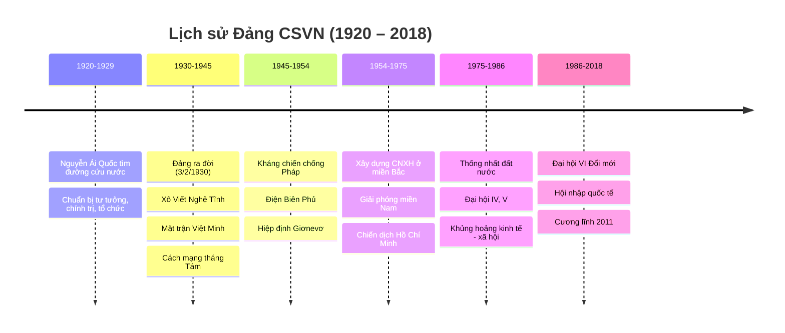
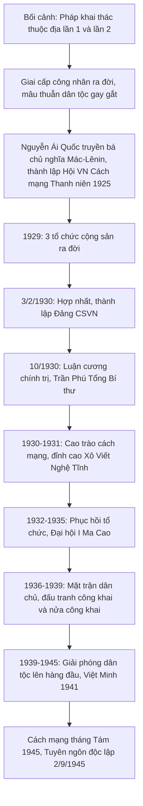
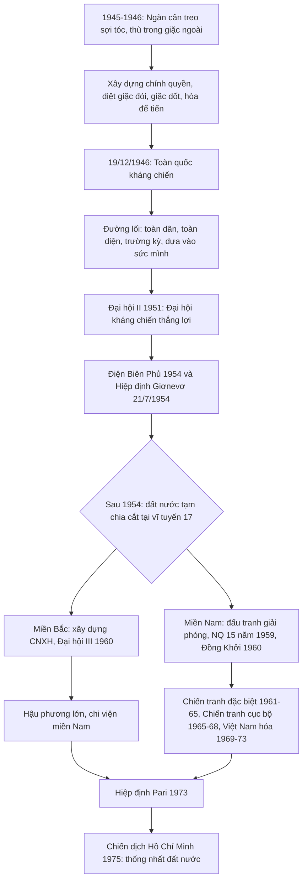
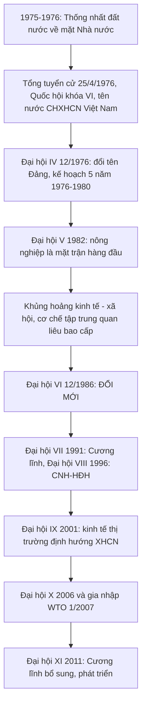

# 📘 ÔN TẬP LỊCH SỬ ĐẢNG CỘNG SẢN VIỆT NAM

> Giáo trình *Lịch sử Đảng Cộng sản Việt Nam* (dành cho sinh viên khối không chuyên Mác – Lênin, tư tưởng Hồ Chí Minh) – Bộ GD&ĐT, NXB Chính trị quốc gia Sự thật.
>
> Cấu trúc: **Nhập môn + 3 chương**. Mỗi chương gồm: ① Sơ đồ tổng quan → ② Mốc sự kiện → ③ Kiến thức trọng tâm → ④ Mẹo nhớ → ⑤ Ngân hàng câu hỏi (có đáp án).
> Ký hiệu: ✅ đáp án · ⚠️ câu cần đối chiếu lại giáo trình · 💡 mẹo nhớ.

---

## 🗺️ BẢN ĐỒ TOÀN MÔN

### Bảng Đại hội đại biểu toàn quốc (phải thuộc)

| Đại hội | Thời gian – Địa điểm | Dấu ấn chính |
|---|---|---|
| **I** | 3/1935, Ma Cao | Phục hồi hệ thống tổ chức; **Lê Hồng Phong** làm Tổng Bí thư |
| **II** | 2/1951, Tuyên Quang | **"Đại hội kháng chiến thắng lợi"**; đưa Đảng ra hoạt động công khai (Đảng Lao động VN); CNXH trải qua **3 giai đoạn** |
| **III** | 5–10/9/1960, **Hà Nội** | Hoàn chỉnh đường lối chung xây dựng CNXH ở miền Bắc; **2 nhiệm vụ chiến lược** |
| **IV** | 14–20/12/1976, Hà Nội | **Đổi tên Đảng → Đảng Cộng sản Việt Nam**; kế hoạch 5 năm 1976–1980 |
| **V** | 3/1982 | **Nông nghiệp là mặt trận hàng đầu**; 2 nhiệm vụ chiến lược (xây dựng CNXH + bảo vệ Tổ quốc) |
| **VI** | 12/1986 | **Đại hội Đổi mới đất nước** |
| **VII** | 6/1991 | Cương lĩnh xây dựng đất nước thời kỳ quá độ (1991) |
| **VIII** | 6/1996 | Đẩy mạnh công nghiệp hóa, hiện đại hóa; tăng trưởng gắn với tiến bộ và công bằng xã hội |
| **IX** | 4/2001 | **Chính thức nêu mô hình kinh tế thị trường định hướng XHCN** |
| **X** | 4/2006 | Cho phép đảng viên làm kinh tế tư nhân; xây dựng, chỉnh đốn Đảng |
| **XI** | 1/2011 | Cương lĩnh bổ sung, phát triển năm 2011 |

---

# 📖 NHẬP MÔN
**Đối tượng, chức năng, nhiệm vụ, phương pháp học tập Lịch sử Đảng**

- **Đối tượng**: sự ra đời của Đảng; quá trình Đảng lãnh đạo cách mạng; hệ thống đường lối, chủ trương, chính sách của Đảng qua các giai đoạn.
- **Chức năng**: nhận thức (tri thức, bài học kinh nghiệm), giáo dục (giáo dục truyền thống, niềm tin), dự báo, phê phán.
- **Nhiệm vụ**: làm rõ sự ra đời tất yếu của Đảng; hệ thống hóa đường lối; tổng kết thắng lợi và bài học.
- **Phương pháp**: phương pháp lịch sử, phương pháp logic (kết hợp), cùng các phương pháp liên ngành.

---

# 📗 CHƯƠNG 1
## ĐẢNG CỘNG SẢN VIỆT NAM RA ĐỜI VÀ LÃNH ĐẠO ĐẤU TRANH GIÀNH CHÍNH QUYỀN (1930 – 1945)

### 1️⃣ Sơ đồ tổng quan

### 2️⃣ Dòng thời gian

| Năm | Sự kiện |
|---|---|
| 1917 | Cách mạng tháng Mười Nga thành công |
| 1919 | Quốc tế Cộng sản ra đời |
| 1925 | Hội Việt Nam Cách mạng Thanh niên (Quảng Châu) |
| 6/1929 | **Đông Dương Cộng sản Đảng** (tổ chức cộng sản **đầu tiên**) |
| 8/1929 | An Nam Cộng sản Đảng |
| 9/1929 | Đông Dương Cộng sản Liên đoàn |
| 3–7/2/1930 | Hội nghị hợp nhất, thành lập Đảng |
| 10/1930 | Hội nghị TW lần 1: Luận cương chính trị, **Trần Phú** Tổng Bí thư |
| 1/5/1930 → 1931 | Phong trào Xô Viết Nghệ Tĩnh |
| 3/1935 | Đại hội I (Ma Cao), Lê Hồng Phong Tổng Bí thư |
| 1936–1939 | Phong trào dân chủ (Mặt trận Dân chủ Đông Dương) |
| 1/9/1939 | Chiến tranh thế giới thứ II bùng nổ |
| 11/1939 | Hội nghị TW 6: thành lập **Mặt trận dân tộc thống nhất phản đế Đông Dương**; tạm gác khẩu hiệu ruộng đất |
| 5/1941 | **Hội nghị TW 8** (Pác Bó): thành lập Việt Minh; chủ trương chính quyền VNDCCH |
| 8/1945 | Tổng khởi nghĩa; 2/9/1945 Tuyên ngôn Độc lập |

### 3️⃣ Kiến thức trọng tâm

**a) Khai thác thuộc địa của Pháp**

| | Khai thác lần 1 (1897–1914) | Khai thác lần 2 (1919–1929) |
|---|---|---|
| Hệ quả | **Giai cấp công nhân VN ra đời** | Cơ cấu kinh tế **mất cân đối, lạc hậu, nghèo nàn**, lệ thuộc Pháp |

**b) So sánh Cương lĩnh chính trị đầu tiên (2/1930) và Luận cương (10/1930)**

| Tiêu chí | Cương lĩnh (Nguyễn Ái Quốc) | Luận cương (Trần Phú) |
|---|---|---|
| Nhiệm vụ | Chống đế quốc và phong kiến, giành độc lập dân tộc | Đánh đổ phong kiến, đế quốc, tư sản phản cách mạng |
| Con đường | Tư sản dân quyền cách mạng → xã hội cộng sản | 2 giai đoạn: tư sản dân quyền → XHCN |
| Lực lượng | Đoàn kết rộng rãi các tầng lớp | Chủ yếu công – nông |
| Điểm yếu | – | Chưa đặt vấn đề dân tộc lên hàng đầu |

**c) So sánh 1930–1931 và 1936–1939**

| | 1930–1931 | 1936–1939 |
|---|---|---|
| Kẻ thù | Đế quốc và phong kiến | Phản động thuộc địa và tay sai |
| Hình thức đấu tranh | Bí mật, bạo lực, vũ trang | Công khai, nửa công khai; **nghị trường, báo chí** |
| Mặt trận | – | Mặt trận Dân chủ Đông Dương |

**d) Hội nghị TW 6 (11/1939) và TW 8 (5/1941)**
- Đưa **nhiệm vụ giải phóng dân tộc lên hàng đầu**; **tạm gác khẩu hiệu cách mạng ruộng đất** ("đánh đổ địa chủ, chia ruộng đất cho dân cày" → chỉ tịch thu ruộng đất của đế quốc và Việt gian).
- TW 8: thành lập **Việt Minh**, xác định hình thức chính quyền **Chính phủ VNDCCH**, coi chuẩn bị khởi nghĩa là **nhiệm vụ trung tâm**.

### 4️⃣ 💡 Mẹo nhớ
- **"Công nhân ra đời từ khai thác lần 1"**, còn lần 2 làm kinh tế **mất cân đối**.
- Tổng Bí thư: **Trần Phú** (10/1930) → **Lê Hồng Phong** (Đại hội I, 1935).
- 1930–31: **bí mật, vũ trang**; 1936–39: **công khai, nghị trường, báo chí**.

### 5️⃣ 📝 Ngân hàng câu hỏi – Chương 1

**C1-1.** Cách mạng tháng Mười Nga thành công (1917) và Quốc tế Cộng sản ra đời (1919) có ý nghĩa
A. Đánh dấu sự thành công của cách mạng vô sản trên thế giới | B. Thức tỉnh phong trào đấu tranh của giai cấp công nhân ở các nước đế quốc | C. Thúc đẩy cuộc đấu tranh giai cấp ở các nước thuộc địa, phụ thuộc | D. Thức tỉnh phong trào đấu tranh giải phóng dân tộc ở các nước thuộc địa, phụ thuộc
✅ **D**

**C1-2.** Giai cấp công nhân Việt Nam ra đời từ:
A. Cuộc khai thác thuộc địa lần thứ nhất của thực dân Pháp | B. Cuộc khai thác thuộc địa lần thứ hai | C. Cuộc xâm lược lần thứ nhất | D. Cuộc xâm lược lần thứ hai
✅ **A**

**C1-3.** Tác động của chương trình khai thác thuộc địa lần thứ hai của Pháp đến kinh tế Việt Nam làm cho
A. Cơ cấu kinh tế Việt Nam mất cân đối, lạc hậu, nghèo nàn | B. Nền kinh tế Việt Nam phát triển độc lập | C. Kinh tế Việt Nam phát triển một cách tự chủ | D. Kinh tế Việt Nam phụ thuộc kinh tế Pháp
✅ **A**

**C1-4.** Trong phong trào cách mạng nước ta, giai cấp nào sẽ là lực lượng lãnh đạo cách mạng?
A. Nông dân | B. Công nhân | C. Tư sản | D. Tiểu tư sản
✅ **B**

**C1-5.** Tổ chức Cộng sản nào ra đời đầu tiên ở Việt Nam?
A. Hội Việt Nam cách mạng Thanh niên | B. Đông Dương Cộng sản Đảng | C. An Nam Cộng sản Đảng | D. Đông Dương Cộng sản liên đoàn
✅ **B**

**C1-6.** Sự kiện lịch sử nào dưới đây diễn ra trong phong trào dân tộc dân chủ ở Việt Nam từ 1925 đến 1930?
A. Bãi công của công nhân Ba Son | B. Bãi công của công nhân Vinh – Bến Thủy | C. Phong trào Đông Dương đại hội | D. Phong trào phá kho thóc của Nhật
✅ **A**

**C1-7.** Sự kiện nào được Nguyễn Ái Quốc đánh giá "là một bước ngoặt vô cùng quan trọng trong lịch sử Cách mạng Việt Nam ta"?
A. Đảng Cộng sản Việt Nam ra đời | B. Sự thành lập Đảng Cộng sản Pháp | C. Sự thành lập hội Việt Nam Cách mạng thanh niên | D. Nguyễn Ái Quốc tìm thấy con đường cứu nước
✅ **A**

**C1-8.** Tổng Bí thư của Đảng được bầu tại Hội nghị Trung ương tháng 10/1930 là
A. Trần Phú | B. Lê Hồng Phong | C. Hà Huy Tập | D. Nguyễn Văn Cừ
✅ **A**

**C1-9.** Nhiệm vụ của cách mạng Việt Nam được xác định trong Luận cương chính trị tháng 10/1930 do Trần Phú soạn thảo là
A. Đánh đổ phong kiến và đế quốc | B. Giải phóng dân tộc | C. Đánh đổ đế quốc và tay sai | D. Đánh đổ đế quốc Pháp, phong kiến và tư sản phản cách mạng, làm cho nước Việt Nam độc lập tự do
✅ **D**

**C1-10.** Trong các nội dung sau, nội dung nào **không** thuộc Luận cương chính trị tháng 10/1930?
A. Cách mạng Việt Nam phải trải qua hai giai đoạn: tư sản dân quyền và XHCN | B. Cách mạng do Đảng của giai cấp vô sản lãnh đạo | C. Cách mạng Việt Nam là một bộ phận của cách mạng thế giới | D. Lực lượng để đánh đuổi đế quốc và phong kiến là công nông; đồng thời "phải biết liên lạc với tiểu tư sản, trí thức, trung nông… để kéo họ về phe vô sản giai cấp"
✅ **D** (theo đáp án đề) ⚠️ *Nội dung D có xuất hiện trong Luận cương; hãy đối chiếu lại giáo trình/đề gốc.*

**C1-11.** Kẻ thù chủ yếu của xã hội Việt Nam trong thời kì 1930–1931 là
A. Thực dân Pháp | B. Địa chủ phong kiến | C. Đế quốc và phong kiến | D. Địa chủ phong kiến, tư sản
✅ **C**

**C1-12.** Phong trào Xô Viết Nghệ Tĩnh được bắt đầu từ ngày tháng năm nào?
A. 1-5-1930 | B. 1-5-1931 | C. 19-5-1930 | D. 19-8-1930
✅ **A**

**C1-13.** Trong lịch sử Đảng, giai đoạn 1932 – 1935 là giai đoạn
A. Chuẩn bị các điều kiện để giành chính quyền | B. Phục hồi hệ thống tổ chức của Đảng | C. Đẩy mạnh phong trào đấu tranh | D. Hợp tác với phong trào nhân dân Pháp
✅ **B**

**C1-14.** Lê Hồng Phong được bầu làm Tổng Bí thư tại Đại hội nào của Đảng?
A. Đại hội II | B. Đại hội III | C. Đại hội I | D. Đại hội IV
✅ **C**

**C1-15.** Điểm khác biệt về phương pháp đấu tranh của thời kì 1936–1939 so với thời kì 1930–1931 là
A. Chính trị và vũ trang | B. Nghị trường và đấu tranh báo chí | C. Đấu tranh chính trị | D. Ngoại giao với vận động quần chúng
✅ **B**

**C1-16.** Một trong những nội dung của chương trình hành động của Đảng Cộng sản Đông Dương là
A. Cải cách ruộng đất | B. Cải cách giáo dục | C. Đòi tự do, bình đẳng | D. Đòi quyền tự do: phát ngôn, tự do đi lại…
✅ **D**

**C1-17.** Chiến tranh thế giới thứ II nổ ra vào thời gian nào?
A. 1937 | B. 1938 | C. 1939 | D. 1940
✅ **C**

**C1-18.** Mặt trận dân tộc thống nhất phản đế Đông Dương được thành lập vào thời gian nào?
A. 10-1930 | B. 5-1935 | C. 11-1939 | D. 5-1941
✅ **C**

**C1-19.** Mối quan hệ giữa hai khẩu hiệu "Độc lập dân tộc" và "Ruộng đất cho dân cày" được giải quyết thế nào trong thời kì 1939–1945?
A. Tạm gác lại khẩu hiệu cách mạng ruộng đất | B. Tạm gác lại khẩu hiệu cách mạng giải phóng dân tộc | C. Tiếp tục thực hiện hai khẩu hiệu một cách đồng bộ | D. Tạm gác lại việc thực hiện hai khẩu hiệu trên
✅ **A**

**C1-20.** "Trong lúc này nếu không giải quyết được vấn đề dân tộc giải phóng, không đòi được độc lập tự do cho toàn thể dân tộc, thì chẳng những toàn thể quốc gia dân tộc còn chịu mãi kiếp ngựa trâu mà quyền lợi của bộ phận giai cấp đến vạn năm cũng không đòi lại được". Luận điểm trên được đưa ra tại Hội nghị nào?
A. Hội nghị BCH Trung ương tháng 11/1939 | B. *(đề bị mất nội dung)* | C. Hội nghị BCH Trung ương tháng 5/1941
✅ **C** (Hội nghị TW 8, 5/1941) ⚠️ *Đề gốc bị thiếu phương án B; đáp án suy ra từ nội dung luận điểm.*

**C1-21.** Hội nghị lần thứ 8 BCH Trung ương Đảng Cộng sản Đông Dương (5/1941) quyết định hình thức chính quyền sau cách mạng ở Việt Nam là:
A. Chính phủ cách mạng lâm thời | B. Chính phủ Việt Nam Dân chủ Cộng hòa | C. Chính phủ Xô viết công-nông-binh | D. Chính phủ dân chủ Cộng hòa Đông Dương
✅ **B**

**C1-22.** Nội dung nào **không** có trong Hội nghị Trung ương VIII (5/1941)?
A. Đưa nhiệm vụ giải phóng dân tộc lên hàng đầu | B. Chuẩn bị điều kiện để "đánh đổ địa chủ, chia ruộng đất cho dân cày" | C. Thành lập mặt trận Việt Minh để tập hợp lực lượng cách mạng | D. Xác định chuẩn bị khởi nghĩa là nhiệm vụ trung tâm trong giai đoạn hiện tại
✅ **B**

---

# 📘 CHƯƠNG 2
## ĐẢNG LÃNH ĐẠO HAI CUỘC KHÁNG CHIẾN, HOÀN THÀNH GIẢI PHÓNG DÂN TỘC, THỐNG NHẤT ĐẤT NƯỚC (1945 – 1975)

### 1️⃣ Sơ đồ tổng quan

### 2️⃣ Dòng thời gian

| Thời gian | Sự kiện |
|---|---|
| 2/9/1945 | Tuyên ngôn Độc lập |
| 6/3/1946 | Hiệp định Sơ bộ Việt – Pháp |
| 3–12/1946 | Chủ trương **"hòa để tiến"** |
| 12/12/1946 | Chỉ thị **Toàn dân kháng chiến** (Ban Thường vụ TW Đảng) |
| 19/12/1946 | **Lời kêu gọi Toàn quốc kháng chiến** (Hồ Chí Minh) |
| 2/1951 | Đại hội II |
| 7/5/1954 | Chiến thắng Điện Biên Phủ |
| 21/7/1954 | Hiệp định Giơnevơ |
| 1/1959 | **Hội nghị TW 15**: dùng bạo lực cách mạng ở miền Nam |
| 1959 | Mỹ – Diệm ban hành **Luật 10/59** |
| 1960 | **Đồng Khởi** (khởi đầu ở Bến Tre) |
| 9/1960 | Đại hội III (Hà Nội) |
| 20/12/1960 | Thành lập **Mặt trận Dân tộc giải phóng miền Nam VN** (Tây Ninh) |
| 1961–1965 | Chiến tranh đặc biệt |
| 3/1965 & 12/1965 | Hội nghị TW 11 và 12 |
| 1973 | Hiệp định Pari |
| 30/4/1975 | Chiến dịch Hồ Chí Minh toàn thắng |

### 3️⃣ Kiến thức trọng tâm

**a) Đường lối kháng chiến chống Pháp**
- Mục tiêu: **đánh phản động thực dân Pháp xâm lược, giành thống nhất và độc lập**.
- Phương châm: **toàn dân, toàn diện, trường kỳ, dựa vào sức mình là chính**.
- Triển vọng: *"tuy lâu dài, gian khổ, khó khăn, song nhất định thắng lợi"*.
- Văn kiện: Chỉ thị Toàn dân kháng chiến (12/12/1946), Lời kêu gọi (19/12/1946), tác phẩm *Kháng chiến nhất định thắng lợi* (Trường Chinh).

**b) Hiệp định Giơnevơ 1954**
- **Quyền dân tộc cơ bản**: độc lập, chủ quyền, thống nhất, toàn vẹn lãnh thổ.
- Giới tuyến quân sự tạm thời: **vĩ tuyến 17**.
- Pháp phải ngồi vào đàm phán vì **thất bại ở Điện Biên Phủ**.

**c) Đại hội III (1960) – Hai nhiệm vụ chiến lược**
1. Tiến hành **cách mạng XHCN ở miền Bắc**.
2. **Giải phóng miền Nam** khỏi ách thống trị của đế quốc Mỹ và tay sai, thực hiện thống nhất nước nhà, hoàn thành độc lập và dân chủ trong cả nước.

**d) Miền Nam**

| Chiến lược của Mỹ | Thời gian |
|---|---|
| **Chiến tranh đặc biệt** | 1961–1965 |
| Chiến tranh cục bộ | 1965–1968 |
| Việt Nam hóa chiến tranh | 1969–1973 |

### 4️⃣ 💡 Mẹo nhớ
- **Hòa để tiến**: 3/1946 → 12/1946.
- **Hội nghị 15 (1/1959)** = **bạo lực cách mạng**; **Đồng Khởi 1960** = chuyển từ **giữ gìn lực lượng sang tiến công**.
- Hội nghị 11 và 12 (1965) → khẩu hiệu **"Tất cả để đánh thắng giặc Mỹ xâm lược"**.
- Nhân tố hàng đầu thắng lợi chống Mỹ: **sự lãnh đạo của Đảng với đường lối đúng đắn, sáng tạo, độc lập tự chủ**.

### 5️⃣ 📝 Ngân hàng câu hỏi – Chương 2

#### 🔹 Giai đoạn 1945–1954 (kháng chiến chống Pháp)

**C2-1.** Tình hình nước ta được ví như "ngàn cân treo sợi tóc" vào thời gian nào?
A. Ngay sau cách mạng Tháng Tám 1945 thành công | B. Trước cách mạng Tháng Tám | C. Ngay sau cuộc kháng chiến chống Mỹ thắng lợi 1975 | D. Ngay sau khi Hiệp định Pari được ký kết 1973
✅ **A**

**C2-2.** Sau Cách mạng tháng Tám đến 1954, kẻ thù chính của nhân dân Việt Nam là
A. Pháp | B. Anh | C. Mỹ | D. Trung Quốc
✅ **A**

**C2-3.** Sau khi giành chính quyền, Đảng chủ trương mở rộng mặt trận nào để tập trung ngọn lửa đấu tranh chống Pháp?
A. Mặt trận Việt Minh | B. Mặt trận Liên Việt | C. Mặt trận Dân chủ | D. Mặt trận Tổ quốc Việt Nam
✅ **A**

**C2-4.** Phong trào mà Đảng vận động nhân dân chống nạn mù chữ sau Cách mạng tháng Tám 1945 là
A. Xây dựng nếp sống văn hoá mới | B. Bình dân học vụ | C. Bài trừ các tệ nạn xã hội | D. Xoá bỏ văn hoá thực dân nô dịch phản động
✅ **B**

**C2-5.** Nội dung nào trong Hiệp định Sơ bộ 6-3-1946 tạo điều kiện cho ta có thời gian chuẩn bị lực lượng đối phó lâu dài với Pháp?
A. Pháp công nhận Việt Nam là một quốc gia tự do trong khối Liên hiệp Pháp | B. Pháp được đưa 15 ngàn quân ra miền Bắc thay thế quân Tưởng | C. Hai bên ngừng bắn ở Nam Bộ | D. Hai bên thực hiện tập kết, chuyển quân
✅ **C**

**C2-6.** Thời gian từ tháng 3/1946 đến 19/12/1946, Đảng lãnh đạo nhân dân thực hiện chủ trương chiến lược:
A. Hòa để tiến | B. Đối đầu với quân đội Pháp | C. Đối đầu với quân đội Tưởng | D. Giải giáp quân đội Nhật
✅ **A**

**C2-7.** Ngày 12/12/1946, Ban Thường vụ Trung ương Đảng đã ra
A. Quân lệnh số 1 | B. Lời kêu gọi Tổng khởi nghĩa | C. Chỉ thị Toàn dân kháng chiến | D. Lời kêu gọi Toàn quốc kháng chiến
✅ **C**

**C2-8.** "Chúng ta thà hy sinh tất cả, chứ nhất định không chịu mất nước, nhất định không chịu làm nô lệ" là đoạn trích trong văn kiện nào?
A. Chỉ thị Toàn dân kháng chiến của Ban Thường vụ TW Đảng | B. Lời kêu gọi toàn quốc kháng chiến của Chủ tịch Hồ Chí Minh | C. Tác phẩm Kháng chiến nhất định thắng lợi của Tổng Bí thư Trường Chinh | D. Chỉ thị sửa soạn khởi nghĩa của Tổng bộ Việt Minh
✅ **B**

**C2-9.** Đường lối toàn quốc kháng chiến của Đảng vạch ra mục tiêu của kháng chiến là
A. Đánh phản động thực dân Pháp xâm lược, giành thống nhất và độc lập | B. Đánh phát xít Nhật xâm lược… | C. Đánh đế quốc Mỹ xâm lược… | D. Đánh Trung Hoa Dân Quốc xâm lược…
✅ **A**

**C2-10.** Khi nói về triển vọng của cuộc kháng chiến chống Pháp, Đảng xác định trong Đường lối kháng chiến là
A. Mặc dù lâu dài, gian khổ, khó khăn song nhất định thắng lợi | B. Mặc dù phải hy sinh to lớn đến đâu nhưng nhất định sẽ thành công | C. Mặc dù bị bao vây và chưa được nước nào công nhận, song nhất định thắng lợi | D. Nhờ có sự hy sinh to lớn của dân tộc nên kháng chiến sẽ thành công
✅ **A**

**C2-11.** Đại hội Đảng lần thứ II xác định con đường đi lên CNXH là một quá trình:
A. Đấu tranh lâu dài, đại thể trải qua ba giai đoạn | B. Đấu tranh kiên trì, bốn giai đoạn | C. Đấu tranh lâu dài, năm giai đoạn | D. Đấu tranh kiên trì, hai giai đoạn
✅ **A**

**C2-12.** Đại hội nào được đánh dấu là "Đại hội kháng chiến thắng lợi"?
A. Hội nghị thành lập Đảng 1930 | B. Đại hội Quốc dân ở Tân Trào 1945 | C. Đại hội lần thứ II của Đảng 1951 | D. Đại hội lần thứ III của Đảng 1960
✅ **C**

**C2-13.** Chiến dịch lịch sử Điện Biên Phủ 1954 là đỉnh cao của
A. Khởi nghĩa chống Pháp | B. Kháng chiến chống Pháp | C. Kháng chiến chống Mĩ | D. Chiến tranh chống Pháp
✅ **B**

**C2-14.** Cuộc kháng chiến chống thực dân Pháp của nhân dân Đông Dương (1953–1954) kết thúc bằng giải pháp
A. Chính trị | B. Quân sự | C. Kinh tế | D. Văn hóa
✅ **A**

**C2-15.** Pháp chấp nhận đàm phán với Việt Nam ở Hội nghị Giơnevơ năm 1954 về Đông Dương vì
A. Sức ép của Liên Xô | B. Bị thất bại ở Điện Biên Phủ | C. Dư luận nhân dân thế giới phản đối | D. Pháp sợ Trung Quốc đưa quân sang giúp đỡ Việt Nam
✅ **B**

**C2-16.** Quyền dân tộc cơ bản của Việt Nam trong Hiệp định Giơnevơ 1954 là gì?
A. Độc lập, chủ quyền, thống nhất, toàn vẹn lãnh thổ | B. Tập kết, chuyển quân, chuyển giao khu vực | C. Tổng tuyển cử thống nhất đất nước | D. Ngừng bắn, lập lại hòa bình ở Đông Dương
✅ **A**

**C2-17.** Hiệp định Giơnevơ 1954 quy định việc di chuyển, tập kết quân đội ở hai miền Nam – Bắc với giới tuyến quân sự tạm thời là:
A. Vĩ tuyến 17 | B. Vĩ tuyến 18 | C. Vĩ tuyến 19 | D. Vĩ tuyến 20
✅ **A**

#### 🔹 Giai đoạn 1954–1965 (hai miền hai nhiệm vụ)

**C2-18.** Đặc điểm nổi bật của nước ta sau 1954 là
A. Đánh đuổi thực dân Pháp và can thiệp Mỹ xâm lược, giành độc lập dân tộc | B. Cả nước quá độ đi lên CNXH | C. Phát triển chế độ dân chủ nhân dân, gây cơ sở cho CNXH | D. Tiến hành đồng thời cách mạng XHCN ở miền Bắc và cách mạng dân tộc dân chủ nhân dân ở miền Nam
✅ **D**

**C2-19.** Đại hội đại biểu toàn quốc lần thứ III của Đảng được tổ chức tại
A. Sài Gòn | B. Hà Nội | C. Tân Trào | D. Hóc Môn
✅ **B**

**C2-20.** Đường lối chung xây dựng XHCN ở miền Bắc (1954–1975) được đề cập ở Đại hội lần thứ mấy?
A. Đại hội II | B. Đại hội III | C. Đại hội IV | D. Đại hội V
✅ **B**

**C2-21.** Đại hội III (5–10/9/1960, Hà Nội) hoàn chỉnh đường lối chiến lược chung của cách mạng Việt Nam trong giai đoạn mới và vạch ra hai nhiệm vụ chiến lược là
✅ **Tiến hành cách mạng XHCN ở miền Bắc; giải phóng miền Nam khỏi ách thống trị của đế quốc Mỹ và tay sai, thực hiện thống nhất nước nhà, hoàn thành độc lập và dân chủ trong cả nước.**

**C2-22.** Nội dung nào **không** phản ánh thành tựu của kế hoạch Nhà nước 5 năm (1961–1965)?
A. Giá trị sản lượng công nghiệp nặng năm 1965 tăng 3 lần so với 1960 | B. Công nghiệp quốc doanh chiếm 93% tổng giá trị sản lượng công nghiệp toàn miền Bắc | C. Công nghiệp nhẹ, tiểu thủ công nghiệp giải quyết 80% hàng tiêu dùng thiết yếu | D. Thương nghiệp tư nhân được Nhà nước ưu tiên phát triển nên chiếm lĩnh được thị trường
✅ **D**

**C2-23.** Mỹ – Ngụy không thực thi Hiệp định Giơnevơ bằng cách:
A. Ngăn cản hiệp thương, tổng tuyển cử thống nhất đất nước | B. Ban hành Luật 10/59 | C. Thực hiện chiến dịch lập ấp chiến lược | D. Các phương án trả lời đều đúng
✅ **A** (theo đáp án đề)

**C2-24.** Nghị quyết Hội nghị Trung ương lần thứ 15 (1/1959) đánh dấu sự thay đổi chiến lược trong chỉ đạo cách mạng miền Nam ở điểm nào?
A. Chuyển sang đấu tranh đòi quyền tự do dân chủ | B. Kết hợp đấu tranh chính trị với đấu tranh quân sự, tiến tới khởi nghĩa vũ trang giành chính quyền về tay nhân dân | C. Sử dụng đấu tranh chính trị giành chính quyền | D. Tập trung lực lượng chính trị, vũ trang đấu tranh giành độc lập dân tộc
✅ **B**

**C2-25.** Tại hội nghị nào, BCH Trung ương quyết định để nhân dân miền Nam sử dụng bạo lực cách mạng đánh đổ chính quyền Mỹ – Diệm?
A. Hội nghị TW 15 (1/1959) | B. Hội nghị TW 11 (3/1965) | C. Hội nghị TW 12 (12/1965) | D. Hội nghị TW 21 (7/1973)
✅ **A**

**C2-26.** Một trong những sự kiện làm bùng nổ phong trào Đồng Khởi năm 1960 là:
A. Ngăn cản hiệp thương, tổng tuyển cử | B. Ban hành Luật 10/59 | C. Lập ấp chiến lược | D. Các phương án đều đúng
✅ **B**

**C2-27.** Ý nghĩa quan trọng của phong trào Đồng Khởi là
A. Chuyển cách mạng miền Nam từ thế giữ gìn lực lượng sang thế tiến công | B. Lật đổ chính quyền Mỹ – Diệm | C. Mỹ phải ngồi vào bàn đàm phán | D. Mỹ phải kí hiệp định Pari
✅ **B** (theo đáp án đề) ⚠️ *Nhiều giáo trình nhấn mạnh ý nghĩa là phương án A ("chuyển từ thế giữ gìn lực lượng sang thế tiến công"); hãy đối chiếu giáo trình của bạn.*

**C2-28.** Hình thức khởi nghĩa chống lại ách thống trị của Mĩ – Diệm đã diễn ra đầu tiên ở đâu?
A. Bến Tre | B. Bình Định | C. Quảng Ngãi | D. Tây Ninh
✅ **B** (theo đáp án đề)

**C2-29.** Mặt trận Dân tộc giải phóng miền Nam Việt Nam được thành lập ở đâu?
A. Bến Tre | B. Tây Ninh | C. Bình Định | D. Tây Nguyên
✅ **B**

#### 🔹 Giai đoạn 1965–1975 (chống Mỹ, cứu nước)

**C2-30.** Từ 1961–1965, Mĩ thực hiện loại hình chiến lược nào ở miền Nam Việt Nam?
A. Chiến tranh đơn phương | B. Chiến tranh đặc biệt | C. Chiến tranh cục bộ | D. Việt Nam hóa chiến tranh
✅ **B**

**C2-31.** Hội nghị TW lần thứ 11 (3/1965) và lần thứ 12 (12/1965) đề ra khẩu hiệu chung của nhân dân cả nước là
A. Tất cả để đánh thắng giặc Mỹ xâm lược | B. Tất cả để thống nhất nước nhà | C. Tất cả vì miền Nam ruột thịt | D. Các phương án trả lời đều đúng
✅ **A**

**C2-32.** Cuộc kháng chiến chống Mĩ, cứu nước của nhân dân ta là một cuộc đụng đầu lịch sử vì
A. Đây là cuộc đấu tranh của một dân tộc nhược tiểu chống lại một đế quốc số một thế giới | B. Đây là cuộc chiến tranh xâm lược, phi nghĩa đúng về phía Mĩ – đại diện cho chủ nghĩa đế quốc | C. Đây là cuộc chiến phản ánh tập trung những mâu thuẫn cơ bản của thời đại
✅ **C**

**C2-33.** Cuộc kháng chiến chống Mỹ, cứu nước (1954–1975) kết thúc bằng thắng lợi của chiến dịch nào?
A. Hồ Chí Minh | B. Tây Nguyên | C. Huế – Đà Nẵng | D. Đường 14 – Phước Long
✅ **A**

**C2-34.** Nhân tố hàng đầu đảm bảo thắng lợi của cuộc kháng chiến chống Mĩ, cứu nước (1954–1975) là sự lãnh đạo của Đảng vì Đảng:
A. Tranh thủ được sự giúp đỡ của các nước XHCN | B. Có đường lối cách mạng đúng đắn, sáng tạo, độc lập tự chủ | C. Lãnh đạo xây dựng miền Bắc thành hậu phương vững mạnh | D. Đã kết hợp sức mạnh toàn dân tộc với sức mạnh của thời đại
✅ **B**

**C2-35.** Thắng lợi của cuộc kháng chiến chống Mỹ cứu nước cho nhiều bài học quý, bài học nào dưới đây **chưa phù hợp** với thời kỳ chống Mỹ?
A. Giương cao ngọn cờ độc lập dân tộc và dân chủ | B. Kiên định tư tưởng chiến lược tiến công quyết đánh và quyết thắng đế quốc Mỹ xâm lược | C. Thực hiện chiến tranh nhân dân linh hoạt sáng tạo | D. Coi trọng công tác tổ chức, công tác xây dựng Đảng
✅ **B** (theo đáp án đề)

---

# 📙 CHƯƠNG 3
## ĐẢNG LÃNH ĐẠO CẢ NƯỚC QUÁ ĐỘ LÊN CHỦ NGHĨA XÃ HỘI VÀ TIẾN HÀNH CÔNG CUỘC ĐỔI MỚI (1975 – 2018)

### 1️⃣ Sơ đồ tổng quan

### 2️⃣ Dòng thời gian

| Thời gian | Sự kiện |
|---|---|
| 1975 | Hội nghị TW 24: thống nhất đất nước là nguyện vọng và quy luật khách quan |
| 25/4/1976 | Tổng tuyển cử bầu Quốc hội chung cả nước |
| 24/6–3/7/1976 | Kỳ họp thứ nhất Quốc hội khóa VI: đặt tên nước **CHXHCN Việt Nam** |
| 12/1976 | Đại hội IV: đổi tên Đảng thành **Đảng Cộng sản Việt Nam** |
| 17/2/1979 | Trung Quốc tấn công biên giới phía Bắc |
| 1982 | Đại hội V |
| 12/1986 | Đại hội VI – Đổi mới |
| 23/10/1991 | Hiệp định Pari về Campuchia |
| 2001 | Đại hội IX |
| 21/8/2006 | Hội nghị TW 3 khóa X: Nghị quyết 04 (phòng, chống tham nhũng, lãng phí) |
| 11/1/2007 | Việt Nam gia nhập **WTO** |
| 2011 | Cương lĩnh bổ sung, phát triển |

### 3️⃣ Kiến thức trọng tâm

**a) Đổi mới (Đại hội VI, 1986)**
- Đổi mới **không phải** thay đổi mục tiêu XHCN mà là **làm cho mục tiêu ấy được thực hiện có hiệu quả**.
- **Bài học kinh tế** 10 năm đổi mới (1986–1996): xây dựng **nền kinh tế hàng hóa nhiều thành phần vận hành theo cơ chế thị trường**.
- Tác hại dai dẳng của cơ chế tập trung quan liêu bao cấp: **nhiều hiện tượng tiêu cực trong xã hội**.

**b) Các mốc nhận thức quan trọng**

| Đại hội | Nhận thức mới |
|---|---|
| VIII (1996) | Tăng trưởng kinh tế gắn với **tiến bộ và công bằng xã hội** *trong từng bước* và *suốt quá trình phát triển* |
| IX (2001) | Chính thức nêu **mô hình kinh tế thị trường định hướng XHCN** |
| X (2006) | **Cho phép đảng viên làm kinh tế tư nhân**; xây dựng, chỉnh đốn Đảng |

**c) Một số Hội nghị Trung ương cần nhớ**

| Hội nghị | Nội dung |
|---|---|
| TW 7 khóa IX (3/2003) | Đất đai là tài nguyên quốc gia vô cùng quý giá, là tư liệu sản xuất đặc biệt, là nguồn nội lực và nguồn vốn to lớn |
| TW 8 khóa IX (7/2003) | **Chiến lược bảo vệ Tổ quốc trong tình hình mới** |
| TW 8 khóa IX (26/3/2004) | Nghị quyết 36-NQ/TW về công tác đối với **người Việt Nam ở nước ngoài** |
| TW 3 khóa X (21/8/2006) | Nghị quyết 04: phòng, chống tham nhũng, lãng phí |
| TW 5 khóa X (7/2007) | Nghị quyết 14: tăng cường công tác kiểm tra, giám sát của Đảng |
| TW 6 khóa XII (25/10/2017) | Nghị quyết 20: bảo vệ, chăm sóc và nâng cao sức khỏe nhân dân |

### 4️⃣ 💡 Mẹo nhớ
- **IV đổi tên Đảng**, **V nông nghiệp hàng đầu**, **VI đổi mới**, **IX kinh tế thị trường định hướng XHCN**, **X đảng viên làm kinh tế tư nhân**.
- **Phạm Hùng** dẫn đầu đoàn đại biểu miền Nam đi hiệp thương.
- Chiến lược biển: **"quốc gia mạnh về biển, làm giàu từ biển"**.
- Tổ chức chính trị – xã hội: Mặt trận Tổ quốc, Đoàn TNCS HCM, Tổng Liên đoàn Lao động, Hội Liên hiệp Phụ nữ…

### 5️⃣ 📝 Ngân hàng câu hỏi – Chương 3

#### 🔹 Giai đoạn 1975–1986 (thống nhất đất nước, Đại hội IV, V)

**C3-1.** Điền từ còn thiếu trong Nghị quyết Hội nghị BCH Trung ương lần 24 (1975): "… đất nước vừa là nguyện vọng tha thiết của nhân dân cả nước, vừa là quy luật khách quan của sự phát triển cách mạng Việt Nam, của lịch sử dân tộc Việt Nam"
A. Độc lập | B. Thống nhất | C. Giải phóng | D. Độc lập và Thống nhất
✅ **B**

**C3-2.** Nhiệm vụ nào được đặt ra một cách bức thiết sau năm 1975?
A. Điều chỉnh các chủ thể kinh tế, hành vi sản xuất kinh doanh và quan hệ kinh tế | B. Phát triển các đạo luật, quy chế, chuẩn mực về kinh tế | C. Thống nhất đất nước về mặt nhà nước | D. Khôi phục kinh tế sau chiến tranh
✅ **C**

**C3-3.** Đoàn đại biểu miền Nam do ai dẫn đầu để hiệp thương thống nhất với miền Bắc sau năm 1975?
A. Phạm Hùng | B. Châu Văn Liêm | C. Trường Chinh | D. Phạm Hữu Thọ
✅ **A**

**C3-4.** Tổ chức tổng tuyển cử trên toàn lãnh thổ Việt Nam bầu ra Quốc hội chung cho cả nước vào đầu năm 1976 theo nguyên tắc nào?
A. Dân chủ, phổ thông, bình đẳng, trực tiếp và bỏ phiếu kín | B. Hoàn thiện thể chế về chính trị và ổn định kinh tế | C. Hoàn thiện thể chế đảm bảo đồng bộ các yếu tố thị trường | D. Hoàn thiện thể chế gắn tăng trưởng kinh tế với tiến bộ, công bằng xã hội và bảo vệ môi trường
✅ **A**

**C3-5.** Kỳ họp thứ nhất Quốc hội khóa VI (24/6–3/7/1976) quyết định đặt tên nước ta là
A. Cộng hòa xã hội chủ nghĩa Việt Nam | B. Cộng hòa Việt Nam | C. Cộng hòa Dân chủ Việt Nam | D. Việt Nam Dân chủ Cộng hòa
✅ **A**

**C3-6.** Đại hội Đảng lần thứ IV (12/1976) quyết định đổi tên Đảng thành:
A. Đảng Lao động Việt Nam | B. Đảng Cộng sản Việt Nam | C. Đảng Cộng sản Đông Dương | D. Đảng nhân dân cách mạng Việt Nam
✅ **B**

**C3-7.** Đại hội lần thứ IV của Đảng họp từ 14–20/12/1976 tại Hà Nội quyết định đổi tên Đảng thành
A. Đảng Lao động Việt Nam | B. Đảng Cộng sản Đông Dương | C. Đảng Cộng sản Việt Nam | D. Đảng Cộng sản Hồ Chí Minh
✅ **C**

**C3-8.** Một trong những nội dung của Đại hội lần thứ IV của Đảng (12/1976) là
A. Kế hoạch nhà nước 5 năm 1976–1980 | B. Phương hướng đổi mới đất nước | C. Tổng kết 10 năm đổi mới đất nước | D. Hàn gắn vết thương chiến tranh
✅ **A**

**C3-9.** Một trong những mục tiêu của kế hoạch phát triển kinh tế và văn hóa 5 năm lần thứ 2 (1976–1980) của cả nước là:
A. Đổi mới tổ chức và phương thức hoạt động của Đảng | B. … của Nhà nước | C. … kinh tế xã hội chủ nghĩa | D. Bảo đảm nhu cầu đời sống của nhân dân, tích lũy để xây dựng cơ sở vật chất kỹ thuật của CNXH
✅ **D**

**C3-10.** Ngày 17/2/1979, quân đội nước nào tấn công biên giới phía Bắc nước ta?
A. Mỹ | B. Khơ me đỏ | C. Trung Quốc | D. Pháp
✅ **C**

**C3-11.** Đại hội lần thứ V của Đảng (1982) coi lĩnh vực nào là mặt trận hàng đầu?
A. Công nghiệp | B. Nông nghiệp | C. Thương nghiệp | D. Dịch vụ
✅ **B**

**C3-12.** Một trong những nhiệm vụ chiến lược mà Đại hội lần thứ V của Đảng khẳng định là
A. Đảm bảo quyền lực thuộc về nhân dân | B. Xây dựng lực lượng cho Đảng | C. Bảo vệ vững chắc Tổ quốc Việt Nam XHCN | D. Xây dựng nhà nước pháp quyền XHCN
✅ **C**

#### 🔹 Giai đoạn Đổi mới (từ 1986)

**C3-13.** Đại hội nào được đánh giá là Đại hội đổi mới đất nước?
A. Đại hội IV 1976 | B. Đại hội V 1982 | C. Đại hội VI 1986 | D. Đại hội VII 1991
✅ **C**

**C3-14.** Một trong những bài học về kinh tế mà Đảng rút ra trong 10 năm đổi mới đất nước 1986–1996 là
A. Xây dựng kinh tế bao cấp | B. Xây dựng kinh tế Hợp tác xã | C. Xây dựng kinh tế tư nhân | D. Xây dựng nền kinh tế hàng hóa nhiều thành phần vận hành theo cơ chế thị trường
✅ **D**

**C3-15.** Đổi mới không phải là thay đổi mục tiêu chủ nghĩa xã hội mà phải
A. Làm cho CNXH ngày càng tốt đẹp hơn | B. Làm cho mục tiêu ấy được thực hiện có hiệu quả | C. Làm cho mục tiêu đã đề ra nhanh chóng được thực hiện | D. Làm cho mục tiêu đã đề ra phù hợp với thực tiễn đất nước
✅ **B**

**C3-16.** Tác hại nào do cơ chế quản lý kinh tế tập trung, quan liêu, bao cấp vẫn tồn tại đến ngày nay và rất khó xóa bỏ?
A. Không tạo được động lực phát triển | B. Không thúc đẩy sản xuất phát triển | C. Làm giảm năng suất, chất lượng, hiệu quả | D. Nhiều hiện tượng tiêu cực trong xã hội
✅ **D**

**C3-17.** Quan điểm quan trọng về giải quyết các vấn đề xã hội thời kỳ đổi mới là
A. Ưu tiên mục tiêu xã hội trên mục tiêu kinh tế | B. Kết hợp các mục tiêu kinh tế với các mục tiêu xã hội | C. Chú trọng mục tiêu kinh tế, từng bước thực hiện mục tiêu xã hội | D. Thực hiện mục tiêu xã hội trên cơ sở thực hiện thắng lợi các mục tiêu kinh tế
✅ **B**

**C3-18.** Đại hội lần thứ VIII chủ trương tăng trưởng kinh tế gắn liền với tiến bộ và công bằng xã hội trong điều kiện nào?
A. Trong cả thời kỳ quá độ và suốt quá trình phát triển | B. Trong từng bước và suốt quá trình phát triển | C. Trong riêng thời kỳ quá độ và suốt quá trình phát triển | D. Trong từng bước và suốt quá trình xây dựng thể chế kinh tế thị trường
✅ **B**

**C3-19.** Mô hình kinh tế thị trường định hướng XHCN ở nước ta được chính thức nêu ra ở Đại hội nào?
A. Đại hội VI | B. Đại hội VII | C. Đại hội VIII | D. Đại hội IX
✅ **D**

**C3-20.** Một trong những nội dung mới của Đại hội Đảng lần thứ X là
A. Xây dựng, chỉnh đốn Đảng là nhiệm vụ then chốt hàng đầu và cho phép đảng viên làm kinh tế tư nhân | B. Xây dựng CNXH | C. Xây dựng hệ thống chính trị | D. Xây dựng kinh tế tư nhân
✅ **A**

**C3-21.** Một trong những quan điểm của Đảng về công nghiệp hóa – hiện đại hóa đất nước là
A. Tập hợp, vận động, đoàn kết rộng rãi các tầng lớp nhân dân | B. Đại diện cho quyền và lợi ích hợp pháp của nhân dân | C. Đề xuất các chủ trương, chính sách về kinh tế, văn hóa, an ninh, quốc phòng | D. Lấy việc phát huy nguồn lực con người là yếu tố cơ bản cho sự phát triển nhanh và bền vững
✅ **D**

**C3-22.** Mặt trận Tổ quốc Việt Nam, Đoàn thanh niên Lao động Hồ Chí Minh, Tổng Công đoàn Việt Nam, Hội Liên hiệp phụ nữ Việt Nam v.v. được gọi là
A. Đảng Cộng sản Việt Nam | B. Các tổ chức đoàn thể | C. Mặt trận tổ quốc Việt Nam | D. Các tổ chức chính trị – xã hội
✅ **D**

**C3-23.** Cương lĩnh xây dựng đất nước trong thời kỳ quá độ lên CNXH (bổ sung, phát triển năm 2011) đã bổ sung đặc trưng của xã hội XHCN. Điểm bổ sung đó là
A. Con người có cuộc sống ấm no, tự do, hạnh phúc, có điều kiện phát triển toàn diện | B. Các dân tộc trong cộng đồng Việt Nam bình đẳng, đoàn kết, tôn trọng và giúp nhau cùng phát triển
✅ **B**

#### 🔹 Hội nhập quốc tế và các Hội nghị Trung ương

**C3-24.** Sự kiện lịch sử nào mở ra tiền đề để Việt Nam thúc đẩy quan hệ với khu vực và cộng đồng quốc tế?
A. Bình thường hóa quan hệ với Trung Quốc | B. Việt Nam tham gia ký Hiệp định Pari (23/10/1991) về giải pháp toàn diện cho vấn đề Campuchia | C. Bình thường hóa quan hệ với Hoa Kỳ | D. Việt Nam gia nhập ASEAN
✅ **B**

**C3-25.** Việt Nam chính thức trở thành thành viên của WTO vào thời gian nào?
A. 11/1/2006 | B. 11/1/2007 | C. 11/1/2008 | D. 11/1/2009
✅ **B**

**C3-26.** Hội nghị Trung ương VII khóa IX (3/2003) đã thống nhất coi
A. Đất đai là tài nguyên quốc gia vô cùng quý giá | B. Đất đai là tài nguyên quốc gia vô cùng quý giá, là tư liệu đặc biệt, là nguồn nội lực và nguồn vốn to lớn của đất nước | C. Công nghiệp hóa được nhận thức là "công nghiệp hóa – hiện đại hóa gắn với phát triển kinh tế tri thức"
✅ **B**

**C3-27.** Hội nghị Trung ương VIII khóa IX (7/2003) đã ban hành
A. Chiến lược bảo vệ Tổ quốc trong tình hình mới | B. Chiến lược phát triển giáo dục, y tế | C. Chiến lược mở rộng xuất khẩu | D. Chiến lược thu hút nguồn vốn
✅ **A**

**C3-28.** Hội nghị Trung ương VIII khóa IX ban hành Nghị quyết số 36-NQ/TW ngày 26/3/2004 về công tác đối với
A. Biến đổi khí hậu | B. Công nghiệp hóa, hiện đại hóa | C. Người Việt Nam ở nước ngoài | D. Phát triển giáo dục
✅ **C**

**C3-29.** Trung ương nhận định như thế nào về Chiến lược kinh tế Biển ở thế kỉ XXI?
A. Biển là tiềm năng kinh tế to lớn của đất nước | B. Việt Nam phải là quốc gia mạnh về biển | C. Việt Nam phải trở thành quốc gia mạnh về biển, làm giàu từ biển | D. Việt Nam phải trở thành quốc gia mạnh về biển, làm giàu từ biển, trên cơ sở phát huy mọi tiềm năng từ biển, phát triển toàn diện các ngành, nghề biển
✅ **D**

**C3-30.** Hội nghị Trung ương 3 khóa X ban hành Nghị quyết số 04-NQ/TW ngày 21/8/2006 về
A. Mở rộng thị trường, trao đổi hàng hóa… | B. Nguồn vốn, khoa học công nghệ, kinh nghiệm quản lý cùng các hình thức đầu tư, hợp tác… | C. Tăng cường sự lãnh đạo của Đảng với công tác đấu tranh phòng, chống tham nhũng, lãng phí
✅ **C**

**C3-31.** Hội nghị Trung ương V khóa X (7/2007) ban hành Nghị quyết số 14-NQ/TW về
A. Tăng cường công tác kiểm tra, giám sát của Đảng | B. … của đoàn thể | C. Cương lĩnh xây dựng đất nước | D. Thay đổi hệ thống chính trị
✅ **A**

**C3-32.** Tháng 11/2006, Bộ Chính trị khóa X ra Chỉ thị số 3 – NQ/TW quyết định tổ chức cuộc vận động
A. Nói đi đôi với làm | B. Phát triển kinh tế tăng trưởng ổn định, hiệu quả | C. Thi đua lập thành tích chào mừng Đại hội | D. Học tập và làm theo tấm gương đạo đức Hồ Chí Minh
✅ **D** ⚠️ *Số hiệu văn bản trong đề có thể khác (thường được nhắc là Chỉ thị 06-CT/TW); nội dung đáp án vẫn là cuộc vận động học tập và làm theo tấm gương đạo đức Hồ Chí Minh.*

**C3-33.** Hội nghị Trung ương VI khóa XII ban hành Nghị quyết số 20-NQ/TW ngày 25/10/2017 về:
A. Công tác dân số trong tình hình mới | B. Xây dựng văn hóa trong tình hình mới | C. Hội nhập trong tình hình mới | D. Tăng cường công tác bảo vệ, chăm sóc và nâng cao sức khỏe nhân dân trong tình hình mới
✅ **D**

---

# 📊 PHỤ LỤC

## A. Tổng hợp số câu theo chương

| Chương | Số câu |
|---|---|
| Chương 1 (1930–1945) | 22 |
| Chương 2 (1945–1975) | 35 |
| Chương 3 (1975–2018) | 33 |
| **Tổng** | **90** |

## B. Danh sách câu ⚠️ cần đối chiếu lại

| Câu | Vấn đề |
|---|---|
| C1-10 | Nội dung D thực tế có trong Luận cương; đáp án đề là D |
| C1-20 | Đề gốc bị mất phương án B; đáp án C suy ra từ nội dung luận điểm (TW 8, 5/1941) |
| C2-23 | Đề cho đáp án A dù có phương án "tất cả đều đúng" |
| C2-27 | Ý nghĩa Đồng Khởi: nhiều giáo trình chọn phương án A |
| C3-32 | Số hiệu chỉ thị có thể khác trong giáo trình |

## C. Checklist ôn nhanh

- [ ] Thuộc **bảng 11 Đại hội** ở đầu file.
- [ ] Phân biệt **Cương lĩnh 2/1930** và **Luận cương 10/1930**.
- [ ] So sánh được **1930–31 / 1936–39 / 1939–45**.
- [ ] Nhớ chuỗi **Hội nghị TW 15 (1959) → Đồng Khởi (1960) → MTDTGPMN (12/1960)**.
- [ ] Nhớ các **Hội nghị Trung ương khóa IX, X, XII** ở Chương 3.
