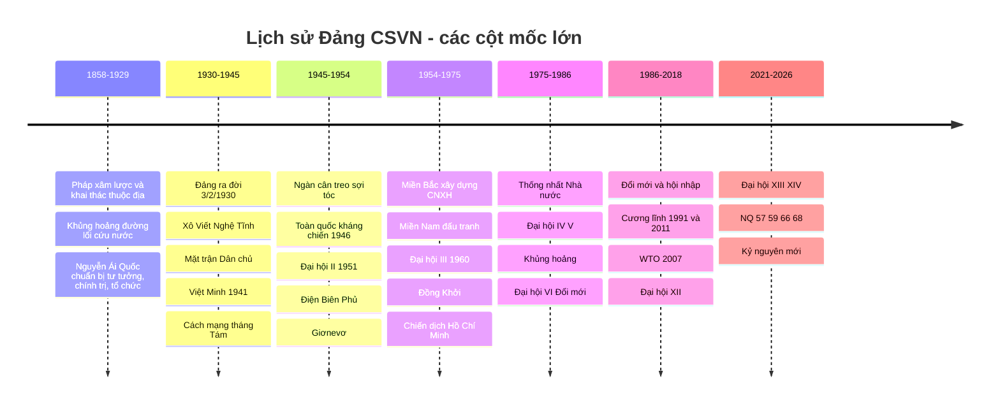
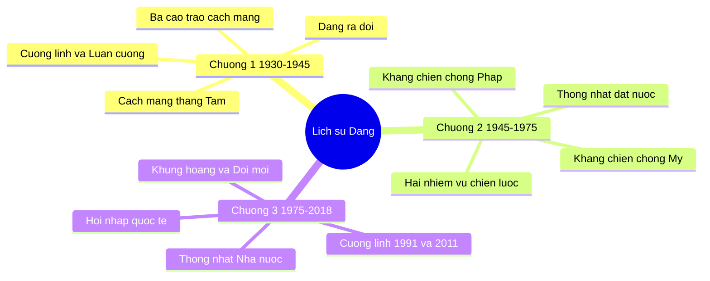

# 📘 BỘ KIẾN THỨC ÔN TẬP LỊCH SỬ ĐẢNG CỘNG SẢN VIỆT NAM (BẢN ĐẦY ĐỦ, TRỰC QUAN)

> **Giáo trình chính:** *Giáo trình Lịch sử Đảng Cộng sản Việt Nam* (dành cho sinh viên khối không chuyên Mác – Lênin, tư tưởng Hồ Chí Minh), Bộ GD&ĐT – NXB Chính trị quốc gia Sự thật, 2021 *(tài liệu chính, bản trực tuyến)*.
> **Cập nhật & liên kết:** Văn kiện Đại hội XII, XIII, XIV; Nghị quyết 57, 68 (và 59, 66 để hiểu "bộ tứ trụ cột"); tác phẩm của Tổng Bí thư Nguyễn Phú Trọng về phòng, chống tham nhũng; tài liệu PCTN của Bộ GD&ĐT (2014); *Chiến tranh cách mạng Việt Nam 1945–1975: thắng lợi và bài học*; *Hồ Chí Minh toàn tập*.
>
> ⚠️ **Lưu ý về độ tin cậy:** các tài liệu dạng PDF/liên kết trong danh sách tài liệu tôi **không mở trực tiếp được toàn văn**. Phần kiến thức được tổng hợp từ cấu trúc giáo trình, hiểu biết lịch sử chuẩn và **tra cứu web các nguồn báo chí/chính thống** (liệt kê ở cuối file). Những điểm có số liệu cụ thể của Đại hội XIV, NQ 57, NQ 68 đã được đối chiếu với nguồn web. Khi thi, **luôn ưu tiên giáo trình và đáp án của giảng viên** nếu có khác biệt.

---

## 🧭 MỤC LỤC

0. [Bản đồ tổng quan toàn môn](#-0-bản-đồ-tổng-quan-toàn-môn)
1. [Nhập môn](#-nhập-môn)
2. [Chương 1 (1930–1945)](#-chương-1)
3. [Chương 2 (1945–1975)](#-chương-2)
4. [Chương 3 (1975–2018)](#-chương-3)
5. [Chương mở rộng: Từ 2018 đến Đại hội XIV (2026)](#-chương-mở-rộng)
6. [Phụ lục A – Giải quyết các câu cần đối chiếu (Phụ lục B cũ)](#-phụ-lục-a)
7. [Phụ lục B – Bảng đáp án nhanh 90 câu](#-phụ-lục-b)
8. [Phụ lục C – Ma trận liên kết nguồn tài liệu](#-phụ-lục-c)
9. [Phụ lục D – Checklist & chiến lược thi](#-phụ-lục-d)
10. [Nguồn tra cứu](#-nguồn-tra-cứu)

---

# 🗺️ 0. BẢN ĐỒ TỔNG QUAN TOÀN MÔN

## 0.1 Trục thời gian lớn

## 0.2 Bản đồ tư duy ba chương của giáo trình

## 0.3 Bảng các Đại hội đại biểu toàn quốc (PHẢI THUỘC)

| Đại hội | Thời gian – địa điểm | Dấu ấn chính |
|---|---|---|
| **Hội nghị hợp nhất** | 1930, Cửu Long (Hồng Kông) | Thành lập Đảng; Chính cương vắn tắt, Sách lược vắn tắt, Chương trình tóm tắt, Điều lệ vắn tắt |
| **I** | 3/1935, Ma Cao | Phục hồi hệ thống tổ chức; **Lê Hồng Phong** làm Tổng Bí thư |
| **II** | 2/1951, Tuyên Quang | **"Đại hội kháng chiến thắng lợi"**; Đảng ra hoạt động công khai (Đảng Lao động VN); CNXH qua **3 giai đoạn** |
| **III** | 5–10/9/1960, **Hà Nội** | Hoàn chỉnh đường lối chung xây dựng CNXH ở miền Bắc; **2 nhiệm vụ chiến lược**; Kế hoạch 5 năm lần thứ nhất (1961–1965) |
| **IV** | 14–20/12/1976, Hà Nội | **Đổi tên Đảng → Đảng Cộng sản Việt Nam**; Kế hoạch 5 năm 1976–1980 |
| **V** | 3/1982 | **Nông nghiệp là mặt trận hàng đầu**; 2 nhiệm vụ chiến lược |
| **VI** | 12/1986 | **Đại hội Đổi mới** |
| **VII** | 6/1991 | **Cương lĩnh xây dựng đất nước trong thời kỳ quá độ lên CNXH (1991)** – 6 đặc trưng |
| **VIII** | 6/1996 | Kết thúc thời kỳ khủng hoảng; đẩy mạnh **công nghiệp hóa, hiện đại hóa**; tăng trưởng gắn tiến bộ, công bằng xã hội |
| **IX** | 4/2001 | **Chính thức nêu mô hình kinh tế thị trường định hướng XHCN** |
| **X** | 4/2006 | Cho phép **đảng viên làm kinh tế tư nhân**; xây dựng, chỉnh đốn Đảng |
| **XI** | 1/2011 | **Cương lĩnh bổ sung, phát triển 2011** – 8 đặc trưng |
| **XII** | 1/2016 | Đẩy mạnh xây dựng, chỉnh đốn Đảng; **NQ TW4 khóa XII (30/10/2016)** ngăn chặn suy thoái, "tự diễn biến", "tự chuyển hóa" |
| **XIII** | 25/1–2/2/2021 | Lần đầu đề ra **mục tiêu 2025, 2030 và tầm nhìn 2045** |
| **XIV** | **19–23/1/2026**, Hà Nội | Tô Lâm tái cử Tổng Bí thư; mục tiêu **tăng trưởng ≥ 10%/năm 2026–2030**; chủ đề *Đoàn kết – Dân chủ – Kỷ cương – Đột phá – Phát triển* |

## 0.4 Các Tổng Bí thư (mốc gần đúng – nên đối chiếu giáo trình)

| Tổng Bí thư | Gắn với |
|---|---|
| **Trần Phú** | Hội nghị TW 10/1930; Luận cương chính trị |
| **Lê Hồng Phong** | Đại hội I (Ma Cao 1935) |
| **Hà Huy Tập** | Thời kỳ Mặt trận Dân chủ (1936–1938) |
| **Nguyễn Văn Cừ** | Chủ trì Hội nghị TW 6 (11/1939) |
| **Trường Chinh** | Từ Hội nghị TW 8 (1941); tác giả *Kháng chiến nhất định thắng lợi*; Đại hội II |
| **Lê Duẩn** | Bí thư thứ nhất (Đại hội III 1960); Tổng Bí thư 1976–1986 |
| **Nguyễn Văn Linh** | Đại hội VI (Đổi mới) |
| **Đỗ Mười – Lê Khả Phiêu – Nông Đức Mạnh** | Đại hội VII, VIII, IX, X |
| **Nguyễn Phú Trọng** | Từ Đại hội XI (2011) đến 19/7/2024; Trưởng Ban Chỉ đạo TW về PCTN |
| **Tô Lâm** | Từ 2024; **tái cử tại Đại hội XIV (1/2026)** |

## 0.5 Bảng giải thích viết tắt

| Viết tắt | Nghĩa |
|---|---|
| TBT | Tổng Bí thư |
| TW | Trung ương |
| QTCS | Quốc tế Cộng sản |
| CNXH | Chủ nghĩa xã hội |
| CNH, HĐH | Công nghiệp hóa, hiện đại hóa |
| MTDTGPMNVN | Mặt trận Dân tộc giải phóng miền Nam Việt Nam |
| PCTN | Phòng, chống tham nhũng |

---

# 📖 NHẬP MÔN
## ĐỐI TƯỢNG, CHỨC NĂNG, NHIỆM VỤ, PHƯƠNG PHÁP NGHIÊN CỨU, HỌC TẬP LỊCH SỬ ĐẢNG

| Nội dung | Ý chính |
|---|---|
| **Đối tượng** | Sự ra đời của Đảng; quá trình Đảng lãnh đạo cách mạng; hệ thống đường lối, chủ trương, chính sách qua các giai đoạn |
| **Chức năng** | **Nhận thức** (cung cấp tri thức, bài học kinh nghiệm); **giáo dục** (truyền thống, niềm tin, lý tưởng); **dự báo**; **phê phán** (đấu tranh với quan điểm sai trái) |
| **Nhiệm vụ** | Làm rõ sự ra đời tất yếu của Đảng; hệ thống hóa đường lối; tổng kết thắng lợi, hạn chế, bài học |
| **Phương pháp** | **Phương pháp lịch sử** (tái hiện tiến trình sự kiện) + **phương pháp logic** (khái quát bản chất, quy luật); kết hợp với các phương pháp liên ngành |

💡 **Mẹo nhớ:** *Lịch sử* = "kể đúng, đủ, theo thời gian"; *Logic* = "rút bản chất, quy luật".

**Liên hệ với đề cương môn:** môn học yêu cầu hoàn thành **khóa ôn tập trực tuyến trên Coursera và có chứng chỉ** để đủ điều kiện dự thi cuối kỳ (xem Phụ lục C).

---
