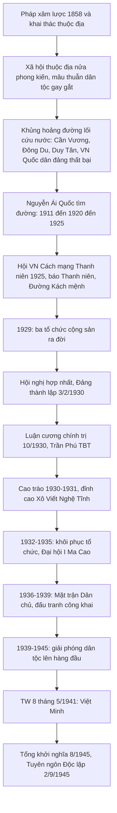

# 📗 CHƯƠNG 1
## ĐẢNG CỘNG SẢN VIỆT NAM RA ĐỜI VÀ LÃNH ĐẠO ĐẤU TRANH GIÀNH CHÍNH QUYỀN (1930 – 1945)

### 1.0 Sơ đồ tổng quan

### 1.1 Bối cảnh lịch sử dẫn đến sự ra đời của Đảng

**a) Thế giới**
- CNTB chuyển từ tự do cạnh tranh sang **chủ nghĩa đế quốc**; các nước thuộc địa bị áp bức nặng nề.
- **Cách mạng tháng Mười Nga thành công (1917)**: mở ra thời đại mới. **Quốc tế Cộng sản ra đời (1919)**: thúc đẩy phong trào cộng sản, và **thức tỉnh phong trào giải phóng dân tộc ở các nước thuộc địa, phụ thuộc** (đúng với đáp án C1-1).

**b) Việt Nam**
- Pháp xâm lược (1858, Đà Nẵng), hoàn thành bình định cuối thế kỷ XIX; Triều Nguyễn đầu hàng (Hiệp ước 1883, 1884) → **xã hội thuộc địa, nửa phong kiến**.
- **Hai cuộc khai thác thuộc địa của Pháp:**

| | Khai thác lần 1 (1897–1914) | Khai thác lần 2 (1919–1929) |
|---|---|---|
| Hệ quả kinh tế | Đầu tư đồn điền, mỏ, giao thông | Đầu tư tăng mạnh, nhưng kinh tế **mất cân đối, lạc hậu, nghèo nàn, lệ thuộc Pháp** |
| Hệ quả xã hội | **Giai cấp công nhân Việt Nam ra đời** | Công nhân tăng nhanh số lượng; phân hóa các giai cấp, tầng lớp |

- **Phân tích giai cấp:** địa chủ (phản động một bộ phận), nông dân (đông nhất, bị bóc lột nặng), **công nhân** (bị ba tầng áp bức: đế quốc, tư sản, phong kiến), tư sản (tư sản mại bản – dân tộc), tiểu tư sản (trí thức, học sinh, viên chức).
- **Hai mâu thuẫn cơ bản:** dân tộc VN ↔ thực dân Pháp (chủ yếu); nông dân ↔ địa chủ phong kiến.
- **Đặc điểm giai cấp công nhân VN:** ra đời trước giai cấp tư sản dân tộc; bị ba tầng áp bức; **gắn bó với nông dân**; kế thừa truyền thống yêu nước; **sớm tiếp thu chủ nghĩa Mác – Lênin**; sớm có Đảng tiên phong lãnh đạo.

### 1.2 Phong trào yêu nước cuối XIX – đầu XX và khủng hoảng đường lối

| Khuynh hướng | Đại diện | Kết quả |
|---|---|---|
| Phong kiến (Cần Vương), nông dân (Yên Thế) | Hàm Nghi – Tôn Thất Thuyết; Hoàng Hoa Thám | Thất bại |
| Dân chủ tư sản | Phan Bội Châu (Đông Du), Phan Châu Trinh (Duy Tân), VN Quốc dân đảng (Yên Bái 1930) | Thất bại – **khủng hoảng về đường lối** |
| **Vô sản** | **Nguyễn Ái Quốc** | **Thắng lợi** |

### 1.3 Nguyễn Ái Quốc chuẩn bị về tư tưởng, chính trị, tổ chức

| Năm | Sự kiện |
|---|---|
| 5/6/1911 | Ra đi tìm đường cứu nước từ bến Nhà Rồng |
| 1919 | Gửi *Yêu sách của nhân dân An Nam* tới Hội nghị Véc-xây |
| 7/1920 | Đọc *Sơ thảo lần thứ nhất những luận cương về vấn đề dân tộc và thuộc địa* của Lênin → tìm thấy con đường cứu nước |
| 12/1920 | Đại hội Tua, tán thành QTCS, tham gia sáng lập **Đảng Cộng sản Pháp** |
| 1921–1923 | Hội Liên hiệp thuộc địa; báo *Người cùng khổ* (Le Paria) |
| 1923–1924 | Sang Liên Xô, dự Đại hội V QTCS |
| 6/1925 | Thành lập **Hội Việt Nam Cách mạng Thanh niên** (Quảng Châu); báo *Thanh niên* |
| 1927 | Tác phẩm **Đường Kách mệnh** |

**Tư tưởng cốt lõi chuẩn bị:** cách mạng giải phóng dân tộc theo **con đường cách mạng vô sản**; cần có **Đảng Cộng sản** lãnh đạo; lực lượng là **toàn dân tộc** trên nền tảng liên minh công – nông; gắn với cách mạng thế giới.

### 1.4 Ba tổ chức cộng sản năm 1929 và Hội nghị hợp nhất

| Tổ chức | Thời gian | Ghi chú |
|---|---|---|
| **Đông Dương Cộng sản Đảng** | 6/1929 | **Tổ chức cộng sản ra đời đầu tiên** (Bắc Kỳ) |
| An Nam Cộng sản Đảng | 8/1929 | Nam Kỳ |
| Đông Dương Cộng sản Liên đoàn | 9/1929 | Trung Kỳ |

- Ba tổ chức hoạt động **riêng rẽ, tranh giành ảnh hưởng** → nguy cơ chia rẽ → yêu cầu cấp bách **hợp nhất**.
- **Nguyễn Ái Quốc** chủ trì Hội nghị hợp nhất ở **Cửu Long (Hương Cảng, Trung Quốc)**. *(Hội nghị họp từ ngày **6/1 đến 7/2/1930**; ngày **3/2/1930** được quyết định lấy làm **Ngày thành lập Đảng**; việc một số tài liệu ghi gộp "3–7/2/1930" là chưa chính xác).*
- Thông qua: **Chính cương vắn tắt, Sách lược vắn tắt, Chương trình tóm tắt, Điều lệ vắn tắt** → **Cương lĩnh chính trị đầu tiên**.

### 1.5 Nội dung Cương lĩnh chính trị đầu tiên (2/1930)

| Nội dung | Chi tiết |
|---|---|
| **Phương hướng chiến lược** | Tiến hành **"tư sản dân quyền cách mạng và thổ địa cách mạng để đi tới xã hội cộng sản"** |
| **Nhiệm vụ** | Đánh đổ đế quốc Pháp, phong kiến, tư sản phản cách mạng; làm cho nước Việt Nam **độc lập tự do** |
| **Lãnh đạo** | Đảng Cộng sản – đội tiên phong của giai cấp vô sản |
| **Lực lượng** | **Công – nông làm gốc**; liên minh với tiểu tư sản, trí thức, trung nông; **lợi dụng hoặc trung lập** phú nông, trung – tiểu địa chủ, tư sản dân tộc chưa rõ mặt phản cách mạng |
| **Quan hệ quốc tế** | Cách mạng VN là một bộ phận của cách mạng thế giới |
| **Đánh giá** | Đường lối đúng đắn, sáng tạo, **độc lập tự chủ**, kết hợp dân tộc và giai cấp; đặt nhiệm vụ giải phóng dân tộc lên hàng đầu |

### 1.6 Luận cương chính trị (10/1930) và so sánh với Cương lĩnh

- **Hội nghị BCHTW lần thứ nhất (10/1930, Hương Cảng)**: đổi tên Đảng thành **Đảng Cộng sản Đông Dương**; thông qua Luận cương do **Trần Phú** soạn thảo; **Trần Phú làm Tổng Bí thư**; quyết định thủ tiêu các văn kiện cũ (Chánh cương, Sách lược, Điều lệ vắn tắt).

| Tiêu chí | **Cương lĩnh (2/1930)** | **Luận cương (10/1930)** |
|---|---|---|
| Người soạn | Nguyễn Ái Quốc | Trần Phú |
| Phương hướng | Tư sản dân quyền → xã hội cộng sản | **Hai giai đoạn:** tư sản dân quyền → XHCN (bỏ qua tư bản) |
| Nhiệm vụ | Đánh đế quốc và phong kiến; **nêu cao giải phóng dân tộc** | Đánh phong kiến và đế quốc – **hai nhiệm vụ gắn khăng khít**, nhưng **chưa nêu mâu thuẫn dân tộc lên hàng đầu** |
| Lực lượng | **Rộng:** công nông + liên minh tiểu tư sản, trí thức, trung nông, **lợi dụng/trung lập** tư sản dân tộc, trung tiểu địa chủ | **Hẹp:** chủ yếu **công nhân và nông dân**; **đánh giá không đúng khả năng** của tiểu tư sản, tư sản dân tộc, trung tiểu địa chủ |
| Lãnh đạo | Đảng của giai cấp vô sản | Đảng của giai cấp vô sản |
| Quan hệ quốc tế | Có | Có |
| Điểm yếu | – | Nặng đấu tranh giai cấp, nhận thức giáo điều, chịu ảnh hưởng khuynh hướng "tả" của QTCS |

**Sau đó:** Ban Thường vụ TW có **Chỉ thị về vấn đề thành lập Hội "Phản đế đồng minh" (11/1930)** nhằm sửa chữa nhược điểm, nhấn mạnh đoàn kết dân tộc rộng rãi.

✅ **Ý nghĩa sự ra đời của Đảng:** chấm dứt cuộc **khủng hoảng về đường lối cứu nước**; cách mạng VN có đường lối đúng, có **đội tiên phong lãnh đạo**; là bước ngoặt vĩ đại. Nguyễn Ái Quốc đánh giá đó là *"một bước ngoặt vô cùng quan trọng trong lịch sử cách mạng Việt Nam ta"* (C1-7).

### 1.7 Cao trào cách mạng 1930 – 1931 và Xô Viết Nghệ Tĩnh

- **Nguyên nhân:** khủng hoảng kinh tế thế giới (1929–1933); Pháp tăng thuế, đàn áp; **Đảng lãnh đạo**.
- **Diễn biến:** từ **1/5/1930** bãi công, biểu tình lan rộng; **12/9/1930** biểu tình nông dân Hưng Nguyên (Nghệ An), bị Pháp ném bom; ở Nghệ – Tĩnh, **chính quyền địch tan rã**, chính quyền công – nông kiểu Xô Viết ra đời (**Xô Viết Nghệ Tĩnh**).
- **Hình thức:** bí mật, **bạo lực**, vũ trang; kẻ thù: **đế quốc và phong kiến**.
- **Ý nghĩa:** khẳng định đường lối đúng; **"cuộc tập dượt đầu tiên"**; khối liên minh công nông được hình thành; rèn luyện lực lượng cho CMT8.

### 1.8 Giai đoạn 1932 – 1935: phục hồi tổ chức

- Địch **khủng bố trắng**, nhiều đảng viên bị bắt; phong trào thoái trào.
- **Chương trình hành động của Đảng Cộng sản Đông Dương (6/1932)**: đòi các quyền **tự do tổ chức, ngôn luận, báo chí, đi lại**; bãi bỏ thuế thân, giảm sưu thuế…
- **Đại hội đại biểu toàn quốc lần thứ I (3/1935, Ma Cao)**: kiện toàn tổ chức; **Lê Hồng Phong** làm Tổng Bí thư; ba nhiệm vụ: củng cố – phát triển Đảng; thu phục quần chúng; chống chiến tranh đế quốc.
- ⇒ Giai đoạn **phục hồi hệ thống tổ chức của Đảng** (C1-13).

### 1.9 Thời kỳ 1936 – 1939: đấu tranh dân chủ

| Nội dung | Chi tiết |
|---|---|
| **Bối cảnh** | Nguy cơ phát xít, chiến tranh; **Đại hội VII QTCS (7/1935)** chủ trương Mặt trận nhân dân; Mặt trận Bình dân Pháp lên cầm quyền (1936) |
| **Hội nghị TW (7/1936, Thượng Hải)** | Xác định kẻ thù trước mắt: **phản động thuộc địa Pháp và tay sai**; nhiệm vụ: **chống phát xít, chống chiến tranh, đòi tự do dân chủ, cơm áo, hòa bình**; lập **Mặt trận Nhân dân phản đế Đông Dương** (sau đổi thành **Mặt trận Dân chủ Đông Dương**, 3/1938) |
| **Phương pháp** | Kết hợp **công khai – nửa công khai – bí mật**; hợp pháp và bất hợp pháp; **đấu tranh nghị trường, báo chí** |
| **Phong trào tiêu biểu** | Phong trào **Đông Dương Đại hội** (1936); đón phái viên Gô-đa; mít tinh 1/5/1938; báo chí công khai (*Tin tức, Dân chúng, Lao động…*); sách *Vấn đề dân cày* |
| **Ý nghĩa** | **"Cuộc tập dượt lần thứ hai"**; tư tưởng và tổ chức; rèn luyện đội ngũ |

📌 **Phân biệt phương pháp 1930–31 và 1936–39:** bí mật, vũ trang, bạo lực ↔ **công khai, nửa công khai, nghị trường, báo chí** (C1-15).

### 1.10 Thời kỳ 1939 – 1945: chuyển hướng chiến lược và Cách mạng tháng Tám

**a) Bối cảnh:** **1/9/1939** Chiến tranh thế giới thứ II bùng nổ (C1-17); Pháp phát xít hóa bộ máy; Nhật vào Đông Dương (9/1940).

**b) Ba hội nghị chuyển hướng chiến lược**

| Hội nghị | Thời gian – địa điểm | Nội dung then chốt |
|---|---|---|
| **TW 6** | 11/1939, Bà Điểm – Hóc Môn (Nguyễn Văn Cừ chủ trì) | **Đặt nhiệm vụ giải phóng dân tộc lên hàng đầu**; **tạm gác khẩu hiệu cách mạng ruộng đất**; thành lập **Mặt trận dân tộc thống nhất phản đế Đông Dương**; chuyển sang đấu tranh bí mật, bất hợp pháp |
| **TW 7** | 11/1940, Đình Bảng – Bắc Ninh | Kẻ thù: Pháp và phát xít Nhật; chủ trương vũ trang bạo động; khẩu hiệu đánh Pháp đuổi Nhật |
| **TW 8** | **10–19/5/1941**, Pác Bó (Cao Bằng), **Nguyễn Ái Quốc chủ trì** | **Hoàn chỉnh** chuyển hướng; **thành lập Việt Minh (19/5/1941)**; xác định chính quyền sau cách mạng là **Nhà nước VNDCCH**; **chuẩn bị khởi nghĩa là nhiệm vụ trung tâm** |

**c) Luận điểm nổi tiếng của TW 8** (đáp án C1-20 → Hội nghị TW 8, tháng 5/1941):
> *Quyền lợi của bộ phận, của giai cấp phải đặt dưới sự sinh tử, tồn vong của quốc gia, dân tộc; nếu không giải quyết được vấn đề dân tộc giải phóng, không đòi được độc lập tự do cho toàn thể dân tộc thì quyền lợi của bộ phận, giai cấp đến vạn năm cũng không đòi lại được.*

**d) Hội nghị TW 8 KHÔNG có nội dung** "chuẩn bị điều kiện để đánh đổ địa chủ, chia ruộng đất cho dân cày" như nhiệm vụ trước mắt (vì tạm gác khẩu hiệu ruộng đất) – đáp án C1-22.

**e) Đường tới Tổng khởi nghĩa**

| Mốc | Sự kiện |
|---|---|
| 9/3/1945 | Nhật đảo chính Pháp |
| 12/3/1945 | Chỉ thị **"Nhật – Pháp bắn nhau và hành động của chúng ta"** → cao trào kháng Nhật cứu nước |
| 13/8/1945 | **Quân lệnh số 1**, Ủy ban Khởi nghĩa toàn quốc |
| 14–15/8 | Hội nghị toàn quốc của Đảng (Tân Trào) |
| 16–17/8 | **Quốc dân Đại hội Tân Trào** |
| 19/8 | Giành chính quyền ở **Hà Nội** |
| 23/8 – 25/8 | Huế – Sài Gòn |
| **2/9/1945** | **Tuyên ngôn Độc lập**, nước VNDCCH ra đời |

**f) Nguyên nhân thắng lợi, ý nghĩa, bài học**
- **Nguyên nhân:** truyền thống yêu nước; **Đảng lãnh đạo** với đường lối đúng; **Mặt trận Việt Minh**; chớp **thời cơ** (Nhật đầu hàng).
- **Ý nghĩa:** phá xiềng thực dân – phong kiến; lập nên **nhà nước dân chủ nhân dân** đầu tiên; mở kỷ nguyên độc lập, tự do; cổ vũ phong trào giải phóng dân tộc thế giới.
- **Bài học:** giữ vững độc lập dân tộc; **toàn dân đoàn kết**; kết hợp lực lượng chính trị và vũ trang; **nắm bắt thời cơ**; xây dựng Đảng.

### 1.11 Bảng so sánh tổng hợp ba cao trào

| | 1930 – 1931 | 1936 – 1939 | 1939 – 1945 |
|---|---|---|---|
| Mục tiêu | Độc lập – ruộng đất | Dân sinh – dân chủ | **Giải phóng dân tộc** (ruộng đất tạm gác) |
| Kẻ thù | Đế quốc + phong kiến | Phản động thuộc địa + tay sai | Pháp – Nhật |
| Hình thức | Bí mật, bạo lực | Công khai, nửa công khai, nghị trường | Bí mật → khởi nghĩa vũ trang |
| Mặt trận | – | Mặt trận Dân chủ Đông Dương | **Việt Minh** |
| Ý nghĩa | Tập dượt lần 1 | Tập dượt lần 2 | **Tổng diễn tập → thắng lợi** |

### 1.12 💡 Mẹo nhớ Chương 1
- **Công nhân VN ra đời từ khai thác lần 1**; lần 2 làm kinh tế **mất cân đối**.
- **Trần Phú** (10/1930) → **Lê Hồng Phong** (Đại hội I 1935).
- 1930–31 **bạo lực**; 1936–39 **nghị trường, báo chí**; 1939–45 **giải phóng dân tộc lên hàng đầu**.
- **TW 6 (11/1939) tạm gác ruộng đất; TW 8 (5/1941) hoàn chỉnh + Việt Minh.**
- Ba tổ chức cộng sản 1929: **Bắc – Nam – Trung = ĐDCSĐ – ANCSĐ – ĐDCS Liên đoàn.**

### 1.13 📝 Ngân hàng câu hỏi – Chương 1 (22 câu)

**C1-1.** Cách mạng tháng Mười Nga thành công (1917) và Quốc tế Cộng sản ra đời (1919) có ý nghĩa
A. Đánh dấu sự thành công của cách mạng vô sản trên thế giới · B. Thức tỉnh phong trào đấu tranh của giai cấp công nhân ở các nước đế quốc · C. Thúc đẩy cuộc đấu tranh giai cấp ở các nước thuộc địa, phụ thuộc · D. Thức tỉnh phong trào đấu tranh giải phóng dân tộc ở các nước thuộc địa, phụ thuộc
✅ **D**

**C1-2.** Giai cấp công nhân Việt Nam ra đời từ:
A. Cuộc khai thác thuộc địa lần thứ nhất của thực dân Pháp · B. Cuộc khai thác thuộc địa lần thứ hai · C. Cuộc xâm lược lần thứ nhất · D. Cuộc xâm lược lần thứ hai
✅ **A**

**C1-3.** Tác động của chương trình khai thác thuộc địa lần thứ hai của Pháp đến kinh tế Việt Nam làm cho
A. Cơ cấu kinh tế Việt Nam mất cân đối, lạc hậu, nghèo nàn · B. Nền kinh tế phát triển độc lập · C. Kinh tế phát triển một cách tự chủ · D. Kinh tế phụ thuộc kinh tế Pháp
✅ **A**

**C1-4.** Trong phong trào cách mạng nước ta, giai cấp nào sẽ là lực lượng lãnh đạo cách mạng?
A. Nông dân · B. Công nhân · C. Tư sản · D. Tiểu tư sản
✅ **B**

**C1-5.** Tổ chức Cộng sản nào ra đời đầu tiên ở Việt Nam?
A. Hội Việt Nam cách mạng Thanh niên · B. Đông Dương Cộng sản Đảng · C. An Nam Cộng sản Đảng · D. Đông Dương Cộng sản liên đoàn
✅ **B** — ra đời 6/1929; Hội VN Cách mạng Thanh niên (1925) là tổ chức **tiền thân**, chưa phải tổ chức cộng sản.

**C1-6.** Sự kiện lịch sử nào dưới đây diễn ra trong phong trào dân tộc dân chủ ở Việt Nam từ 1925 đến 1930?
A. Bãi công của công nhân Ba Son · B. Bãi công của công nhân Vinh – Bến Thủy · C. Phong trào Đông Dương đại hội · D. Phong trào phá kho thóc của Nhật
✅ **A** — Ba Son (8/1925). Bến Thủy gắn với cao trào 1930; Đông Dương đại hội là 1936; phá kho thóc là 1945.

**C1-7.** Sự kiện nào được Nguyễn Ái Quốc đánh giá "là một bước ngoặt vô cùng quan trọng trong lịch sử Cách mạng Việt Nam ta"?
A. Đảng Cộng sản Việt Nam ra đời · B. Thành lập Đảng Cộng sản Pháp · C. Thành lập Hội Việt Nam Cách mạng thanh niên · D. Nguyễn Ái Quốc tìm thấy con đường cứu nước
✅ **A**

**C1-8.** Tổng Bí thư của Đảng được bầu tại Hội nghị Trung ương tháng 10/1930 là
A. Trần Phú · B. Lê Hồng Phong · C. Hà Huy Tập · D. Nguyễn Văn Cừ
✅ **A**

**C1-9.** Nhiệm vụ của cách mạng Việt Nam được xác định trong Luận cương chính trị tháng 10/1930 do Trần Phú soạn thảo là
A. Đánh đổ phong kiến và đế quốc · B. Giải phóng dân tộc · C. Đánh đổ đế quốc và tay sai · D. Đánh đổ đế quốc Pháp, phong kiến và tư sản phản cách mạng, làm cho nước Việt Nam độc lập tự do
✅ **D** (theo đáp án đề).

**C1-10.** Nội dung nào **không** thuộc Luận cương chính trị tháng 10/1930?
A. Hai giai đoạn: tư sản dân quyền và XHCN · B. Do Đảng của giai cấp vô sản lãnh đạo · C. Cách mạng VN là một bộ phận của cách mạng thế giới · D. Lực lượng để đánh đuổi đế quốc và phong kiến là công nông; đồng thời "phải biết liên lạc với tiểu tư sản, trí thức, trung nông… để kéo họ về phe vô sản giai cấp"
✅ **D** (theo đáp án đề) — ⚠️ xem **Phụ lục A, mục A1** (câu này có vấn đề về nội dung; cách xử lý khi thi được hướng dẫn ở đó).

**C1-11.** Kẻ thù chủ yếu của xã hội Việt Nam trong thời kì 1930–1931 là
A. Thực dân Pháp · B. Địa chủ phong kiến · C. Đế quốc và phong kiến · D. Địa chủ phong kiến, tư sản
✅ **C**

**C1-12.** Phong trào Xô Viết Nghệ Tĩnh được bắt đầu từ ngày tháng năm nào?
A. 1-5-1930 · B. 1-5-1931 · C. 19-5-1930 · D. 19-8-1930
✅ **A**

**C1-13.** Trong lịch sử Đảng, giai đoạn 1932 – 1935 là giai đoạn
A. Chuẩn bị các điều kiện để giành chính quyền · B. Phục hồi hệ thống tổ chức của Đảng · C. Đẩy mạnh phong trào đấu tranh · D. Hợp tác với phong trào nhân dân Pháp
✅ **B**

**C1-14.** Lê Hồng Phong được bầu làm Tổng Bí thư tại Đại hội nào của Đảng?
A. Đại hội II · B. Đại hội III · C. Đại hội I · D. Đại hội IV
✅ **C** — Đại hội I (Ma Cao, 3/1935).

**C1-15.** Điểm khác biệt về phương pháp đấu tranh của thời kì 1936–1939 so với thời kì 1930–1931 là
A. Chính trị và vũ trang · B. Nghị trường và đấu tranh báo chí · C. Đấu tranh chính trị · D. Ngoại giao với vận động quần chúng
✅ **B**

**C1-16.** Một trong những nội dung của chương trình hành động của Đảng Cộng sản Đông Dương là
A. Cải cách ruộng đất · B. Cải cách giáo dục · C. Đòi tự do, bình đẳng · D. Đòi quyền tự do: phát ngôn, tự do đi lại…
✅ **D** — gắn với Chương trình hành động 6/1932 (các quyền tự do tổ chức, ngôn luận, đi lại).

**C1-17.** Chiến tranh thế giới thứ II nổ ra vào thời gian nào?
A. 1937 · B. 1938 · C. 1939 · D. 1940
✅ **C**

**C1-18.** Mặt trận dân tộc thống nhất phản đế Đông Dương được thành lập vào thời gian nào?
A. 10-1930 · B. 5-1935 · C. 11-1939 · D. 5-1941
✅ **C** — Hội nghị TW 6. (5-1941 là thành lập **Việt Minh**.)

**C1-19.** Mối quan hệ giữa hai khẩu hiệu "Độc lập dân tộc" và "Ruộng đất cho dân cày" được giải quyết thế nào trong thời kì 1939–1945?
A. Tạm gác lại khẩu hiệu cách mạng ruộng đất · B. Tạm gác khẩu hiệu giải phóng dân tộc · C. Thực hiện đồng bộ · D. Tạm gác cả hai
✅ **A**

**C1-20.** "Trong lúc này nếu không giải quyết được vấn đề dân tộc giải phóng, không đòi được độc lập tự do cho toàn thể dân tộc, thì chẳng những toàn thể quốc gia dân tộc còn chịu mãi kiếp ngựa trâu mà quyền lợi của bộ phận giai cấp đến vạn năm cũng không đòi lại được". Luận điểm trên được đưa ra tại Hội nghị nào?
A. Hội nghị BCH TW tháng 11/1939 · B. *(đề gốc bị mất nội dung)* · C. Hội nghị BCH TW tháng 5/1941
✅ **C** — ✔️ **Đã xác minh** (Hội nghị TW 8, 10–19/5/1941, Pác Bó). Xem Phụ lục A, mục A2.

**C1-21.** Hội nghị lần thứ 8 BCH TW Đảng Cộng sản Đông Dương (5/1941) quyết định hình thức chính quyền sau cách mạng ở Việt Nam là:
A. Chính phủ cách mạng lâm thời · B. Chính phủ Việt Nam Dân chủ Cộng hòa · C. Chính phủ Xô viết công–nông–binh · D. Chính phủ dân chủ Cộng hòa Đông Dương
✅ **B**

**C1-22.** Nội dung nào **không** có trong Hội nghị Trung ương VIII (5/1941)?
A. Đưa nhiệm vụ giải phóng dân tộc lên hàng đầu · B. Chuẩn bị điều kiện để "đánh đổ địa chủ, chia ruộng đất cho dân cày" · C. Thành lập mặt trận Việt Minh · D. Xác định chuẩn bị khởi nghĩa là nhiệm vụ trung tâm
✅ **B**

---
