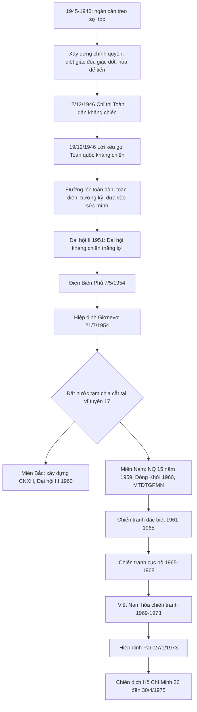

# 📘 CHƯƠNG 2
## ĐẢNG LÃNH ĐẠO HAI CUỘC KHÁNG CHIẾN, HOÀN THÀNH GIẢI PHÓNG DÂN TỘC, THỐNG NHẤT ĐẤT NƯỚC (1945 – 1975)

> 📚 **Nguồn liên kết:** *Chiến tranh cách mạng Việt Nam 1945–1975, thắng lợi và bài học* (Ban chỉ đạo tổng kết chiến tranh, NXB CTQG 2008) và *Hồ Chí Minh toàn tập* (Lời kêu gọi Toàn quốc kháng chiến, thư và diễn văn).

### 2.0 Sơ đồ tổng quan

---
## PHẦN I. KHÁNG CHIẾN CHỐNG THỰC DÂN PHÁP (1945 – 1954)

### 2.1 Xây dựng và bảo vệ chính quyền cách mạng (1945 – 1946)

**Tình thế "ngàn cân treo sợi tóc"** – ngay sau Cách mạng tháng Tám 1945:

| Thuận lợi | Khó khăn ("thù trong, giặc ngoài") |
|---|---|
| Hệ thống XHCN hình thành; phong trào giải phóng dân tộc dâng cao; chính quyền cách mạng; nhân dân phấn khởi | **Giặc ngoại xâm:** quân Tưởng (phía Bắc, kéo theo Việt Quốc – Việt Cách), Anh – Pháp (phía Nam), tàn quân Nhật |
| | **Giặc đói** (nạn đói 1945), **giặc dốt** (hơn 90% dân mù chữ), **tài chính** trống rỗng |
| | Chưa nước nào công nhận nước VNDCCH |

**Kẻ thù chính** (sau CMT8 đến 1954): **thực dân Pháp** (C2-2).

**Chủ trương của Đảng:**
- **Chỉ thị "Kháng chiến kiến quốc" (25/11/1945)**: xác định kẻ thù chính là thực dân Pháp xâm lược; nhiệm vụ cấp bách: **củng cố chính quyền, chống thực dân Pháp xâm lược, bài trừ nội phản, cải thiện đời sống**.
- **Xây dựng chính quyền:** Tổng tuyển cử **6/1/1946**; Quốc hội khóa I; **Hiến pháp 1946** (9/11/1946).
- **Diệt giặc đói:** tăng gia sản xuất, "Tuần lễ vàng", Quỹ độc lập.
- **Diệt giặc dốt:** phong trào **Bình dân học vụ** (C2-4).
- **Mở rộng mặt trận:** Mặt trận **Việt Minh**; sau đó Hội **Liên Việt** (5/1946) (C2-3).
- **Ngoại giao khôn khéo – "hòa để tiến":**
  - **6/3/1946** – **Hiệp định Sơ bộ Việt – Pháp**: Pháp công nhận VN là *quốc gia tự do* trong Liên bang Đông Dương, thuộc khối Liên hiệp Pháp; VN cho 15.000 quân Pháp ra miền Bắc thay quân Tưởng; **hai bên ngừng bắn ở Nam Bộ** → **tạo thời gian chuẩn bị lực lượng đối phó lâu dài** (C2-5).
  - **14/9/1946** – **Tạm ước** Việt – Pháp.
- **Chủ trương "hòa để tiến" kéo dài từ tháng 3 đến 19/12/1946** (C2-6).

### 2.2 Đường lối toàn quốc kháng chiến

- **12/12/1946:** Ban Thường vụ TW ra **Chỉ thị Toàn dân kháng chiến** (C2-7).
- **19/12/1946:** **Lời kêu gọi toàn quốc kháng chiến** của Chủ tịch Hồ Chí Minh (nguồn: *Hồ Chí Minh toàn tập*).
- **1947:** tác phẩm *Kháng chiến nhất định thắng lợi* của TBT **Trường Chinh** (C2-8 lưu ý: câu "*Chúng ta thà hy sinh tất cả, chứ nhất định không chịu mất nước, nhất định không chịu làm nô lệ*" là trong **Lời kêu gọi** của Hồ Chí Minh).

**Nội dung đường lối:**

| Lĩnh vực | Nội dung |
|---|---|
| **Mục tiêu** | **Đánh phản động thực dân Pháp xâm lược, giành thống nhất và độc lập** (C2-9) |
| **Tính chất** | Chiến tranh **chính nghĩa, cách mạng, nhân dân** |
| **Chính trị** | Đoàn kết toàn dân; đoàn kết Việt – Miên – Lào; **toàn dân** |
| **Quân sự** | Chiến tranh nhân dân, **toàn diện**, vũ trang toàn dân; **trường kỳ**; 3 giai đoạn: phòng ngự → cầm cự → tổng phản công |
| **Kinh tế** | Tự cấp, tự túc, phát triển nông nghiệp, thủ công nghiệp, công nghiệp quốc phòng |
| **Văn hóa** | Dân tộc, khoa học, đại chúng |
| **Ngoại giao** | Thêm bạn, bớt thù; **dựa vào sức mình là chính** |
| **Triển vọng** | *"Tuy lâu dài, gian khổ, khó khăn, song nhất định thắng lợi"* (C2-10) |

### 2.3 Chiến dịch lớn và Đại hội II (1951)

| Mốc | Sự kiện |
|---|---|
| 1947 | Chiến dịch Việt Bắc thu – đông (đánh bại kế hoạch đánh nhanh thắng nhanh) |
| 1950 | Chiến dịch Biên giới (thu – đông) – phá thế bao vây, giành thế chủ động |
| **2/1951** | **Đại hội II (Tuyên Quang)** – **"Đại hội kháng chiến thắng lợi"** (C2-12) |
| 1953 | Cải cách ruộng đất (có sai lầm, được sửa sai ở giai đoạn sau) |
| Đông – Xuân 1953–1954 | Chiến cuộc Đông Xuân → **Điện Biên Phủ** |

**Đại hội II (1951):**
- Đưa Đảng ra hoạt động công khai với tên **Đảng Lao động Việt Nam**; TBT **Trường Chinh**.
- Chính cương: tính chất xã hội: dân chủ nhân dân, một phần thuộc địa và nửa phong kiến; ba nhiệm vụ cơ bản: đánh đuổi đế quốc; xóa bỏ tàn tích phong kiến; phát triển chế độ dân chủ nhân dân.
- Con đường lên CNXH: **quá trình đấu tranh lâu dài, đại thể ba giai đoạn** (C2-11).

### 2.4 Điện Biên Phủ và Hiệp định Giơnevơ

- **Điện Biên Phủ (13/3 – 7/5/1954):** đỉnh cao của **kháng chiến chống Pháp** (C2-13); chiến dịch lịch sử, đánh bại kế hoạch Nava.
- **Hội nghị Giơnevơ về Đông Dương (1954):** Pháp phải đàm phán vì **thất bại ở Điện Biên Phủ** (C2-15). Hiệp định ký **21/7/1954** (văn bản ghi 20/7).

**Nội dung Hiệp định Giơnevơ:**

| Nội dung | Chi tiết |
|---|---|
| **Quyền dân tộc cơ bản** | Các nước tham dự cam kết **tôn trọng độc lập, chủ quyền, thống nhất và toàn vẹn lãnh thổ** của Việt Nam (C2-16) |
| Quân sự | Ngừng bắn; **tập kết, chuyển quân**; giới tuyến quân sự tạm thời tại **vĩ tuyến 17** (C2-17) |
| Chính trị | **Tổng tuyển cử tự do thống nhất đất nước** (dự kiến 7/1956); Ủy ban quốc tế giám sát |
| Phía Mỹ | **Không ký** Tuyên bố cuối cùng của Hội nghị, về sau phá hoại Hiệp định |

**Ý nghĩa thắng lợi chống Pháp:** chấm dứt chiến tranh xâm lược và ách thống trị của thực dân Pháp; **miền Bắc hoàn toàn giải phóng**, chuyển sang cách mạng XHCN; cổ vũ phong trào giải phóng dân tộc thế giới.

**Kháng chiến chống Pháp kết thúc bằng giải pháp chính trị – ngoại giao** (C2-14).

**Nguyên nhân thắng lợi / bài học (tóm tắt):** sự lãnh đạo đúng đắn của Đảng (đường lối chính trị, quân sự đúng); sức mạnh đoàn kết toàn dân; hậu phương vững; kết hợp sức mạnh dân tộc với sức mạnh thời đại; giữ vững độc lập tự chủ; xây dựng Đảng.

---
## PHẦN II. KHÁNG CHIẾN CHỐNG MỸ, CỨU NƯỚC (1954 – 1975)

### 2.5 Đặc điểm nước ta sau 1954

**Đặc điểm nổi bật:** đất nước **tạm chia thành hai miền, hai chế độ**, Đảng **tiến hành đồng thời hai chiến lược cách mạng**:
- **Cách mạng XHCN ở miền Bắc** – nhiệm vụ quyết định nhất đối với phát triển của toàn bộ cách mạng.
- **Cách mạng dân tộc dân chủ nhân dân ở miền Nam** – nhiệm vụ quyết định trực tiếp đối với sự nghiệp giải phóng miền Nam, thống nhất Tổ quốc.

✅ (C2-18) → phương án **D**.

### 2.6 Đại hội III (1960) và đường lối chung

- **Họp tại Hà Nội, 5 – 10/9/1960** (C2-19).
- Hoàn chỉnh **đường lối chiến lược chung của cách mạng cả nước** trong giai đoạn mới (C2-20): đây là đại hội đề cập **đường lối chung xây dựng CNXH ở miền Bắc**.
- **Hai nhiệm vụ chiến lược** (C2-21):
  1. Tiến hành **cách mạng XHCN ở miền Bắc**.
  2. **Giải phóng miền Nam** khỏi ách thống trị của đế quốc Mỹ và tay sai, thực hiện thống nhất nước nhà, hoàn thành độc lập và dân chủ trong cả nước.
- **Kế hoạch Nhà nước 5 năm lần thứ nhất (1961 – 1965)** – thành tựu: giá trị sản lượng công nghiệp nặng năm 1965 tăng gấp 3 lần so với 1960; công nghiệp quốc doanh chiếm 93% tổng giá trị sản lượng công nghiệp toàn miền Bắc; công nghiệp nhẹ, thủ công giải quyết ~80% hàng tiêu dùng thiết yếu. **Không** phải thành tựu: "thương nghiệp tư nhân được ưu tiên phát triển" (C2-22 – sai vì Nhà nước **cải tạo, hạn chế** tư nhân, không ưu tiên).

### 2.7 Miền Nam 1954 – 1960: từ giữ gìn lực lượng đến Đồng Khởi

**a) Mỹ – Diệm phá hoại Hiệp định Giơnevơ**
- **Ngăn cản hiệp thương, tổng tuyển cử** (1955 – 1956); lập chính quyền Ngô Đình Diệm (1955), "trưng cầu dân ý" 23/10/1955, ban hành "hiến pháp" riêng (10/1956).
- Chính sách **"tố cộng, diệt cộng"**; **Luật 10/59 (6/5/1959)** – lê máy chém khắp miền Nam.
- Đây là lý do C2-23 (đáp án đề: **A**; xem Phụ lục A, mục A3).

**b) Đường lối cách mạng miền Nam**
- 1954 – 1959: Đảng chủ trương **đấu tranh chính trị, giữ gìn lực lượng**, đòi thi hành Hiệp định.
- **Hội nghị TW 15 (1/1959)** (C2-24, C2-25): **quyết định để nhân dân miền Nam dùng bạo lực cách mạng đánh đổ chính quyền Mỹ – Diệm**; con đường cơ bản là **khởi nghĩa giành chính quyền về tay nhân dân**, kết hợp lực lượng chính trị với lực lượng vũ trang.

**c) Phong trào Đồng Khởi (1959 – 1960)**

| Nội dung | Chi tiết |
|---|---|
| Nguyên nhân | Luật 10/59 + NQ 15 |
| Khởi đầu | Khởi nghĩa Vĩnh Thạnh (Bình Định), Bắc Ái (Ninh Thuận), Trà Bồng (Quảng Ngãi) (1959) → **bùng nổ ngày 17/1/1960 tại Mỏ Cày (Bến Tre)** (Định Thủy, Phước Hiệp, Bình Khánh) → lan ra Nam Bộ, Tây Nguyên, Trung Trung Bộ |
| Kết quả cuối 1960 | Làm chủ **600/1.298 xã** ở Nam Bộ; **3.200/5.721 thôn** Tây Nguyên; **904/3.829 thôn** Trung Trung Bộ |
| **Ý nghĩa** | Giáng đòn nặng nề vào chính sách thực dân mới của Mỹ; **làm lung lay tận gốc chính quyền Ngô Đình Diệm**; **chuyển cách mạng miền Nam từ thế giữ gìn lực lượng sang thế tiến công**; dẫn đến sự ra đời của **MTDTGPMNVN** |

- **20/12/1960:** thành lập **Mặt trận Dân tộc giải phóng miền Nam Việt Nam** tại **Tây Ninh** (C2-29).
- (C2-26) Sự kiện làm bùng nổ Đồng Khởi: **Luật 10/59**. (C2-28) Khởi nghĩa vũ trang đầu tiên (theo đề): **Bình Định**.
- (C2-27) Ý nghĩa quan trọng nhất: **chuyển sang thế tiến công** – xem Phụ lục A, mục A4.

### 2.8 Các chiến lược chiến tranh của Mỹ

| Chiến lược | Thời gian | Đặc điểm | Thất bại của Mỹ |
|---|---|---|---|
| **Chiến tranh đặc biệt** | **1961 – 1965** (C2-30) | Dùng **quân đội Sài Gòn** là chủ yếu, cố vấn Mỹ, vũ khí Mỹ; **ấp chiến lược** | Ấp Bắc (1/1963), phong trào đô thị, đảo chính 1/11/1963, **Bình Giã 1964** → phá sản |
| **Chiến tranh cục bộ** | 1965 – 1968 | Quân Mỹ + chư hầu trực tiếp chiến đấu; "tìm diệt", "bình định" | Núi Thành, Vạn Tường (8/1965); **Tổng tiến công Tết Mậu Thân 1968** → "phi Mỹ hóa" |
| **Việt Nam hóa chiến tranh** | 1969 – 1973 | Dùng quân Sài Gòn là chủ yếu, Mỹ rút dần | Thất bại; **Hiệp định Pari (27/1/1973)** |

**Hội nghị TW 11 (3/1965) và 12 (12/1965)** (C2-31): quyết tâm đánh thắng chiến tranh cục bộ; **khẩu hiệu chung: "Tất cả để đánh thắng giặc Mỹ xâm lược"** (đáp án A).

### 2.9 1973 – 1975: giải phóng miền Nam

- **Hội nghị TW 21 (7/1973):** khẳng định con đường cách mạng miền Nam là bạo lực cách mạng.
- **Chủ trương của Bộ Chính trị (12/1974 – 1/1975):** giải phóng miền Nam trong 2 năm 1975 – 1976, nếu thời cơ đến sớm thì làm ngay trong 1975.
- **Chiến dịch Tây Nguyên (3/1975)** (mở màn Buôn Ma Thuột 10/3) → **Huế – Đà Nẵng** → **Chiến dịch Hồ Chí Minh (26 – 30/4/1975)** (C2-33) → **30/4/1975** miền Nam hoàn toàn giải phóng.

### 2.10 Ý nghĩa, nguyên nhân thắng lợi và bài học kháng chiến chống Mỹ

- **Cuộc đụng đầu lịch sử** vì phản ánh tập trung những **mâu thuẫn cơ bản của thời đại** (C2-32).
- **Nhân tố hàng đầu** bảo đảm thắng lợi: **sự lãnh đạo của Đảng với đường lối cách mạng đúng đắn, sáng tạo, độc lập tự chủ** (C2-34).
- **Các bài học (khái quát theo giáo trình và tổng kết chiến tranh):** giương cao ngọn cờ **độc lập dân tộc gắn liền với CNXH**; kiên định quyết tâm đánh thắng đế quốc Mỹ; chiến tranh nhân dân sáng tạo; xây dựng hậu phương – tiền tuyến; kết hợp sức mạnh dân tộc với sức mạnh thời đại; coi trọng xây dựng Đảng.
- (C2-35) Lưu ý: bài học **"độc lập dân tộc và CNXH"** – xem Phụ lục A, mục A5.

### 2.11 💡 Mẹo nhớ Chương 2
- **"Hòa để tiến"** = 3/1946 – 12/1946 (kết thúc 19/12/1946).
- **12/12/1946 = Chỉ thị**; **19/12/1946 = Lời kêu gọi**.
- **Đồng Khởi:** Luật 10/59 → NQ 15 → 17/1/1960 Bến Tre → MTDTGPMN (20/12/1960, Tây Ninh).
- **Chiến tranh đặc biệt 1961–1965** → **cục bộ 1965–1968** → **Việt Nam hóa 1969–1973**.
- **Đại hội III họp ở Hà Nội** (khác Đại hội II ở Tuyên Quang).
- Giơnevơ: **vĩ tuyến 17**, **tổng tuyển cử 7/1956**.

### 2.12 📝 Ngân hàng câu hỏi – Chương 2 (35 câu)

#### 🔹 Giai đoạn 1945–1954 (kháng chiến chống Pháp)

**C2-1.** Tình hình nước ta được ví như "ngàn cân treo sợi tóc" vào thời gian nào?
A. Ngay sau Cách mạng Tháng Tám 1945 thành công · B. Trước Cách mạng Tháng Tám · C. Ngay sau kháng chiến chống Mỹ thắng lợi 1975 · D. Ngay sau Hiệp định Pari 1973
✅ **A**

**C2-2.** Sau Cách mạng tháng Tám đến 1954, kẻ thù chính của nhân dân Việt Nam là
A. Pháp · B. Anh · C. Mỹ · D. Trung Quốc
✅ **A**

**C2-3.** Sau khi giành chính quyền, Đảng chủ trương mở rộng mặt trận nào để tập trung ngọn lửa đấu tranh chống Pháp?
A. Mặt trận Việt Minh · B. Mặt trận Liên Việt · C. Mặt trận Dân chủ · D. Mặt trận Tổ quốc Việt Nam
✅ **A** (theo đáp án đề).

**C2-4.** Phong trào mà Đảng vận động nhân dân chống nạn mù chữ sau CMT8 1945 là
A. Xây dựng nếp sống văn hoá mới · B. Bình dân học vụ · C. Bài trừ các tệ nạn xã hội · D. Xoá bỏ văn hoá thực dân nô dịch phản động
✅ **B**

**C2-5.** Nội dung nào trong Hiệp định Sơ bộ 6-3-1946 tạo điều kiện cho ta có thời gian chuẩn bị lực lượng đối phó lâu dài với Pháp?
A. Pháp công nhận VN là quốc gia tự do trong Liên hiệp Pháp · B. Pháp đưa 15 ngàn quân ra miền Bắc thay quân Tưởng · C. Hai bên ngừng bắn ở Nam Bộ · D. Hai bên thực hiện tập kết, chuyển quân
✅ **C**

**C2-6.** Thời gian từ tháng 3/1946 đến 19/12/1946, Đảng lãnh đạo nhân dân thực hiện chủ trương chiến lược:
A. Hòa để tiến · B. Đối đầu với quân đội Pháp · C. Đối đầu với quân đội Tưởng · D. Giải giáp quân đội Nhật
✅ **A**

**C2-7.** Ngày 12/12/1946, Ban Thường vụ Trung ương Đảng đã ra
A. Quân lệnh số 1 · B. Lời kêu gọi Tổng khởi nghĩa · C. Chỉ thị Toàn dân kháng chiến · D. Lời kêu gọi Toàn quốc kháng chiến
✅ **C**

**C2-8.** "Chúng ta thà hy sinh tất cả, chứ nhất định không chịu mất nước, nhất định không chịu làm nô lệ" là đoạn trích trong văn kiện nào?
A. Chỉ thị Toàn dân kháng chiến · B. Lời kêu gọi toàn quốc kháng chiến của Chủ tịch Hồ Chí Minh · C. Kháng chiến nhất định thắng lợi (Trường Chinh) · D. Chỉ thị sửa soạn khởi nghĩa của Tổng bộ Việt Minh
✅ **B**

**C2-9.** Đường lối toàn quốc kháng chiến của Đảng vạch ra mục tiêu của kháng chiến là
A. Đánh phản động thực dân Pháp xâm lược, giành thống nhất và độc lập · B. Đánh phát xít Nhật… · C. Đánh đế quốc Mỹ… · D. Đánh Trung Hoa Dân Quốc…
✅ **A**

**C2-10.** Khi nói về triển vọng của cuộc kháng chiến chống Pháp, Đảng xác định trong Đường lối kháng chiến là
A. Mặc dù lâu dài, gian khổ, khó khăn song nhất định thắng lợi · B. Mặc dù phải hy sinh to lớn… · C. Mặc dù bị bao vây, chưa nước nào công nhận… · D. Nhờ sự hy sinh to lớn…
✅ **A**

**C2-11.** Đại hội Đảng lần thứ II xác định con đường đi lên CNXH là một quá trình:
A. Đấu tranh lâu dài, đại thể trải qua ba giai đoạn · B. Đấu tranh kiên trì, bốn giai đoạn · C. Đấu tranh lâu dài, năm giai đoạn · D. Đấu tranh kiên trì, hai giai đoạn
✅ **A**

**C2-12.** Đại hội nào sau đây được đánh dấu là "Đại hội kháng chiến thắng lợi"?
A. Hội nghị thành lập Đảng 1930 · B. Đại hội Quốc dân ở Tân Trào 1945 · C. Đại hội lần thứ II của Đảng 1951 · D. Đại hội lần thứ III 1960
✅ **C**

**C2-13.** Chiến dịch lịch sử Điện Biên Phủ 1954 là đỉnh cao của
A. Khởi nghĩa chống Pháp · B. Kháng chiến chống Pháp · C. Kháng chiến chống Mĩ · D. Chiến tranh chống Pháp
✅ **B**

**C2-14.** Cuộc kháng chiến chống thực dân Pháp của nhân dân Đông Dương (1953–1954) kết thúc bằng giải pháp
A. Chính trị · B. Quân sự · C. Kinh tế · D. Văn hóa
✅ **A** (theo đáp án đề; ý: kết thúc bằng **thương lượng ngoại giao – Hiệp định Giơnevơ**).

**C2-15.** Pháp chấp nhận đàm phán với Việt Nam ở Hội nghị Giơnevơ 1954 vì
A. Sức ép của Liên Xô · B. Bị thất bại ở Điện Biên Phủ · C. Dư luận thế giới phản đối · D. Sợ Trung Quốc đưa quân sang giúp VN
✅ **B**

**C2-16.** Quyền dân tộc cơ bản của Việt Nam trong Hiệp định Giơnevơ 1954 là gì?
A. Độc lập, chủ quyền, thống nhất, toàn vẹn lãnh thổ · B. Tập kết, chuyển quân, chuyển giao khu vực · C. Tổng tuyển cử · D. Ngừng bắn, lập lại hòa bình
✅ **A**

**C2-17.** Hiệp định Giơnevơ 1954 quy định giới tuyến quân sự tạm thời là:
A. Vĩ tuyến 17 · B. Vĩ tuyến 18 · C. Vĩ tuyến 19 · D. Vĩ tuyến 20
✅ **A**

#### 🔹 Giai đoạn 1954–1965 (hai miền, hai nhiệm vụ)

**C2-18.** Đặc điểm nổi bật của nước ta sau 1954 là
A. Đánh đuổi Pháp và can thiệp Mỹ, giành độc lập · B. Cả nước quá độ lên CNXH · C. Phát triển chế độ dân chủ nhân dân · D. Tiến hành đồng thời cách mạng XHCN ở miền Bắc và cách mạng dân tộc dân chủ nhân dân ở miền Nam
✅ **D**

**C2-19.** Đại hội đại biểu toàn quốc lần thứ III của Đảng được tổ chức tại
A. Sài Gòn · B. Hà Nội · C. Tân Trào · D. Hóc Môn
✅ **B**

**C2-20.** Đường lối chung xây dựng XHCN ở miền Bắc (1954–1975) được đề cập ở Đại hội lần thứ mấy?
A. II · B. III · C. IV · D. V
✅ **B**

**C2-21.** Đại hội III (5–10/9/1960, Hà Nội) vạch ra hai nhiệm vụ chiến lược là
✅ Tiến hành **cách mạng XHCN ở miền Bắc**; **giải phóng miền Nam** khỏi ách thống trị của đế quốc Mỹ và tay sai, thực hiện thống nhất nước nhà, hoàn thành độc lập và dân chủ trong cả nước.

**C2-22.** Nội dung nào **không** phản ánh thành tựu của kế hoạch Nhà nước 5 năm (1961–1965)?
A. Giá trị sản lượng công nghiệp nặng 1965 tăng 3 lần so với 1960 · B. Công nghiệp quốc doanh 93% · C. Công nghiệp nhẹ, tiểu thủ công nghiệp giải quyết 80% hàng tiêu dùng · D. Thương nghiệp tư nhân được Nhà nước ưu tiên phát triển
✅ **D**

**C2-23.** Mỹ – Ngụy không thực thi Hiệp định Giơnevơ bằng cách:
A. Ngăn cản hiệp thương, tổng tuyển cử thống nhất đất nước · B. Ban hành Luật 10/59 · C. Thực hiện chiến dịch lập ấp chiến lược · D. Các phương án trả lời đều đúng
✅ **A** (theo đáp án đề) — ⚠️ xem **Phụ lục A, mục A3**.

**C2-24.** Nghị quyết Hội nghị TW 15 (1/1959) đánh dấu sự thay đổi chiến lược trong chỉ đạo cách mạng miền Nam ở điểm nào?
A. Chuyển sang đấu tranh đòi tự do dân chủ · B. Kết hợp đấu tranh chính trị với đấu tranh quân sự, tiến tới khởi nghĩa vũ trang giành chính quyền · C. Sử dụng đấu tranh chính trị giành chính quyền · D. Tập trung lực lượng chính trị, vũ trang đấu tranh giành độc lập
✅ **B**

**C2-25.** Tại hội nghị nào, BCH TW quyết định để nhân dân miền Nam sử dụng bạo lực cách mạng đánh đổ chính quyền Mĩ – Diệm?
A. Hội nghị TW 15 (1/1959) · B. TW 11 (3/1965) · C. TW 12 (12/1965) · D. TW 21 (7/1973)
✅ **A**

**C2-26.** Một trong những sự kiện làm bùng nổ phong trào Đồng Khởi năm 1960 là:
A. Ngăn cản hiệp thương, tổng tuyển cử · B. Ban hành Luật 10/59 · C. Lập ấp chiến lược · D. Các phương án đều đúng
✅ **B**

**C2-27.** Ý nghĩa quan trọng của phong trào Đồng Khởi là
A. Chuyển cách mạng miền Nam từ thế giữ gìn lực lượng sang thế tiến công · B. Lật đổ chính quyền Mỹ – Diệm · C. Mỹ phải ngồi vào bàn đàm phán · D. Mỹ phải kí hiệp định Pari
✅ **Kiến thức đúng: A.** *(Đề gốc ghi B)* — ⚠️ xem **Phụ lục A, mục A4**.

**C2-28.** Hình thức khởi nghĩa chống lại ách thống trị của Mĩ – Diệm đã diễn ra đầu tiên ở đâu?
A. Bến Tre · B. Bình Định · C. Quảng Ngãi · D. Tây Ninh
✅ **B** (theo đáp án đề).

**C2-29.** Mặt trận Dân tộc giải phóng miền Nam Việt Nam được thành lập ở đâu?
A. Bến Tre · B. Tây Ninh · C. Bình Định · D. Tây Nguyên
✅ **B**

#### 🔹 Giai đoạn 1965–1975 (chống Mỹ, cứu nước)

**C2-30.** Từ 1961–1965, Mĩ thực hiện loại hình chiến lược nào ở miền Nam Việt Nam?
A. Chiến tranh đơn phương · B. Chiến tranh đặc biệt · C. Chiến tranh cục bộ · D. Việt Nam hóa chiến tranh
✅ **B**

**C2-31.** Hội nghị TW 11 (3/1965) và 12 (12/1965) đề ra khẩu hiệu chung của nhân dân cả nước là
A. Tất cả để đánh thắng giặc Mỹ xâm lược · B. Tất cả để thống nhất nước nhà · C. Tất cả vì miền Nam ruột thịt · D. Các phương án đều đúng
✅ **A**

**C2-32.** Cuộc kháng chiến chống Mĩ, cứu nước của nhân dân ta là một cuộc đụng đầu lịch sử vì
A. Dân tộc nhược tiểu chống đế quốc số một · B. Chiến tranh xâm lược phi nghĩa về phía Mĩ · C. Phản ánh tập trung những mâu thuẫn cơ bản của thời đại
✅ **C**

**C2-33.** Cuộc kháng chiến chống Mỹ, cứu nước (1954–1975) kết thúc bằng thắng lợi của chiến dịch nào?
A. Hồ Chí Minh · B. Tây Nguyên · C. Huế – Đà Nẵng · D. Đường 14 – Phước Long
✅ **A**

**C2-34.** Nhân tố hàng đầu đảm bảo thắng lợi của kháng chiến chống Mĩ (1954–1975) là sự lãnh đạo của Đảng vì Đảng:
A. Tranh thủ sự giúp đỡ của các nước XHCN · B. Có đường lối cách mạng đúng đắn, sáng tạo, độc lập tự chủ · C. Lãnh đạo xây dựng miền Bắc thành hậu phương · D. Kết hợp sức mạnh dân tộc với sức mạnh thời đại
✅ **B**

**C2-35.** Thắng lợi của kháng chiến chống Mỹ cho nhiều bài học quý, bài học nào dưới đây **chưa phù hợp** với thời kỳ chống Mỹ?
A. Giương cao ngọn cờ độc lập dân tộc và dân chủ · B. Kiên định tư tưởng chiến lược tiến công, quyết đánh và quyết thắng đế quốc Mỹ xâm lược · C. Thực hiện chiến tranh nhân dân linh hoạt sáng tạo · D. Coi trọng công tác tổ chức, xây dựng Đảng
✅ **Đáp án của đề: B** — ⚠️ **có mâu thuẫn với các nguồn tra cứu**, xem **Phụ lục A, mục A5**.

---
