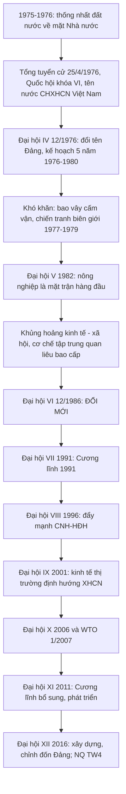

# 📙 CHƯƠNG 3
## ĐẢNG LÃNH ĐẠO CẢ NƯỚC QUÁ ĐỘ LÊN CHỦ NGHĨA XÃ HỘI VÀ TIẾN HÀNH CÔNG CUỘC ĐỔI MỚI (1975 – 2018)

> 📚 **Nguồn liên kết:** Giáo trình 2021 (Chương 3); **Văn kiện Đại hội XII (2016)**; Cương lĩnh 1991 và 2011; các Nghị quyết Hội nghị Trung ương khóa IX, X, XII được hỏi trong ngân hàng câu hỏi; tài liệu PCTN (Bộ GD&ĐT 2014) cho các nghị quyết về phòng, chống tham nhũng.

### 3.0 Sơ đồ tổng quan

---
## PHẦN I. 1975 – 1986: THỐNG NHẤT ĐẤT NƯỚC VÀ TÌM TÒI CON ĐƯỜNG ĐI LÊN CNXH

### 3.1 Thống nhất đất nước về mặt Nhà nước (1975 – 1976)

| Mốc | Nội dung |
|---|---|
| **1975** | **Hội nghị TW 24**: thống nhất đất nước là **nguyện vọng tha thiết của nhân dân cả nước, vừa là quy luật khách quan** của sự phát triển cách mạng Việt Nam (C3-1) |
| 11/1975 | Hội nghị hiệp thương chính trị; **đoàn đại biểu miền Nam do Phạm Hùng dẫn đầu** (C3-3) |
| **25/4/1976** | **Tổng tuyển cử** bầu Quốc hội chung cả nước theo nguyên tắc **dân chủ, phổ thông, bình đẳng, trực tiếp và bỏ phiếu kín** (C3-4) |
| **24/6 – 3/7/1976** | Kỳ họp thứ nhất Quốc hội khóa VI: **đặt tên nước CHXHCN Việt Nam** (C3-5), Quốc kỳ, Quốc huy, Quốc ca; Thủ đô Hà Nội; thành phố Sài Gòn – Gia Định đổi tên **TP Hồ Chí Minh** |

**Nhiệm vụ bức thiết nhất sau 1975:** **thống nhất đất nước về mặt Nhà nước** (C3-2).

### 3.2 Đại hội IV (12/1976)

- **14 – 20/12/1976, Hà Nội.**
- **Đổi tên Đảng → Đảng Cộng sản Việt Nam** (C3-6, C3-7).
- **Đường lối chung** của cách mạng XHCN trong cả nước: nắm vững chuyên chính vô sản; phát huy quyền làm chủ tập thể của nhân dân lao động; tiến hành **ba cuộc cách mạng** (quan hệ sản xuất, khoa học – kỹ thuật, tư tưởng – văn hóa), trong đó **cách mạng khoa học – kỹ thuật là then chốt**; **công nghiệp hóa XHCN là nhiệm vụ trung tâm** của cả thời kỳ quá độ.
- **Kế hoạch Nhà nước 5 năm 1976 – 1980** (C3-8). Mục tiêu: **bảo đảm nhu cầu đời sống của nhân dân, tích lũy để xây dựng cơ sở vật chất – kỹ thuật của CNXH** (C3-9).

**Kết quả:** nhiều chỉ tiêu **không đạt**; nguyên nhân khách quan (chiến tranh, bao vây cấm vận, thiên tai) và **chủ quan** (duy ý chí, nóng vội, mô hình kinh tế **tập trung, quan liêu, bao cấp**).

### 3.3 Chiến tranh bảo vệ biên giới

- 1977 – 1978: chiến tranh biên giới **Tây Nam** (Khơ-me Đỏ).
- **17/2/1979:** **Trung Quốc tấn công biên giới phía Bắc** (C3-10).

### 3.4 Đại hội V (3/1982)

- **Nông nghiệp là mặt trận hàng đầu** (C3-11).
- **Hai nhiệm vụ chiến lược:** (1) xây dựng thành công CNXH; (2) **bảo vệ vững chắc Tổ quốc Việt Nam XHCN** (C3-12).
- Bối cảnh "xé rào", "bung ra" (Hội nghị TW 6 khóa IV – 8/1979), **Chỉ thị 100** (1981) khoán sản phẩm trong nông nghiệp.
- Hạn chế: chưa thoát khỏi mô hình cũ → khủng hoảng kinh tế – xã hội kéo dài (lạm phát phi mã, đời sống khó khăn).

### 3.5 Tác hại của cơ chế tập trung quan liêu bao cấp

| Mặt | Biểu hiện |
|---|---|
| Kinh tế | Không tạo động lực, kìm hãm sản xuất, **giảm năng suất, chất lượng, hiệu quả** |
| Xã hội | **Nhiều hiện tượng tiêu cực** trong xã hội – **vẫn tồn tại đến nay và rất khó xóa bỏ** (C3-16) |

---
## PHẦN II. ĐỔI MỚI TOÀN DIỆN (TỪ 1986)

### 3.6 Đại hội VI (12/1986) – Đại hội Đổi mới (C3-13)

**Nguyên tắc:**
- **Đổi mới không phải thay đổi mục tiêu XHCN** mà là **làm cho mục tiêu ấy được thực hiện có hiệu quả** (C3-15).
- Phương châm: **"nhìn thẳng vào sự thật, đánh giá đúng sự thật, nói rõ sự thật"**.

**Nội dung đổi mới:**
- **Đổi mới tư duy**, trước hết là **tư duy kinh tế**; phát triển **nền kinh tế nhiều thành phần**; xóa bỏ cơ chế bao cấp.
- **Ba chương trình kinh tế:** lương thực – thực phẩm; hàng tiêu dùng; hàng xuất khẩu.
- Các chính sách tiêu biểu sau đó: **Khoán 10** (1988), **Luật Đầu tư nước ngoài** (1987), mở cửa.

**Bốn bài học của Đại hội VI:** lấy dân làm gốc; xuất phát từ thực tế, tôn trọng quy luật khách quan; kết hợp sức mạnh dân tộc với sức mạnh thời đại; xây dựng Đảng ngang tầm nhiệm vụ.

**Bài học kinh tế (tổng kết 10 năm đổi mới 1986–1996):** xây dựng **nền kinh tế hàng hóa nhiều thành phần vận hành theo cơ chế thị trường** (C3-14).

**Quan điểm về vấn đề xã hội thời kỳ đổi mới:** **kết hợp các mục tiêu kinh tế với các mục tiêu xã hội** (C3-17).

### 3.7 Đại hội VII (6/1991) – Cương lĩnh 1991

**Sáu đặc trưng của xã hội XHCN (Cương lĩnh 1991):**
1. Do **nhân dân lao động làm chủ**;
2. Có nền **kinh tế phát triển cao** dựa trên lực lượng sản xuất hiện đại và chế độ công hữu về tư liệu sản xuất chủ yếu;
3. Có nền **văn hóa tiên tiến, đậm đà bản sắc dân tộc**;
4. **Con người được giải phóng** khỏi áp bức, bóc lột, bất công; làm theo năng lực, hưởng theo lao động; ấm no, tự do, hạnh phúc, phát triển toàn diện;
5. **Các dân tộc** trong nước bình đẳng, đoàn kết, giúp đỡ nhau cùng tiến bộ;
6. Có **quan hệ hữu nghị và hợp tác** với nhân dân tất cả các nước.

**Hội nhập quốc tế – mốc mở đường:**

| Mốc | Ý nghĩa |
|---|---|
| **23/10/1991** | Ký **Hiệp định Pari về giải pháp toàn diện cho vấn đề Campuchia** → **mở ra tiền đề thúc đẩy quan hệ với khu vực và cộng đồng quốc tế** (C3-24) |
| 11/1991 | Bình thường hóa quan hệ với Trung Quốc |
| 1995 | Bình thường hóa quan hệ với Hoa Kỳ; gia nhập ASEAN |

### 3.8 Đại hội VIII (6/1996)

- **Kết thúc thời kỳ khủng hoảng**, chuyển sang **thời kỳ đẩy mạnh công nghiệp hóa, hiện đại hóa**.
- Mục tiêu: đến năm 2020 cơ bản trở thành nước công nghiệp theo hướng hiện đại.
- **Quan điểm CNH – HĐH:** **lấy việc phát huy nguồn lực con người làm yếu tố cơ bản cho sự phát triển nhanh và bền vững** (C3-21).
- **Tăng trưởng kinh tế gắn liền với tiến bộ và công bằng xã hội "trong từng bước và suốt quá trình phát triển"** (C3-18).

### 3.9 Đại hội IX (4/2001)

- **Chính thức nêu mô hình kinh tế thị trường định hướng XHCN** (C3-19).
- Chiến lược phát triển KT – XH 2001 – 2010; phát huy sức mạnh đại đoàn kết dân tộc.
- **Hội nghị TW 7 khóa IX (3/2003):** đất đai là **tài nguyên quốc gia vô cùng quý giá, là tư liệu sản xuất đặc biệt, là nguồn nội lực và nguồn vốn to lớn của đất nước** (C3-26).
- **Hội nghị TW 8 khóa IX (7/2003):** ban hành **Chiến lược bảo vệ Tổ quốc trong tình hình mới** (C3-27).
- **NQ 36-NQ/TW (26/3/2004):** công tác đối với **người Việt Nam ở nước ngoài** (C3-28). *(Một số tài liệu ghi nghị quyết này do Bộ Chính trị khóa IX ban hành; đáp án không thay đổi.)*

### 3.10 Đại hội X (4/2006) và hội nhập sâu rộng

- **Cho phép đảng viên làm kinh tế tư nhân**; xây dựng, chỉnh đốn Đảng là nhiệm vụ then chốt (C3-20).
- **Hội nghị TW 3 khóa X:** **NQ 04-NQ/TW (21/8/2006)** – tăng cường sự lãnh đạo của Đảng với **công tác đấu tranh phòng, chống tham nhũng, lãng phí** (C3-30).
- **Chỉ thị 06-CT/TW (7/11/2006)** của Bộ Chính trị khóa X – **tổ chức cuộc vận động "Học tập và làm theo tấm gương đạo đức Hồ Chí Minh"** (C3-32), phát động từ 3/2/2007 (nguồn: văn bản Chỉ thị 06).
- **11/1/2007:** Việt Nam chính thức gia nhập **WTO** (C3-25).
- **Hội nghị TW 5 khóa X (7/2007):** NQ 14-NQ/TW – tăng cường sự lãnh đạo của Đảng đối với công tác **kiểm tra, giám sát** (C3-31).
- **Chiến lược biển:** Việt Nam phải trở thành **quốc gia mạnh về biển, làm giàu từ biển, trên cơ sở phát huy mọi tiềm năng từ biển, phát triển toàn diện các ngành, nghề biển** (C3-29).

### 3.11 Đại hội XI (1/2011) – Cương lĩnh bổ sung, phát triển 2011

- Tổng kết **20 năm thực hiện Cương lĩnh 1991** và Chiến lược 2001–2010; thông qua **Cương lĩnh xây dựng đất nước trong thời kỳ quá độ lên CNXH (bổ sung, phát triển năm 2011)**.
- **Tám đặc trưng của xã hội XHCN:**
  1. **Dân giàu, nước mạnh, dân chủ, công bằng, văn minh**;
  2. Do **nhân dân làm chủ**;
  3. Có **nền kinh tế phát triển cao** dựa trên lực lượng sản xuất hiện đại và quan hệ sản xuất tiến bộ phù hợp;
  4. Có **nền văn hóa tiên tiến, đậm đà bản sắc dân tộc**;
  5. **Con người** có cuộc sống ấm no, tự do, hạnh phúc, phát triển toàn diện;
  6. **Các dân tộc trong cộng đồng Việt Nam bình đẳng, đoàn kết, tôn trọng và giúp nhau cùng phát triển** (C3-23);
  7. Có **Nhà nước pháp quyền XHCN** của nhân dân, do nhân dân, vì nhân dân, dưới sự lãnh đạo của Đảng;
  8. Có **quan hệ hữu nghị và hợp tác** với các nước.
- **Tám phương hướng cơ bản** xây dựng và phát triển đất nước; **ba đột phá chiến lược** của Chiến lược 2011–2020: hoàn thiện thể chế kinh tế thị trường định hướng XHCN; phát triển nguồn nhân lực chất lượng cao; xây dựng hệ thống kết cấu hạ tầng đồng bộ.
- **Chỉ thị 03-CT/TW (14/5/2011):** tiếp tục đẩy mạnh học tập và làm theo tấm gương đạo đức Hồ Chí Minh.

### 3.12 Đại hội XII (1/2016) và công tác xây dựng, chỉnh đốn Đảng

- Tổng Bí thư **Nguyễn Phú Trọng**; Đại hội XII nhấn mạnh **xây dựng, chỉnh đốn Đảng** (công tác xây dựng Đảng được cụ thể hóa qua các Hội nghị TW 4, 6, 7, 8; riêng **NQ 26-NQ/TW ngày 19/5/2018** về xây dựng đội ngũ cán bộ, nhất là cán bộ cấp chiến lược).
- **Chỉ thị 05-CT/TW (15/5/2016):** đẩy mạnh học tập và làm theo **tư tưởng, đạo đức, phong cách** Hồ Chí Minh.
- **Nghị quyết TW 4 khóa XII – NQ 04-NQ/TW (30/10/2016):** **tăng cường xây dựng, chỉnh đốn Đảng; ngăn chặn, đẩy lùi sự suy thoái về tư tưởng chính trị, đạo đức, lối sống, những biểu hiện "tự diễn biến", "tự chuyển hóa"** – nhận diện **27 biểu hiện** (9 + 9 + 9).
- **Hội nghị TW 6 khóa XII (25/10/2017):** **NQ 18** (tinh gọn bộ máy hệ thống chính trị), **NQ 19** (đơn vị sự nghiệp công lập), **NQ 20-NQ/TW – tăng cường công tác bảo vệ, chăm sóc và nâng cao sức khỏe nhân dân trong tình hình mới** (C3-33), NQ 21 (công tác dân số).

### 3.13 Hệ thống chính trị Việt Nam

- Gồm: **Đảng Cộng sản Việt Nam – Nhà nước – Mặt trận Tổ quốc Việt Nam và các tổ chức chính trị – xã hội**.
- **Các tổ chức chính trị – xã hội:** Đoàn TNCS Hồ Chí Minh, Tổng Liên đoàn Lao động Việt Nam, Hội Liên hiệp Phụ nữ Việt Nam, Hội Nông dân, Hội Cựu chiến binh… (C3-22).

### 3.14 Thành tựu – hạn chế – bài học của công cuộc Đổi mới

| | Nội dung |
|---|---|
| **Thành tựu** | Thoát khủng hoảng; tăng trưởng cao; mở rộng quan hệ đối ngoại; đời sống nâng cao; vị thế quốc tế tăng |
| **Hạn chế** | Thể chế kinh tế, chất lượng nhân lực, kết cấu hạ tầng còn yếu; tham nhũng, suy thoái tư tưởng, đạo đức; dân chủ XHCN và đại đoàn kết chưa phát huy đầy đủ |
| **Bài học** | Kiên định mục tiêu độc lập dân tộc gắn liền với CNXH; lấy dân làm gốc; đổi mới toàn diện, đồng bộ; kết hợp sức mạnh dân tộc với sức mạnh thời đại; xây dựng Đảng trong sạch, vững mạnh |

### 3.15 💡 Mẹo nhớ Chương 3
- **IV = đổi tên Đảng** · **V = nông nghiệp hàng đầu** · **VI = Đổi mới** · **VII = Cương lĩnh 1991** · **VIII = CNH-HĐH** · **IX = KTTT định hướng XHCN** · **X = đảng viên làm KT tư nhân, WTO 2007** · **XI = Cương lĩnh 2011**.
- **Hội nghị TW 7 IX = đất đai; TW 8 IX = bảo vệ Tổ quốc; TW 3 X = PCTN; TW 5 X = kiểm tra giám sát; TW 6 XII = NQ 20 sức khỏe.**
- **Chỉ thị 06 (2006) → 03 (2011) → 05 (2016)** về học tập và làm theo Bác.
- **Phạm Hùng** = hiệp thương; **Hiệp định Pari 1991** = Campuchia (đừng nhầm Pari 1973).

### 3.16 📝 Ngân hàng câu hỏi – Chương 3 (33 câu)

#### 🔹 Giai đoạn 1975–1986

**C3-1.** Điền từ còn thiếu (Nghị quyết TW 24, 1975): "… đất nước vừa là nguyện vọng tha thiết của nhân dân cả nước, vừa là quy luật khách quan…"
A. Độc lập · B. Thống nhất · C. Giải phóng · D. Độc lập và Thống nhất
✅ **B**

**C3-2.** Nhiệm vụ nào được đặt ra một cách bức thiết sau năm 1975?
A. Điều chỉnh các chủ thể kinh tế… · B. Phát triển các đạo luật, quy chế về kinh tế · C. Thống nhất đất nước về mặt nhà nước · D. Khôi phục kinh tế sau chiến tranh
✅ **C**

**C3-3.** Đoàn đại biểu miền Nam do ai dẫn đầu để hiệp thương thống nhất với miền Bắc sau năm 1975?
A. Phạm Hùng · B. Châu Văn Liêm · C. Trường Chinh · D. Phạm Hữu Thọ
✅ **A**

**C3-4.** Tổ chức tổng tuyển cử bầu Quốc hội chung cho cả nước đầu năm 1976 theo nguyên tắc nào?
A. Dân chủ, phổ thông, bình đẳng, trực tiếp và bỏ phiếu kín · B. Hoàn thiện thể chế về chính trị… · C. … đồng bộ các yếu tố thị trường… · D. … gắn tăng trưởng với công bằng xã hội và bảo vệ môi trường
✅ **A**

**C3-5.** Kỳ họp thứ nhất Quốc hội khóa VI (24/6–3/7/1976) quyết định đặt tên nước ta là
A. Cộng hòa xã hội chủ nghĩa Việt Nam · B. Cộng hòa Việt Nam · C. Cộng hòa Dân chủ Việt Nam · D. Việt Nam Dân chủ Cộng hòa
✅ **A**

**C3-6.** Đại hội Đảng lần thứ IV (12/1976) quyết định đổi tên Đảng thành:
A. Đảng Lao động Việt Nam · B. Đảng Cộng sản Việt Nam · C. Đảng Cộng sản Đông Dương · D. Đảng nhân dân cách mạng Việt Nam
✅ **B**

**C3-7.** Đại hội IV họp từ 14–20/12/1976 tại Hà Nội quyết định đổi tên Đảng thành
A. Đảng Lao động Việt Nam · B. Đảng Cộng sản Đông Dương · C. Đảng Cộng sản Việt Nam · D. Đảng Cộng sản Hồ Chí Minh
✅ **C**

**C3-8.** Một trong những nội dung của Đại hội IV (12/1976) là
A. Kế hoạch nhà nước 5 năm 1976–1980 · B. Phương hướng đổi mới đất nước · C. Tổng kết 10 năm đổi mới · D. Hàn gắn vết thương chiến tranh
✅ **A**

**C3-9.** Một trong những mục tiêu của kế hoạch 5 năm lần thứ 2 (1976–1980) là:
A. Đổi mới tổ chức và phương thức hoạt động của Đảng · B. … của Nhà nước · C. … kinh tế xã hội chủ nghĩa · D. Bảo đảm nhu cầu đời sống của nhân dân, tích lũy để xây dựng cơ sở vật chất kỹ thuật của CNXH
✅ **D**

**C3-10.** Ngày 17/2/1979, quân đội nước nào tấn công biên giới phía Bắc nước ta?
A. Mỹ · B. Khơ me đỏ · C. Trung Quốc · D. Pháp
✅ **C**

**C3-11.** Đại hội V (1982) coi lĩnh vực nào là mặt trận hàng đầu?
A. Công nghiệp · B. Nông nghiệp · C. Thương nghiệp · D. Dịch vụ
✅ **B**

**C3-12.** Một trong những nhiệm vụ chiến lược mà Đại hội V khẳng định là
A. Đảm bảo quyền lực thuộc về nhân dân · B. Xây dựng lực lượng cho Đảng · C. Bảo vệ vững chắc Tổ quốc Việt Nam XHCN · D. Xây dựng nhà nước pháp quyền XHCN
✅ **C**

#### 🔹 Giai đoạn Đổi mới (từ 1986)

**C3-13.** Đại hội nào được đánh giá là Đại hội đổi mới đất nước?
A. IV 1976 · B. V 1982 · C. VI 1986 · D. VII 1991
✅ **C**

**C3-14.** Một trong những bài học về kinh tế mà Đảng rút ra trong 10 năm đổi mới 1986–1996 là
A. Xây dựng kinh tế bao cấp · B. Xây dựng kinh tế Hợp tác xã · C. Xây dựng kinh tế tư nhân · D. Xây dựng nền kinh tế hàng hóa nhiều thành phần vận hành theo cơ chế thị trường
✅ **D**

**C3-15.** Đổi mới không phải là thay đổi mục tiêu chủ nghĩa xã hội mà phải
A. Làm cho CNXH ngày càng tốt đẹp hơn · B. Làm cho mục tiêu ấy được thực hiện có hiệu quả · C. Làm cho mục tiêu nhanh chóng được thực hiện · D. Làm cho mục tiêu phù hợp với thực tiễn đất nước
✅ **B**

**C3-16.** Tác hại nào do cơ chế quản lý kinh tế tập trung, quan liêu, bao cấp vẫn tồn tại đến ngày nay và rất khó xóa bỏ?
A. Không tạo được động lực phát triển · B. Không thúc đẩy sản xuất phát triển · C. Làm giảm năng suất, chất lượng, hiệu quả · D. Nhiều hiện tượng tiêu cực trong xã hội
✅ **D**

**C3-17.** Quan điểm quan trọng về giải quyết các vấn đề xã hội thời kỳ đổi mới là
A. Ưu tiên mục tiêu xã hội trên mục tiêu kinh tế · B. Kết hợp các mục tiêu kinh tế với các mục tiêu xã hội · C. Chú trọng mục tiêu kinh tế, từng bước thực hiện mục tiêu xã hội · D. Thực hiện mục tiêu xã hội trên cơ sở thắng lợi các mục tiêu kinh tế
✅ **B**

**C3-18.** Đại hội VIII chủ trương tăng trưởng kinh tế gắn liền với tiến bộ và công bằng xã hội trong điều kiện nào?
A. Trong cả thời kỳ quá độ và suốt quá trình phát triển · B. Trong từng bước và suốt quá trình phát triển · C. Trong riêng thời kỳ quá độ… · D. Trong từng bước và suốt quá trình xây dựng thể chế kinh tế thị trường
✅ **B**

**C3-19.** Mô hình kinh tế thị trường định hướng XHCN được chính thức nêu ra ở Đại hội nào?
A. VI · B. VII · C. VIII · D. IX
✅ **D**

**C3-20.** Một trong những nội dung mới của Đại hội X là
A. Xây dựng, chỉnh đốn Đảng là nhiệm vụ then chốt hàng đầu và cho phép đảng viên làm kinh tế tư nhân · B. Xây dựng CNXH · C. Xây dựng hệ thống chính trị · D. Xây dựng kinh tế tư nhân
✅ **A**

**C3-21.** Một trong những quan điểm của Đảng về CNH – HĐH đất nước là
A. Tập hợp, vận động, đoàn kết rộng rãi các tầng lớp nhân dân · B. Đại diện cho quyền và lợi ích hợp pháp của nhân dân · C. Đề xuất các chủ trương, chính sách về kinh tế, văn hóa, an ninh, quốc phòng · D. Lấy việc phát huy nguồn lực con người là yếu tố cơ bản cho sự phát triển nhanh và bền vững
✅ **D**

**C3-22.** Mặt trận Tổ quốc Việt Nam, Đoàn thanh niên Lao động Hồ Chí Minh, Tổng Công đoàn Việt Nam, Hội Liên hiệp phụ nữ Việt Nam v.v. được gọi là
A. Đảng Cộng sản Việt Nam · B. Các tổ chức đoàn thể · C. Mặt trận tổ quốc Việt Nam · D. Các tổ chức chính trị – xã hội
✅ **D**

**C3-23.** Cương lĩnh (bổ sung, phát triển 2011) đã bổ sung đặc trưng của xã hội XHCN. Điểm bổ sung đó là
A. Con người có cuộc sống ấm no, tự do, hạnh phúc, có điều kiện phát triển toàn diện · B. Các dân tộc trong cộng đồng Việt Nam bình đẳng, đoàn kết, tôn trọng và giúp nhau cùng phát triển
✅ **B** (theo đáp án đề; đề gốc chỉ có 2 phương án) — ⚠️ xem Phụ lục A, mục A6.

#### 🔹 Hội nhập quốc tế và các Hội nghị Trung ương

**C3-24.** Sự kiện lịch sử nào mở ra tiền đề để Việt Nam thúc đẩy quan hệ với khu vực và cộng đồng quốc tế?
A. Bình thường hóa quan hệ với Trung Quốc · B. Việt Nam ký Hiệp định Pari (23/10/1991) về giải pháp toàn diện cho vấn đề Campuchia · C. Bình thường hóa quan hệ với Hoa Kỳ · D. Gia nhập ASEAN
✅ **B**

**C3-25.** Việt Nam chính thức trở thành thành viên của WTO vào thời gian nào?
A. 11/1/2006 · B. 11/1/2007 · C. 11/1/2008 · D. 11/1/2009
✅ **B**

**C3-26.** Hội nghị TW VII khóa IX (3/2003) đã thống nhất coi
A. Đất đai là tài nguyên quốc gia vô cùng quý giá · B. Đất đai là tài nguyên quốc gia vô cùng quý giá, là tư liệu đặc biệt, là nguồn nội lực và nguồn vốn to lớn của đất nước · C. Công nghiệp hóa gắn với phát triển kinh tế tri thức
✅ **B**

**C3-27.** Hội nghị TW VIII khóa IX (7/2003) đã ban hành
A. Chiến lược bảo vệ Tổ quốc trong tình hình mới · B. Chiến lược phát triển giáo dục, y tế · C. Chiến lược mở rộng xuất khẩu · D. Chiến lược thu hút nguồn vốn
✅ **A**

**C3-28.** Nghị quyết số 36-NQ/TW ngày 26/3/2004 về công tác đối với
A. Biến đổi khí hậu · B. CNH – HĐH · C. Người Việt Nam ở nước ngoài · D. Phát triển giáo dục
✅ **C**

**C3-29.** Trung ương nhận định như thế nào về Chiến lược kinh tế Biển ở thế kỉ XXI?
A. Biển là tiềm năng kinh tế to lớn · B. Việt Nam phải là quốc gia mạnh về biển · C. Phải trở thành quốc gia mạnh về biển, làm giàu từ biển · D. Phải trở thành quốc gia mạnh về biển, làm giàu từ biển, trên cơ sở phát huy mọi tiềm năng từ biển, phát triển toàn diện các ngành, nghề biển
✅ **D**

**C3-30.** Hội nghị TW 3 khóa X ban hành Nghị quyết số 04-NQ/TW ngày 21/8/2006 về
A. Mở rộng thị trường, trao đổi hàng hóa… · B. Nguồn vốn, khoa học công nghệ, kinh nghiệm quản lý… · C. Tăng cường sự lãnh đạo của Đảng với công tác đấu tranh phòng, chống tham nhũng, lãng phí
✅ **C**

**C3-31.** Hội nghị TW V khóa X (7/2007) ban hành Nghị quyết số 14-NQ/TW về
A. Tăng cường công tác kiểm tra, giám sát của Đảng · B. … của đoàn thể · C. Cương lĩnh xây dựng đất nước · D. Thay đổi hệ thống chính trị
✅ **A**

**C3-32.** Tháng 11/2006, Bộ Chính trị khóa X ra Chỉ thị số 3 – NQ/TW quyết định tổ chức cuộc vận động
A. Nói đi đôi với làm · B. Phát triển kinh tế tăng trưởng ổn định, hiệu quả · C. Thi đua lập thành tích chào mừng Đại hội · D. Học tập và làm theo tấm gương đạo đức Hồ Chí Minh
✅ **D** — ✔️ **Đã xác minh nội dung:** đây là **Chỉ thị 06-CT/TW (7/11/2006)**; số "3" trong đề là nhầm với **Chỉ thị 03-CT/TW (2011)**. Xem Phụ lục A, mục A7.

**C3-33.** Hội nghị TW VI khóa XII ban hành Nghị quyết số 20-NQ/TW ngày 25/10/2017 về:
A. Công tác dân số trong tình hình mới · B. Xây dựng văn hóa trong tình hình mới · C. Hội nhập trong tình hình mới · D. Tăng cường công tác bảo vệ, chăm sóc và nâng cao sức khỏe nhân dân trong tình hình mới
✅ **D**

---
