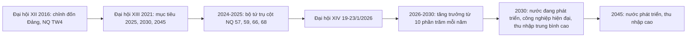
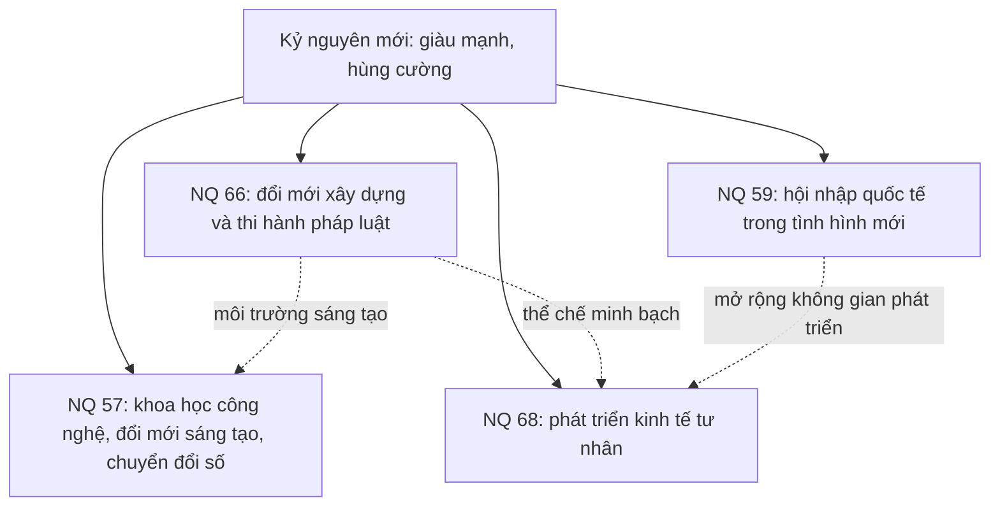
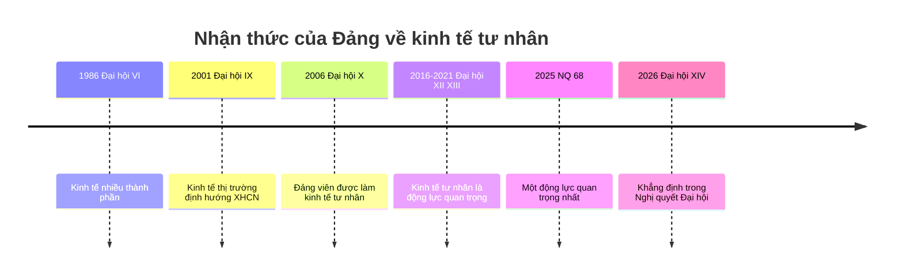

# 📕 CHƯƠNG MỞ RỘNG
## TỪ 2018 ĐẾN ĐẠI HỘI XIV (2026) – LIÊN KẾT VỚI VĂN KIỆN VÀ NGHỊ QUYẾT MỚI

> ℹ️ Giáo trình 2021 kết thúc Chương 3 ở mốc 2018. Danh sách tài liệu tham khảo của môn học lại bao gồm **Văn kiện Đại hội XII, XIII, XIV, Nghị quyết 57, Nghị quyết 68, tài liệu PCTN**. Vì vậy chương này **nối tiếp Chương 3** để bạn học trọn tuyến "Đổi mới → Kỷ nguyên mới". Phần này **không có câu hỏi trong ngân hàng 90 câu**; các câu tự luyện ở cuối là **do tôi soạn**, không phải đề gốc.
>
> 🔎 Số liệu của Đại hội XIV, NQ 57, NQ 68, NQ 59, NQ 66 dưới đây đã được **đối chiếu với các nguồn web** (liệt kê ở cuối file).

### X.0 Sơ đồ tổng quan

---
## X.1 Đại hội XIII (25/1 – 2/2/2021)

| Nội dung | Chi tiết |
|---|---|
| **Điểm mới nổi bật** | Lần đầu xác định mục tiêu **cho 5 năm, 10 năm (2030) và 25 năm (tầm nhìn 2045)** – điểm mới "đáng nói nhất" của Đại hội XIII |
| **Mục tiêu 2025** | Nước đang phát triển có công nghiệp theo hướng hiện đại, **vượt qua mức thu nhập trung bình thấp** |
| **Mục tiêu 2030** | Nước đang phát triển có **công nghiệp hiện đại, thu nhập trung bình cao** |
| **Tầm nhìn 2045** | **Nước phát triển, thu nhập cao** |
| **Chỉ tiêu 2021–2025** | GDP bình quân khoảng **6,5 – 7%/năm**; GDP/người năm 2025 khoảng **4.700 – 5.000 USD**; đô thị hóa ~45% |
| **Khung chiến lược** | **12 định hướng phát triển**, **6 nhiệm vụ trọng tâm**, **3 đột phá chiến lược** (thể chế; nguồn nhân lực; hạ tầng) |
| **Xây dựng Đảng** | Xây dựng, chỉnh đốn Đảng là nhiệm vụ ưu tiên hàng đầu; **Quy định 37-QĐ/TW** (những điều đảng viên không được làm) thay Quy định 47 |

**Liên hệ:** Đại hội XIII khẳng định lại quyết tâm *"kiên quyết, kiên trì đấu tranh, ngăn chặn, đẩy lùi tham nhũng, lãng phí… không có vùng cấm, không có ngoại lệ"*.

---
## X.2 Đại hội XIV (19 – 23/1/2026) – Kỷ nguyên mới

| Nội dung | Chi tiết |
|---|---|
| **Thời gian – địa điểm** | **19 – 23/1/2026**, Trung tâm Hội nghị Quốc gia, Hà Nội; **1.586 đại biểu** |
| **Chủ đề** | **Đoàn kết – Dân chủ – Kỷ cương – Đột phá – Phát triển** |
| **Nhân sự** | **Tô Lâm** được bầu lại làm Tổng Bí thư khóa XIV; Bộ Chính trị khóa XIV có **19 đồng chí** (10 tái cử, 9 lần đầu tham gia); nhiệm kỳ **2026 – 2031** |
| **Báo cáo trình Đại hội** | Báo cáo chính trị; **Báo cáo tổng kết một số vấn đề lý luận và thực tiễn về công cuộc đổi mới theo định hướng XHCN (40 năm)**; báo cáo tổng kết công tác xây dựng Đảng và thi hành Điều lệ; báo cáo kinh tế – xã hội 2021–2030, kế hoạch 5 năm 2026–2030 |
| **Mục tiêu tổng quát** | Giữ vững hòa bình, ổn định; phát triển nhanh, bền vững; **tự chủ chiến lược, tự cường, tự tin, tiến mạnh trong kỷ nguyên mới**; 2030: nước đang phát triển có công nghiệp hiện đại, thu nhập trung bình cao; **2045: nước phát triển, thu nhập cao** |
| **Quan điểm chỉ đạo (trong đó có)** | Kiên định hệ quan điểm nguyên tắc: sự lãnh đạo của Đảng, chủ nghĩa Mác – Lênin, tư tưởng Hồ Chí Minh, đường lối đổi mới; **phát huy tự chủ chiến lược, xác lập mô hình phát triển mới**, "lấy phát triển để ổn định, ổn định để thúc đẩy phát triển nhanh, bền vững"; nâng cao đời sống và hạnh phúc của Nhân dân; **bảo vệ vững chắc Tổ quốc Việt Nam XHCN** |
| **Tư duy kinh tế** | **Xác lập mô hình tăng trưởng mới**, đẩy mạnh CNH, HĐH, lấy **khoa học, công nghệ, đổi mới sáng tạo, chuyển đổi số quốc gia là động lực chính**; phát huy vai trò chủ đạo của kinh tế nhà nước, **phát triển kinh tế tư nhân là một động lực quan trọng nhất** |
| **Khung hành động** | **12 định hướng lớn, 6 nhiệm vụ trọng tâm, 3 đột phá chiến lược**; Bộ Chính trị chọn một số vấn đề cốt lõi để ban hành **9 Nghị quyết** |
| **Tầm nhìn xa hơn** | Giao BCH TW khóa XIV **tổng kết 40 năm thực hiện Cương lĩnh** để trình **Đại hội XV (dịp 100 năm thành lập Đảng)** |

### Chỉ tiêu kinh tế – xã hội 2026 – 2030

| Chỉ tiêu | Mục tiêu |
|---|---|
| **GDP bình quân** | **từ 10%/năm trở lên** |
| GDP bình quân đầu người năm 2030 | khoảng **8.500 USD** |
| Công nghiệp chế biến, chế tạo | khoảng **28% GDP** |
| Kinh tế số | khoảng **30% GDP** |
| Đóng góp của TFP | **trên 55%** |
| Năng suất lao động | tăng khoảng **8,5%/năm** |
| Tích lũy tài sản | khoảng 35 – 36% GDP |
| Tiêu hao năng lượng/GDP | giảm 1 – 1,5%/năm |
| Đô thị hóa | trên 50% |
| HDI | khoảng 0,8 |
| Tuổi thọ trung bình | khoảng 75,5 tuổi (sống khỏe tối thiểu 68 năm) |
| Lao động nông nghiệp | dưới 20% tổng lao động |
| Lao động qua đào tạo có bằng cấp, chứng chỉ | 35 – 40% |

*(Nguồn: các bản tin về Nghị quyết Đại hội XIV – xem danh mục nguồn.)*

---
## X.3 "Bộ tứ trụ cột" của Bộ Chính trị (2024 – 2025)

| Nghị quyết | Ngày ban hành | Ý chính |
|---|---|---|
| **NQ 57-NQ/TW** | **22/12/2024** | **Đột phá phát triển khoa học, công nghệ, đổi mới sáng tạo và chuyển đổi số quốc gia** |
| NQ 59-NQ/TW | 24/1/2025 | **Hội nhập quốc tế trong tình hình mới**: chủ động, tích cực, đồng bộ, toàn diện, sâu rộng, hiệu quả |
| NQ 66-NQ/TW | 30/4/2025 | **Đổi mới công tác xây dựng và thi hành pháp luật** đáp ứng yêu cầu phát triển trong kỷ nguyên mới; tháo gỡ "điểm nghẽn" thể chế |
| **NQ 68-NQ/TW** | **4/5/2025** | **Phát triển kinh tế tư nhân** |

**Hội nghị toàn quốc quán triệt NQ 66 và 68:** 18/5/2025. Tinh thần liên kết: *thể chế minh bạch (66) → kinh tế tư nhân phát triển (68) → môi trường sáng tạo cho KHCN (57) → hội nhập hiệu quả (59).*

### X.3.1 Nghị quyết 57-NQ/TW (22/12/2024)

- **Định vị:** phát triển khoa học, công nghệ, đổi mới sáng tạo và chuyển đổi số là **đột phá quan trọng hàng đầu**, **điều kiện tiên quyết** để đưa đất nước phát triển trong kỷ nguyên mới.
- **Kết cấu:** 4 phần; **5 quan điểm chỉ đạo**; mục tiêu đến **2030** và tầm nhìn **2045**; **7 nhóm nhiệm vụ, giải pháp**.
- **Trọng tâm đột phá:** **thể chế, nhân lực, hạ tầng, dữ liệu và công nghệ chiến lược**, trên nguyên tắc **hiện đại, đồng bộ, an ninh, an toàn, hiệu quả**.
- **Tư duy mới:** **chấp nhận rủi ro, đầu tư mạo hiểm và độ trễ** trong nghiên cứu khoa học, phát triển công nghệ, đổi mới sáng tạo.
- **Mục tiêu:** đến **2030** Việt Nam là nước đang phát triển có công nghiệp hiện đại, thu nhập trung bình cao; đến **2045** là nước phát triển, thu nhập cao. Quy mô **kinh tế số tối thiểu khoảng 30% GDP** vào 2030 (nguồn bản tin).
- **Thực thi:** Chính phủ ban hành **NQ 03/NQ-CP (9/1/2025)** – Chương trình hành động.

### X.3.2 Nghị quyết 68-NQ/TW (4/5/2025) – Phát triển kinh tế tư nhân

| Nội dung | Chi tiết |
|---|---|
| **Tinh thần chung** | Kinh tế tư nhân là **"một động lực quan trọng nhất của nền kinh tế quốc gia"**; **Đảng lãnh đạo, Nhà nước kiến tạo, doanh nghiệp là trung tâm, là chủ thể** |
| **Cấu trúc** | **5 quan điểm chỉ đạo**; **8 nhóm nhiệm vụ, giải pháp** |
| **Mục tiêu 2030** | Là một động lực quan trọng nhất; **lực lượng tiên phong** trong KHCN, đổi mới sáng tạo, chuyển đổi số; **2 triệu doanh nghiệp**; **20 doanh nghiệp/1.000 dân**; **ít nhất 20 doanh nghiệp lớn** tham gia chuỗi giá trị toàn cầu |
| **Tầm nhìn 2045** | **Ít nhất 3 triệu doanh nghiệp**; đóng góp **trên 60% GDP** |
| **Thực thi** | Chính phủ ban hành **NQ 138/NQ-CP (19/5/2025)**; Quốc hội có NQ 198/2025/QH15 |

**Tiến trình nhận thức về kinh tế tư nhân (tổng hợp theo mạch lịch sử Đảng):**

*(Sơ đồ trên là tổng hợp của tôi để dễ nhớ; các mốc 1986, 2001, 2006 là kiến thức của Chương 3, mốc 2025 – 2026 là theo NQ 68 và Nghị quyết Đại hội XIV.)*

---
## X.4 Đấu tranh phòng, chống tham nhũng, tiêu cực

> 📚 **Nguồn:** *Kiên quyết, kiên trì đấu tranh phòng, chống tham nhũng, tiêu cực, góp phần xây dựng Đảng và Nhà nước ta ngày càng trong sạch, vững mạnh* (TBT Nguyễn Phú Trọng, NXB CTQG Sự thật) và *Tài liệu giảng dạy về phòng, chống tham nhũng* (Bộ GD&ĐT, 2014; QĐ 3468/QĐ-BGDĐT ngày 6/9/2014). ⚠️ Tôi **chưa đọc toàn văn tài liệu 2014**; phần dưới là khung nội dung cơ bản, hãy đối chiếu với tài liệu.

### X.4.1 Dòng thời gian chính sách PCTN trong lịch sử Đảng

| Mốc | Nội dung |
|---|---|
| **Hồ Chí Minh** | Xem tham ô, lãng phí, quan liêu là "giặc nội xâm"; đạo đức cách mạng: **cần, kiệm, liêm, chính, chí công vô tư** |
| **8/2006** | **NQ 04-NQ/TW (Hội nghị TW 3 khóa X)** – tăng cường lãnh đạo công tác PCTN, lãng phí |
| **2012** | Hội nghị TW 4 khóa XI: NQ 12-NQ/TW "Một số vấn đề cấp bách về xây dựng Đảng hiện nay" |
| **2013** | Hội nghị TW 5 khóa XI quyết định thành lập **Ban Chỉ đạo Trung ương về PCTN**, **trực thuộc Bộ Chính trị, Tổng Bí thư làm Trưởng ban** |
| **30/10/2016** | **NQ 04-NQ/TW (TW 4 khóa XII)** – ngăn chặn suy thoái, "tự diễn biến", "tự chuyển hóa" (27 biểu hiện) |
| **2021** | Đại hội XIII: tiếp tục kiên quyết, kiên trì, không có vùng cấm, không có ngoại lệ; Quy định 37-QĐ/TW |
| **2022 trở đi** | Ban Chỉ đạo mở rộng chức năng: **PCTN gắn với phòng, chống tiêu cực** |
| **2023** | Ra mắt cuốn sách của TBT Nguyễn Phú Trọng (dịp 93 năm thành lập Đảng, 10 năm Ban Chỉ đạo) |
| **19/7/2024** | TBT Nguyễn Phú Trọng từ trần |

### X.4.2 Các quan điểm chỉ đạo then chốt (theo tác phẩm)

| Quan điểm | Ý nghĩa |
|---|---|
| **"Kiên quyết, kiên trì, thường xuyên, liên tục, bền bỉ, không ngừng, nghỉ"** | Phương châm xuyên suốt |
| **"Phòng là chính, là cơ bản, lâu dài; chống là quan trọng, cấp bách"** | Phòng và chống đi đôi |
| **"Không có vùng cấm, không có ngoại lệ"** | Bất kể là ai, giữ chức vụ nào |
| **"Nhốt quyền lực vào trong lồng cơ chế"** | Kiểm soát quyền lực |
| **"PCTN gắn với chống suy thoái tư tưởng chính trị, đạo đức, lối sống, tự diễn biến, tự chuyển hóa"** | Căn nguyên, gốc rễ |
| **Xử lý cả hành vi tham nhũng, tiêu cực và hành vi dung túng, bao che, can thiệp, cản trở** | Không bỏ lọt |

**Tác phẩm gồm 3 phần** (≈600 trang, 111 ảnh); phần thứ nhất gồm các vấn đề rút ra từ thực tiễn công cuộc đấu tranh qua **36 phiên họp, cuộc họp của Ban Chỉ đạo, Thường trực Ban Chỉ đạo (2013 – 2022)**.

### X.4.3 Khái niệm cơ bản (kiến thức pháp luật chung)

- **Tham nhũng (Luật PCTN 2018):** hành vi của **người có chức vụ, quyền hạn** đã **lợi dụng chức vụ, quyền hạn đó vì vụ lợi**.
- **Cách học:** *Khái niệm → Nguyên nhân → Tác hại → Biện pháp → Trách nhiệm của sinh viên.* (Đối chiếu với tài liệu Bộ GD&ĐT 2014.)

---
## X.5 Liên kết *Hồ Chí Minh toàn tập* với các giai đoạn lịch sử Đảng

| Văn kiện / tác phẩm của Hồ Chí Minh | Gắn với | Ý nghĩa ôn tập |
|---|---|---|
| **Đường Kách mệnh (1927)** | Chương 1 | Chuẩn bị tư tưởng, chính trị cho sự ra đời của Đảng |
| **Chánh cương vắn tắt, Sách lược vắn tắt (2/1930)** | Chương 1 | Cương lĩnh chính trị đầu tiên |
| **Thư gửi đồng bào cả nước (6/6/1941)** | Chương 1 (TW 8) | "Trong lúc này quyền lợi dân tộc giải phóng cao hơn hết thảy" |
| **Tuyên ngôn Độc lập (2/9/1945)** | Chương 1 → 2 | Khai sinh nước VNDCCH |
| **Lời kêu gọi Toàn quốc kháng chiến (19/12/1946)** | Chương 2 | "Thà hy sinh tất cả, chứ nhất định không chịu mất nước…" |
| **Di chúc (1965 – 1969)** | Chương 2 → 3 | Dặn dò về xây dựng Đảng, đạo đức, đoàn kết |
| **Tư tưởng về đạo đức cách mạng** | Chương 3 + X.4 | Nền tảng của các cuộc vận động học tập và làm theo Bác (Chỉ thị 06, 03, 05) |

---
## X.6 📝 Câu hỏi tự luyện (do tôi soạn – không phải đề gốc)

**TL-1.** Đại hội XIV của Đảng được tổ chức vào thời gian nào?
A. 25/1–2/2/2021 · B. 19–23/1/2026 · C. 1/2016 · D. 1/2011
✅ **B**

**TL-2.** Mục tiêu tăng trưởng GDP bình quân giai đoạn 2026–2030 do Đại hội XIV đề ra là:
A. 6,5–7%/năm · B. Khoảng 8%/năm · C. Từ 10%/năm trở lên · D. 5–6%/năm
✅ **C**

**TL-3.** Điểm mới nổi bật của Đại hội XIII so với các kỳ đại hội trước là:
A. Đổi tên Đảng · B. Lần đầu đề ra mục tiêu 2025, 2030 và tầm nhìn 2045 · C. Chính thức nêu KTTT định hướng XHCN · D. Cho phép đảng viên làm kinh tế tư nhân
✅ **B**

**TL-4.** Nghị quyết 57-NQ/TW (22/12/2024) của Bộ Chính trị có nội dung chính là:
A. Phát triển kinh tế tư nhân · B. Hội nhập quốc tế · C. Đột phá phát triển khoa học, công nghệ, đổi mới sáng tạo và chuyển đổi số quốc gia · D. Đổi mới công tác xây dựng pháp luật
✅ **C**

**TL-5.** Nghị quyết 68-NQ/TW xác định đến năm 2045 Việt Nam có ít nhất bao nhiêu doanh nghiệp hoạt động?
A. 1 triệu · B. 2 triệu · C. 3 triệu · D. 5 triệu
✅ **C** (2 triệu là mục tiêu năm 2030)

**TL-6.** "Bộ tứ trụ cột" của Bộ Chính trị gồm các Nghị quyết:
A. 04, 12, 20, 36 · B. 57, 59, 66, 68 · C. 14, 18, 19, 21 · D. 03, 05, 06, 24
✅ **B**

**TL-7.** Ban Chỉ đạo Trung ương về phòng, chống tham nhũng được thành lập từ năm nào, do ai làm Trưởng ban?
A. 2006, Thủ tướng · B. 2013, Tổng Bí thư · C. 2016, Chủ tịch nước · D. 2021, Chủ tịch Quốc hội
✅ **B**

**TL-8.** Nghị quyết TW 4 khóa XII (30/10/2016) tập trung vào nội dung:
A. Kinh tế tư nhân · B. Tăng cường xây dựng, chỉnh đốn Đảng; ngăn chặn, đẩy lùi suy thoái, "tự diễn biến", "tự chuyển hóa" · C. Chiến lược biển · D. Công tác dân số
✅ **B**

**TL-9.** Quan điểm chỉ đạo của NQ 68 về quan hệ giữa các chủ thể là:
A. Nhà nước làm chủ, doanh nghiệp phụ thuộc · B. Đảng lãnh đạo, Nhà nước kiến tạo, doanh nghiệp là trung tâm, là chủ thể · C. Doanh nghiệp lãnh đạo · D. Nhà nước kiểm soát toàn bộ
✅ **B**

**TL-10.** Chọn thứ tự đúng các văn bản về học tập và làm theo tấm gương Hồ Chí Minh:
A. 03 (2011) → 06 (2006) → 05 (2016) · B. 06 (2006) → 03 (2011) → 05 (2016) · C. 05 (2016) → 06 (2006) → 03 (2011) · D. 06 (2006) → 05 (2016) → 03 (2011)
✅ **B**

---
